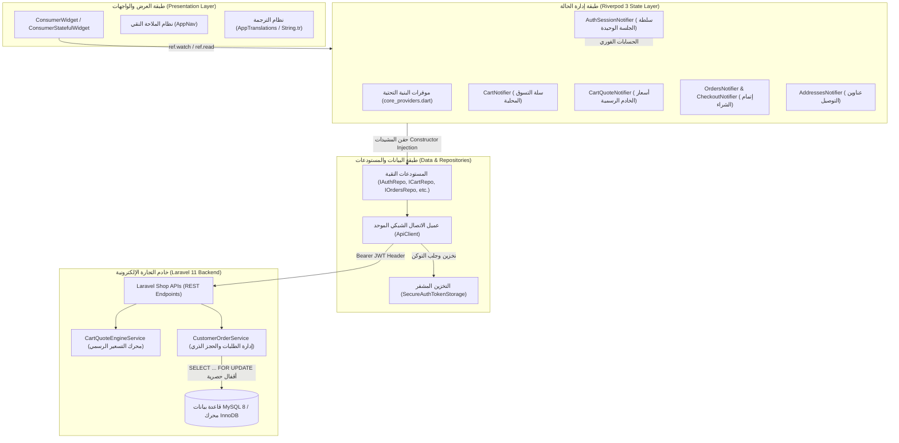

# دليل المعمارية والتطوير الشامل لمنصة رونقك للتجارة الإلكترونية
## Rawnaquk E-Commerce — Master Architectural & Developer Manual (Arabic Edition)

> **الإصدار المعماري:** Riverpod 3.5.0 Pure Architecture (ما بعد شطب GetX بالكامل)  
> **تاريخ التحديث:** نوفمبر 2026  
> **الفئة المستهدفة:** المطور الأساسي وفريق العمل الهندسي المستقبلي  

---

## فهرس المحتويات
1. [الفصل 1: الرؤية العامة وهندسة النظام](#الفصل-1-الرؤية-العامة-وهندسة-النظام)
2. [الفصل 2: الهيكل الشجري للمشروع ودليل المجلدات](#الفصل-2-الهيكل-الشجري-للمشروع-ودليل-المجلدات)
3. [الفصل 3: المعمارية الكاملة لإدارة الحالة في Riverpod 3](#الفصل-3-المعمارية-الكاملة-لإدارة-الحالة-في-riverpod-3)
4. [الفصل 4: التكامل مع خادم Laravel وعقود الـ API](#الفصل-4-التكامل-مع-خادم-laravel-وعقود-الـ-api)
5. [الفصل 5: الأمان المالي ومنع تكرار الطلبات](#الفصل-5-الأمان-المالي-ومنع-تكرار-الطلبات)
6. [الفصل 6: نظام الملاحة والتوجيه النقي (AppNav)](#الفصل-6-نظام-الملاحة-والتوجيه-النقي-appnav)
7. [الفصل 7: نظام التدويل واللغة العربية ودعم RTL](#الفصل-7-نظام-التدويل-واللغة-العربية-ودعم-rtl)
8. [الفصل 8: دليل الاختبارات وضمان الجودة البرمجية](#الفصل-8-دليل-الاختبارات-وضمان-الجودة-البرمجية)
9. [الفصل 9: استكشاف الأخطاء الشائعة وحلولها](#الفصل-9-استكشاف-الأخطاء-الشائعة-وحلولها)
10. [الفصل 10: المبادئ الذهبية وميثاق التطوير المستقبلي](#الفصل-10-المبادئ-الذهبية-وميثاق-التطوير-المستقبلي)

---

# الفصل 1: الرؤية العامة وهندسة النظام

### 1.1 هوية المشروع
**رونقك (Rawnaquk E-Commerce)** هو تطبيق متجر إلكتروني متكامل عالي الأداء والأمان، صُمم بواجهات عصرية موجهة للسوق اليمني والعربي مع دعم كامل للغتين العربية والإنجليزية، وتجربة مستخدم مخصصة للاتجاه من اليمين لليسار (RTL).

### 1.2 البيئة والتقنيات الأساسية
| المكون | التقنية المعتمدة | الإصدار | الوظيفة الأساسية |
| :--- | :--- | :--- | :--- |
| **واجهة التطبيق** | Flutter / Dart | Flutter 3.47+ / Dart 3.13+ | واجهة المستخدم التفاعلية المتجاوبة لنظامي Android و iOS |
| **إدارة الحالة** | Flutter Riverpod | 3.5.0 | إدارة الحالة المركزية والجلسات وحقن التبعيات بنمط نقي |
| **عميل الشبكة** | Dio | ^5.4.0 | إدارة اتصالات REST API واعتراض الطلبات والمصادقة |
| **التخزين الآمن** | FlutterSecureStorage | أحدث إصدار | تشفير رموز الدخول بنظام AES-256 عبر Android KeyStore |
| **الخلفية البرمجية** | Laravel REST API | Laravel 11 / PHP 8.5+ | منطق الأعمال، ومعالجة الطلبات، والتسعير، والمخزون |
| **قاعدة البيانات** | MySQL / InnoDB | MySQL 8.0 | قاعدة بيانات علائقية تدعم المعاملات الذرية والأقفال الحصرية |

### 1.3 المخطط العام لتدفق البيانات (Data Flow Architecture)



---

# الفصل 2: الهيكل الشجري للمشروع ودليل المجلدات

يعتمد المشروع نمط **Feature-First Architecture**، حيث تُقسّم الميزات إلى وحدات مستقلة تحتوي كل وحدة على طبقاتها الداخلية:

```text
lib/
├── core/                               # البنية التحتية والخدمات المشتركة
│   ├── constants/                      # الثوابت (الألوان، المتغيرات، إعدادات البيئة)
│   │   ├── app_colors.dart             # الألوان والهوية البصرية وامتدادات ContextColors
│   │   └── app_env.dart                # معالجة البيئات (Staging / Production)
│   ├── di/                             # حقن التبعيات
│   │   └── core_providers.dart         # الملف المرجعي الموحد لكافة موفرات Riverpod الأساسية
│   ├── localization/                   # محرك التدويل
│   │   └── app_localizations.dart      # امتداد String.tr والترجمة بدون GetX
│   ├── network/                        # الاتصال الشبكي
│   │   ├── api_client.dart             # عميل Dio الموحد والمعترضات Interceptors
│   │   ├── api_endpoints.dart          # مسارات واجهات REST API
│   │   └── api_exceptions.dart         # تحويل وتصنيف أخطاء الشبكة إلى استثناءات قوية
│   ├── routing/                        # نظام التوجيه النقي
│   │   └── app_nav.dart                # كلاس AppNav للتحكم بالملاحة عبر GlobalKey
│   ├── services/                       # خدمات المنصة
│   │   ├── auth/                       # خدمة الجلسة والتخزين الآمن للرموز
│   │   │   ├── auth_token_storage.dart # واجهة التخزين المشفر
│   │   │   ├── auth_session_service.dart# مفوض الجلسة النقي
│   │   │   └── providers/auth_session_providers.dart # موفر الجلسة المرجعي
│   │   └── geo/                        # خدمات تحديد المواقع والتغطية
│   ├── theme/                          # الهوية البصرية والثيمات
│   │   ├── app_theme.dart              # إعدادات النمطين الفاتح والداكن
│   │   ├── app_theme_extensions.dart   # امتدادات السياق context.theme و context.width
│   │   └── app_text_theme.dart         # خط القاهرة Cairo بأوزانه المختلفة
│   ├── translations/                   # قواميس النصوص
│   │   ├── app_locale_keys.dart        # مفاتيح النصوص الثابتة Tk.homeTitle
│   │   └── maps/                       # ملفات الترجمة العربية والإنجليزية
│   ├── utils/                          # أدوات مساعدة (تحويل العملات، التحقق، التنسيق)
│   └── widgets/                        # العناصر المرئية العامة والمشتركة
│
├── modules/                            # ميزات التطبيق (Features)
│   ├── auth/                           # المصادقة والتسجيل و2FA
│   ├── cart/                           # سلة المشتريات وعروض الأسعار
│   ├── catalog/                        # تصفح المنتجات والأقسام وتفاصيل المنتج
│   ├── checkout/                       # إنهاء الطلب والدفع وإرفاق السندات
│   ├── customer/                       # العناوين والملف الشخصي والإعدادات
│   ├── home/                           # الصفحة الرئيسية والبنرات
│   ├── onboarding/                     # شاشات التعريف بالتطبيق
│   ├── orders/                         # قائمة الطلبات وتتبع الشحنات
│   ├── search/                         # البحث مع ميزة Debounce
│   ├── support/                        # الدعم الفني ومركز المساعدة
│   └── wishlist/                       # المفضلة والمشاهدات الأخيرة
│
└── routes/
    ├── app_routes.dart                 # ثوابت أسماء المسارات (AppRoutes.main, etc.)
    └── app_router.dart                 # دالة onGenerateRoute لتوليد المسارات وحماية الدخول
```

### هيكل كل ميزة داخل `lib/modules/{feature}/`:
كل مجلد ميزة منظم طبقياً وفق الآتي:
- **`data/models/`**: نماذج البيانات غير القابلة للتغيير (Immutable DTOs / Entities).
- **`data/repositories/`**: الواجهات النقية وتنفيذاتها (مثلاً `ICartRepository` و `CartRepositoryImpl`).
- **`models/`**: كلاسات الحالة الخاصة بالموفر (State Classes مع دالة `copyWith`).
- **`providers/`**: موفرات Riverpod (مثل `cartProvider` و `cartQuoteProvider`).
- **`views/`**: الشاشات الرئيسية كـ `ConsumerWidget`.
- **`widgets/`**: العناصر الفرعية التابعة للميزة حصراً.

---

# الفصل 3: المعمارية الكاملة لإدارة الحالة في Riverpod 3

### 3.1 مبدأ الملكية الأحادية للكتابة (Single Authoritative Writer)
لا يجوز لأي شاشة أو مستودع أو خدمة أن تعدل الحالة مباشرة. لكل نطاق عمل **Notifier واحد فقط** هو المخوّل حصرياً بتعديل الحالة عبر إصدار حالة جديدة غير قابلة للتغيير.

### 3.2 كيفية كتابة Notifier جديد وفق معايير المشروع

عند إضافة أي ميزة جديدة، اتبع النمط القياسي التالي:

```dart
// 1. تعريف كلاس الحالة (غير قابل للتعديل)
class FeatureState {
  final bool isLoading;
  final List<String> items;
  final String? errorMessage;

  const FeatureState({
    this.isLoading = false,
    this.items = const [],
    this.errorMessage,
  });

  FeatureState copyWith({
    bool? isLoading,
    List<String>? items,
    String? errorMessage,
    bool clearError = false,
  }) {
    return FeatureState(
      isLoading: isLoading ?? this.isLoading,
      items: items ?? this.items,
      errorMessage: clearError ? null : (errorMessage ?? this.errorMessage),
    );
  }
}

// 2. تعريف الموفر الأساسي (NotifierProvider)
final featureProvider = NotifierProvider<FeatureNotifier, FeatureState>(
  FeatureNotifier.new,
);

// 3. كتابة كائن الحالة المتصرف (Notifier)
class FeatureNotifier extends Notifier<FeatureState> {
  @override
  FeatureState build() {
    // التهيئة المبدئية
    return const FeatureState();
  }

  // الوصول للتبعيات عبر ref.read
  IFeatureRepository get _repo => ref.read(featureRepositoryProvider);

  Future<void> loadItems() async {
    state = state.copyWith(isLoading: true, clearError: true);
    try {
      final data = await _repo.fetchItems();
      state = state.copyWith(isLoading: false, items: data);
    } catch (e) {
      state = state.copyWith(isLoading: false, errorMessage: e.toString());
    }
  }
}
```

### 3.3 استهلاك الحالة في شاشات العرض (Presentation Layer)
- استخدم دائماً **`ref.watch`** داخل دالة `build()` للاستماع والتحديث التلقائي.
- استخدم **`ref.read`** داخل معالجات الأحداث (الأزرار مثل `onPressed`) لتنفيذ الإجراءات.

```dart
class FeatureView extends ConsumerWidget {
  const FeatureView({super.key});

  @override
  Widget build(BuildContext context, WidgetRef ref) {
    // 1. قراءة تفاعلية للحالة
    final state = ref.watch(featureProvider);

    if (state.isLoading) {
      return const Center(child: CircularProgressIndicator());
    }

    return Scaffold(
      appBar: AppBar(title: Text(Tk.someTitle.tr)),
      body: ListView.builder(
        itemCount: state.items.length,
        itemBuilder: (context, index) => ListTile(title: Text(state.items[index])),
      ),
      floatingActionButton: FloatingActionButton(
        // 2. استدعاء الإجراءات دون إعادة بناء غير ضرورية
        onPressed: () => ref.read(featureProvider.notifier).loadItems(),
        child: const Icon(Icons.refresh),
      ),
    );
  }
}
```

### 3.4 دورة حياة عزل بيانات المستخدم والجلسات (`syncWithSession`)
لمنع تسريب بيانات العميل السابق (كالسلة أو العناوين أو المفضلة) عند تسجيل الخروج أو تبديل الحساب على نفس الجهاز:
- كل موفر يمتلك بيانات عميل يطبق التابع:
  ```dart
  void syncWithSession({required String? userId, required int generation});
  ```
- عند حدوث أي تبديل للحساب أو تسجيل خروج (`state.activeUserId != userId || userId == null`)، يقوم الموفر فوراً بإفراغ بياناته في الذاكرة:
  ```dart
  state = const FeatureState(); // مسح كامل وفوري للبيانات
  ```

---

# الفصل 4: التكامل مع خادم Laravel وعقود الـ API

### 4.1 عميل الشبكة الموحد (`ApiClient`)
يتم حقن `ApiClient` مركزياً عبر `apiClientProvider`. يقوم العميل بالآتي:
1. ضبط المهلات الزمنية (Connect: 15s, Receive: 20s).
2. إرفاق ترويسة المصادقة تلقائياً: `Authorization: Bearer <token>`.
3. إرفاق مفاتيح اللغة واتجاه العرض: `Accept-Language: ar`.
4. رصد أخطاء انتهاء الجلسة `401 Unauthorized` وتفعيل تفريغ الجلسة التلقائي عبر `onUnauthorized`.

### 4.2 التخزين المشفر للرموز (`SecureAuthTokenStorage`)
- **التقنية:** AES-256 Hardware-backed Keystore على Android، و Keychain على iOS.
- **الترحيل التلقائي:** عند إقلاع التطبيق لأول مرة، يفحص التخزين المشفر وجود أي توكن مخزن قديماً بنص صريح في `SharedPreferences`، ويقوم بنقله فوراً للتخزين المشفر ومسح النسخة غير المشفرة.
- **التفريغ الآمن:** عند استدعاء `clearToken()`، يتم مسح التوكن من الذاكرة ومن القرص في آن واحد.

### 4.3 سيادة خادم Laravel في حسابات التسعير (Server Pricing Authority)
- **القاعدة الذهبية:** لا يعتمد تطبيق Flutter نهائياً على أي حساب مالي محلي كأساس للمعاملة.
- **آلية العمل:**
  1. يقوم `CartNotifier` بحساب أسعار البنود محلياً لعرض تقديري فوري وسريع للعميل.
  2. عند فتح شاشة السلة أو الدفع، يستدعي `CartQuoteNotifier` واجهة `/api/v1/customer/cart/quote` ويرسل فقط معرّفات المنتجات والكميات وكود الكوبون وعنوان الشحن.
  3. يقوم خادم Laravel (`CartQuoteEngineService`) باحتساب الضرائب، ورسوم التوصيل، والخصومات، والإجمالي الفعلي بناءً على قواعد قاعدة البيانات.
  4. عند إرسال الطلب النهائي عبر `/api/v1/customer/orders`، يرسل التطبيق `expected_grand_total`. إذا وجد الخادم أي اختلاف ولو بمقدار فلس واحد، يُرفض الطلب فوراً برمز `409 Conflict` لحماية العميل والمتجر من التلاعب.

---

# الفصل 5: الأمان المالي ومنع تكرار الطلبات

### 5.1 بروتوكول منع التكرار (`X-Idempotency-Key`)
لحماية المتجر من تكرار إنشاء الطلبات وخصم المخزون مرتين عند النقر المتكرر أو بطء الشبكة:
1. يقوم `OrdersRepositoryImpl` بتوليد معرف عشوائي مشفر `UUIDv4` لكل محاولة طلب.
2. يُرسل المفتاح في الترويسة:
   ```http
   X-Idempotency-Key: e4b0f92b-871d-4091-a6b1-6a849742f9b8
   ```
3. يقوم خادم Laravel بفحص جدول `idempotent_requests`.
4. إذا تكرر نفس المفتاح خلال مهلة المعاملة، يُرجع الخادم الاستجابة السابقة المحفوظة بدون إعادة حجز المخزون أو إعادة إنشاء الطلب.

### 5.2 حماية المخزون عبر أقفال قاعدة البيانات (Pessimistic Locking)
في خادم Laravel (`CustomerOrderService`):
- يتم تنفيذ حجز المنتجات داخل معاملة ذرية:
  ```php
  DB::transaction(function () use ($items) {
      // حجز المنتجات مع قفل الصف المالي
      $products = Product::whereIn('id', $productIds)->lockForUpdate()->get();
      // التحقق من كفاية المخزون
      // خصم الكميات ذرياً
  });
  ```
- هذا الأسلوب يمنع بشكل قاطع مشكلة البيع الزائد (Overselling) حتى في حال قيام مئات العملاء بالشراء في نفس الثانية.

### 5.3 أمان إيصالات الدفع البنكي (Wallet Receipts)
- يتم رفع الإيصال أولاً عبر نقطة نهاية آمنة لإنشاء سجل في جدول `customer_receipt_uploads`.
- عند إنشاء الطلب، يتحقق الخادم من:
  1. أن الإيصال يتبع لنفس المستخدم الموثق (حماية ضد ثغرات IDOR).
  2. أن رابط الإيصال تابع لنطاق الخادم الداخلي حصراً ويمنع إدخال أي روابط خارجية.
  3. أن الإيصال لم يسبق استخدامه في طلب آخر.

---

# الفصل 6: نظام الملاحة والتوجيه النقي (`AppNav` & `AppRouter`)

تم استبدال `Get.toNamed` و `Get.offAllNamed` و `GetMaterialApp` بنظام ملاحة نقي يعتمد على واجهات Flutter القياسية.

### 6.1 فئة الملاحة المعتمدة (`AppNav`)
المسار: `lib/core/routing/app_nav.dart`
```dart
class AppNav {
  static final GlobalKey<NavigatorState> navigatorKey = GlobalKey<NavigatorState>();
  static String? currentRoute;

  static BuildContext? get context => navigatorKey.currentContext;

  // الانتقال إلى شاشة معينة مع تمرير بيانات
  static Future<T?>? toNamed<T>(String routeName, {Object? arguments}) {
    currentRoute = routeName;
    return navigatorKey.currentState?.pushNamed<T>(routeName, arguments: arguments);
  }

  // الانتقال وحذف كافة الشاشات السابقة من المكدس (مثل تسجيل الخروج أو الدخول)
  static Future<T?>? offAllNamed<T>(String routeName, {Object? arguments}) {
    currentRoute = routeName;
    return navigatorKey.currentState?.pushNamedAndRemoveUntil<T>(
      routeName,
      (route) => false,
      arguments: arguments,
    );
  }

  // العودة للشاشة السابقة
  static void back<T>([T? result]) {
    navigatorKey.currentState?.pop<T>(result);
  }
}
```

### 6.2 جدول المسارات (`AppRouter.onGenerateRoute`)
المسار: `lib/routes/app_router.dart`
يقوم هذا التابع بمعالجة المسارات وتمرير الحجج بطريقة قوية:
```dart
switch (settings.name) {
  case AppRoutes.main:
    return MaterialPageRoute(builder: (_) => const MainUiView());
  case AppRoutes.productDetails:
    final args = settings.arguments as Map<String, dynamic>?;
    final productId = args?['productId'] as String? ?? '';
    return MaterialPageRoute(builder: (_) => ProductDetailsView(productId: productId));
  case AppRoutes.cart:
    return MaterialPageRoute(builder: (_) => const CartView());
  case AppRoutes.checkout:
    return MaterialPageRoute(builder: (_) => const CheckoutView());
  default:
    return MaterialPageRoute(builder: (_) => const MainUiView());
}
```

---

# الفصل 7: نظام التدويل واللغة العربية ودعم RTL

### 7.1 محرك الترجمة النقي وامتداد `.tr`
المسار: `lib/core/localization/app_localizations.dart`  
تم الحفاظ على سهولة وسرعة كتابة النصوص عبر الامتداد:
```dart
extension StringTranslationExtension on String {
  String get tr => AppTranslations.translate(this);
}
```
- يعتمد الامتداد على قراءة اللغة الحالية من `AppTranslations.currentLocale`.
- يدعم استبدال النصوص الديناميكية مع وجود Fallback دائم للغة الإنجليزية في حال عدم وجود المفتاح.

### 7.2 التبديل الديناميكي وحفظ اللغة (`AppLocaleNotifier`)
- **الموفر:** `appLocaleProvider`.
- **تبديل اللغة:** يتم استدعاء `ref.read(appLocaleProvider.notifier).setLocale(newLocale)`.
- **الحفظ الدائم:** يتم حفظ اختيار المستخدم تلقائياً في `SharedPreferences` وتطبيقه لحظة إقلاع التطبيق.

### 7.3 مواءمة اتجاه الواجهة (RTL / Cairo Font)
- **خط القاهرة (Cairo):** معرّف كخط أساسي في `AppTextTheme.cairo(...)` لضمان وضوح الأحرف والتشكيل العربي.
- **التناظر التلقائي:** يتم استخدام خصائص المحاذاة الاتجاهية القياسية (`EdgeInsetsDirectional`, `leading`, `trailing`) لضمان انعكاس الواجهات بسلاسة بين العربية والإنجليزية دون تشوه.

---

# الفصل 8: دليل الاختبارات وضمان الجودة البرمجية

### 8.1 التحليل الاستاتيكي الشامل (Static Analysis)
يجب تشغيل هذا الأمر قبل اعتماد أي كود والتأكد من خلوه من أي خطأ:
```powershell
flutter analyze
```
- **المعيار الإلزامي:** `No issues found!` (0 أخطاء، 0 تحذيرات).

### 8.2 حزمة اختبارات Flutter الآلية
لتشغيل كافة اختبارات الواجهة، وإدارة الحالة، وعزل الحسابات:
```powershell
flutter test
```
- تشمل الحزمة النشطة:
  - `phase9_final_riverpod_migration_test.dart` (اختبارات معمارية Riverpod 3 المكتملة وعزل الجلسات).
  - `phase8_1_backend_integration_test.dart` (اختبارات التكامل والتعاقد مع Laravel).
  - `secure_auth_token_storage_test.dart` (اختبارات التشفير والترحيل).
  - `widget_test.dart` (اختبارات الإقلاع والبيئة).

### 8.3 اختبارات الخادم والمعاملات المالية (Laravel Tests)
لتشغيل اختبارات المتجر والمعاملات المالية في مستودع الخلفية:
```powershell
cd D:\project\laravel\app-rwnaqk\rwnaqk-backend
php artisan test --filter=Customer
```
- يؤكد نجاح اختبارات الأقفال الحصرية للمخزون ومنع البيع الزائد والتسعير.

---

# الفصل 9: استكشاف الأخطاء الشائعة وحلولها

### 9.1 أخطاء التعامل مع النصوص القابلة للقيمة الفارغة (`String?` مع `isNotEmpty`)
- **الخطأ:**  
  `The property 'isNotEmpty' can't be unconditionally accessed because the receiver can be 'null'.`
- **السبب:** عند استدعاء `customer?.fullName.isNotEmpty`، ترجع `customer?.fullName` نوع `String?`. لغة Dart تمنع الوصول المباشر للخاصية بدون أمان.
- **الحل الصحيح:**
  ```dart
  // ✅ أسلوب آمن وصحيح
  final hasName = customer?.fullName?.isNotEmpty == true;
  final name = (customer?.fullName?.isNotEmpty == true) ? customer!.fullName! : '';
  ```

### 9.2 أخطاء الاستيراد لمسارات محذوفة (Target of URI doesn't exist)
- **السبب:** محاولة استيراد متحكم قديم تم حذفه أثناء تنظيف GetX (مثل `profile_service.dart`).
- **الحل:** مراجعة موقع الموفرات الحديثة في `lib/modules/{feature}/providers/` أو `core_providers.dart`، واستيراد النموذج المطلوب من موقعه الجديد.

### 9.3 أخطاء التبعية الدائرية في Riverpod (`CircularDependencyError`)
- **السبب:** قيام موفر (أ) بمراقبة موفر (ب) عبر `ref.watch` داخل دالة `build()`، بينما يقوم الموفر (ب) بمراقبة الموفر (أ) أثناء تحديث حالته.
- **الحل:**
  1. لا تقم بمراقبة موفرات الجلسة داخل `build()` للموفرات التابعة إذا كان موفر الجلسة يستدعيها في دورة حياته.
  2. اعتمد أسلوب المزامنة عبر التوابع الخارجية الصريحة مثل `syncWithSession`.

---

# الفصل 10: المبادئ الذهبية وميثاق التطوير المستقبلي

للأعضاء الجدد في الفريق الهندسي ولمستقبل منصة رونقك:

1. **الولاء التام لمعمارية Riverpod 3:** يُمنع منعاً باتاً استيراد أي مكتبة لإدارة الحالة كـ GetX أو Provider أو BLoC، ويجب بناء أي ميزة جديدة باستخدام Notifiers نقية.
2. **فصل الواجهة عن منطق الأعمال:** الودجات والواجهات (`Widgets`) مسؤولة فقط عن العرض وتمرير تفاعلات المستخدم؛ لا تضع أي معالجات حسابية أو استدعاءات شبكة مباشرة داخل الودجت.
3. **سيادة الخادم المالية:** السعر النهائي والضريبة والشحن والكوبونات ملكية حصرية لخادم Laravel. واجهة التطبيق لا تملك سلطة إقرار أي رقم مالي.
4. **أمان الجلسات وعزل البيانات:** لا تسمح بحفظ بيانات خاصة بمستخدم في متغيرات عامة ثابتة (Static Variables) دون ربطها بدورة حياة الجلسة والتفريغ الفوري عند الخروج.
5. **الالتزام بنظافة الكود:** لا يُقبل دمج أي Pull Request دون اجتياز `flutter analyze` بنتيجة نظيفة تماماً (صفر تحذيرات).

---
**تم إعداد واعتماد هذا الدليل كمرجع هندسي رسمي لمنصة رونقك للتجارة الإلكترونية.**

