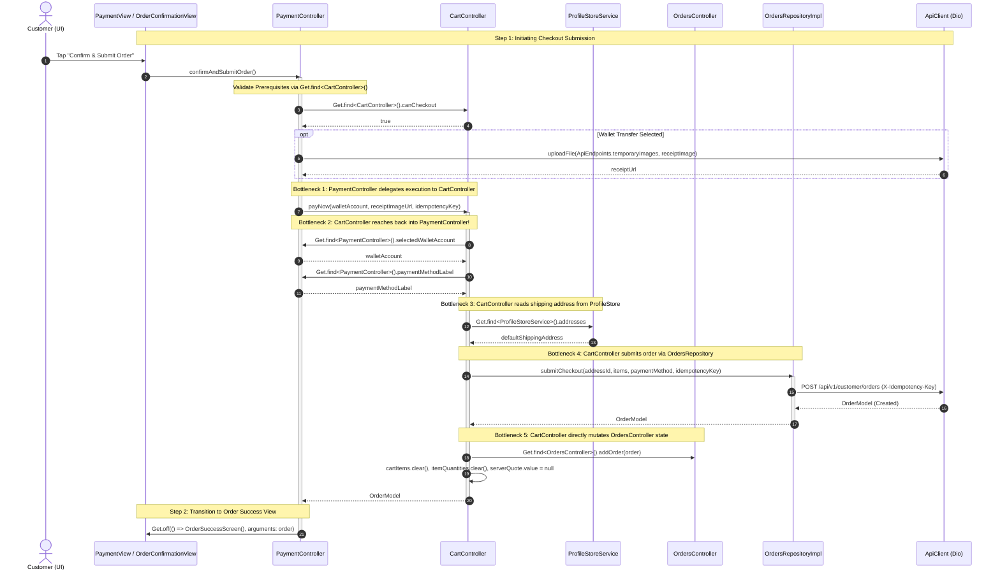

# 03 — Architecture Dependency Map & Coupling Analysis

> **Phase**: Phase 00 — Architecture Audit & Migration Readiness  
> **Project**: Rawnaquk E-Commerce Storefront (`rwnaqk_frontend`)  
> **Focus**: Structural integrity, cross-module boundaries, and coupling bottlenecks  

---

## 1. Architectural Philosophy: Ideal vs. Real Implementation

In an ideal Clean Architecture for Flutter e-commerce applications, data and events flow in a strict, unidirectional manner:

```text
Ideal Flow:
[Widget / View] ──> [State Controller / Notifier] ──> [Repository Contract] ──> [ApiClient (Dio)] ──> [Laravel REST API]
```

### Audit Findings on Real Implementation Divergence:

Our source code inspection reveals three distinct patterns currently operating in the codebase:

### Pattern A: Clean Repository-Driven Flow (Verified Strong Asset)
- **Applies to**: `Catalog` (products listing & details), `Addresses` (customer address book), `Orders` (remote order history & cancellation).
- **Actual Flow**:
  `View → Controller → Repository Interface → Repository Impl → ApiClient (Dio) → Laravel API`
- **Integrity**: Repositories do not import GetX, do not reference `BuildContext`, and map exceptions cleanly to domain `Failure` objects or return fallback mock data when `AppEnv.enableMockData` is enabled.

### Pattern B: Legacy Service-Direct Flow (Architectural Debt)
- **Applies to**: `Auth` session bootstrap & me, `Customer` 2FA settings, `Customer` profile lookup, `Auth` registration geo lookup.
- **Actual Flow**:
  `View → Controller → Service → GetConnect → Laravel API`
- **Integrity**: Completely bypasses `ApiClient` and `IAuthRepository`, resulting in duplicated HTTP configuration and conflicting error parsing.

### Pattern C: Circular Controller-Direct Flow (Critical Coupling Bottleneck)
- **Applies to**: `Cart`, `Checkout`, `Payment`, `Orders`.
- **Actual Flow**:
  `PaymentView → PaymentController → CartController.payNow() → OrdersController.repository.submitCheckout() → ApiClient`
  *(While simultaneously `CartController` reaches back into `PaymentController.selectedWalletAccount` and `ProfileStoreService.addresses`)*.
- **Integrity**: Direct cross-controller queries via `Get.find()`, resulting in circular dependencies, shared mutable memory state, and order-of-initialization sensitivity.

---

## 2. Mermaid Architectural Diagrams

### 2.1 App-Wide Module Dependency & Interaction Graph

```mermaid
graph TD
    classDef core fill:#33091F,stroke:#FAAD01,stroke-width:2px,color:#FCFCFC;
    classDef feature fill:#140A13,stroke:#6E0131,stroke-width:2px,color:#FCFCFC;
    classDef transactional fill:#500A2A,stroke:#FAAD01,stroke-width:3px,color:#FCFCFC;
    classDef backend fill:#26141E,stroke:#FAAD01,stroke-width:2px,stroke-dasharray: 5 5,color:#FAAD01;

    subgraph CoreInfrastructure["Core Infrastructure Layer"]
        ApiClient["ApiClient (Dio 5.7.0)"]:::core
        TokenStore["SecureAuthTokenStorage"]:::core
        AuthSession["AuthSessionService (GetxService)"]:::core
        ProfileStore["ProfileStoreService (GetxService)"]:::core
        InitialBinding["InitialBinding (Composition Root)"]:::core
    end

    subgraph FeatureModules["Independent & Browse Modules"]
        AuthModule["Auth Module (Login, Register, 2FA)"]:::feature
        CatalogModule["Catalog Module (Listing, Details, Reviews)"]:::feature
        HomeModule["Home Module (Tabs, Banners, Feeds)"]:::feature
        SearchModule["Search Module"]:::feature
        WishlistModule["Wishlist Module"]:::feature
        SupportModule["Support Module (Help Center, Chat)"]:::feature
        OnboardingModule["Onboarding Module"]:::feature
    end

    subgraph TransactionalCore["Critical Commerce & Transactional Core"]
        CustomerModule["Customer Module (Addresses, Profile, Settings)"]:::transactional
        CartModule["Cart Module (CartController & Quote)"]:::transactional
        CheckoutModule["Checkout Module (PaymentController)"]:::transactional
        OrdersModule["Orders Module (OrdersController & History)"]:::transactional
    end

    subgraph ExternalBackend["Laravel Backend"]
        LaravelAPI["Laravel REST API (/api/v1/...)"]:::backend
    end

    %% Bindings & DI Wireup
    InitialBinding --> ApiClient
    InitialBinding --> TokenStore
    InitialBinding --> AuthSession
    InitialBinding --> ProfileStore
    InitialBinding --> CartModule
    InitialBinding --> CheckoutModule
    InitialBinding --> OrdersModule

    %% Session & Profile Flow
    AuthSession --> TokenStore
    ProfileStore --> AuthSession
    AuthModule --> AuthSession
    CustomerModule --> ProfileStore
    CustomerModule --> AuthSession

    %% Catalog & Browsing
    HomeModule --> CatalogModule
    HomeModule --> CartModule
    CatalogModule --> WishlistModule
    CatalogModule --> CartModule
    SearchModule --> CatalogModule

    %% Critical Commerce Loop
    CustomerModule -.->|"Provides Addresses"| CartModule
    CartModule <-->|"Bidirectional Coupling"| CheckoutModule
    CheckoutModule -->|"Delegates Checkout"| CartModule
    CartModule -->|"Submits via Repository"| OrdersModule

    %% Network Outbound
    ApiClient --> LaravelAPI
    AuthModule -.->|"Legacy GetConnect"| LaravelAPI
    CustomerModule -.->|"Legacy GetConnect"| LaravelAPI
    OrdersModule --> ApiClient
    CatalogModule --> ApiClient
    CustomerModule --> ApiClient
    CartModule --> ApiClient
```



---

### 2.2 Critical Commerce & Checkout Circular Dependency Loop

This diagram details the exact coupling bottleneck identified between `PaymentController`, `CartController`, `OrdersController`, and `ProfileStoreService`:



---

## 3. In-Depth Coupling & Architectural Risk Analysis

### 3.1 Module Ownership Boundaries
- **Finding**: Most modules maintain reasonable boundary separation for their UI assets and models. However, **ownership of the checkout process is completely fragmented**.
- **Issue**: Is checkout owned by `CartModule` or `CheckoutModule`? Currently:
  - `PaymentController` is in `modules/checkout/`.
  - `CartController.payNow()` is in `modules/cart/`.
  - `IOrdersRepository.submitCheckout()` is in `modules/orders/`.
- **Riverpod 3 Recommendation**: Consolidate checkout transaction orchestration into a dedicated `CheckoutNotifier` within a unified `checkout` feature boundary. `CartNotifier` should only manage cart items and server quote requests.

### 3.2 Presentation Code vs. Business Rules
- **Finding**: Presentation widgets are largely free of business logic. However, several Controllers contain raw UI manipulation:
  - `PaymentController` uses `ImagePicker` directly (`payment_controller.dart:98`).
  - `AuthSessionService` performs imperative navigation (`Get.offAllNamed(AppRoutes.login)`) from within background bootstrap code (`auth_session_service.dart:180`).
  - `AppSettingsController` orchestrates multi-controller data deletion during logout (`app_settings_controller.dart:218`).
- **Riverpod 3 Recommendation**: Keep Notifiers pure. Hardware/plugin operations (e.g. `ImagePicker`) belong in UI event handlers or dedicated infrastructure services. Navigation should be triggered via presentation listeners (`ref.listen`).

### 3.3 Direct HTTP Calls in Controllers
- **Finding**: Zero controllers instantiate `Dio` directly. All remote access goes through `ApiClient` or `GetConnect`.
- **Exception**:
  - `PaymentController:201` calls `apiClient.uploadFile(...)` directly instead of delegating to a media/orders repository.
  - `CartService:42, 72` calls `_api.post(...)` directly for `cartQuote` and `validateCoupon` instead of using a formal `ICartRepository`.
- **Riverpod 3 Recommendation**: Introduce a formal `ICartRepository` interface to encapsulate cart quote calculation and coupon validation.

### 3.4 Triple Controller Pattern Overhead
- **Finding**: In almost every module, three classes are declared:
  1. `<Feature>Controller` (GetxController)
  2. `<Feature>Service` (Business logic / data preparation)
  3. `<Feature>UiController` (Pure UI state flags like `selectedIndex`, `isExpanded`)
- **Assessment**: While this provides separation of concerns, in GetX it created massive DI registration bloat (149 `Get.find` calls, 59 `Get.lazyPut` calls).
- **Riverpod 3 Recommendation**: Riverpod simplifies this cleanly:
  - A synchronous `NotifierProvider` for UI state.
  - An `AsyncNotifierProvider` for remote/business state.
  - No need for intermediate `*Service` wrappers when pure repositories are already in place.

### 3.5 Fragile Initialization Order
- **Finding**: `InitialBinding` must execute in a precise sequence:
  1. `IAuthTokenStorage` must be put before `ApiClient`.
  2. `ApiClient` must be put before `IAuthRepository` and `AuthSessionService`.
  3. `AuthSessionService` must be put before `ProfileStoreService`.
  4. `ProfileStoreService` and `ApiClient` must be put before `CartService`.
- **Risk**: In GetX, if an eager controller calls `Get.find<ProfileStoreService>()` before `InitialBinding` reaches line 123, the app crashes with `Service not found`.
- **Riverpod 3 Benefit**: Riverpod is **declarative and pull-based**. Providers naturally resolve their dependencies on demand, completely eliminating initialization order bugs!

