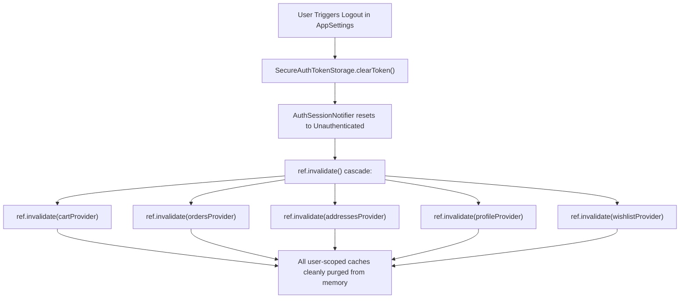

# 05 — Riverpod 3 Migration Compatibility & Technical Verification

> **Phase**: Phase 00 — Architecture Audit & Migration Readiness  
> **Target Framework**: `flutter_riverpod: ^3.5.0` (Verified 2026-11-09)  
> **Host SDK**: Flutter 3.47.3 • Dart 3.13.3 (Stable)  
> **Status**: Technically Verified & Compatible  

---

## 1. SDK & Package Compatibility Assessment

### 1.1 Dart & Flutter Version Alignment
- **Verified Environment**: Flutter 3.47.3 / Dart 3.13.3 on Windows 11.
- **Riverpod 3 Requirements**: `flutter_riverpod 3.5.0` requires **Dart >= 3.12**.
- **Compatibility Verdict**: **100% Compatible**. The project's Dart SDK (3.13.3) fully satisfies the engine constraints of `flutter_riverpod 3.5.0` without requiring SDK modifications.

### 1.2 Toolchain & Code Generation Strategy
| Package | Version | Recommendation for Migration | Justification |
|---|---|---|---|
| `flutter_riverpod` | `^3.5.0` | **Mandatory (Add in Phase 01)** | Core state management engine |
| `riverpod_annotation` | `^4.0.8` | **Deferred (Post-Migration)** | Avoids initial build toolchain dependency |
| `riverpod_generator` | `^4.0.10` | **Deferred (Post-Migration)** | Keeps migration commits clean and reviewable |
| `riverpod_lint` | `3.2.0` | **DO NOT ADD IN PHASE 01** | `riverpod_lint 3.2.0` requires Dart 3.13-dev prerelease |

> [!IMPORTANT]
> **Zero Code-Generation Rule for Initial Migration**:  
> To maintain developer velocity, avoid slow `build_runner` cycles, and preserve pure Dart source reviewability, all Phase 01 to Phase 07 migrations must use **explicit, handwritten Riverpod 3 providers** (`Notifier`, `AsyncNotifier`, `Provider`, `FutureProvider`). Code generation can be evaluated as an optional enhancement after all modules pass their regression gates.

---

## 2. Riverpod 3 API Primitives & Mapping Matrix

Riverpod 3 represents a complete architectural evolution. Legacy providers (`StateNotifierProvider`, `StateProvider`, `ChangeNotifierProvider`) are obsolete and quarantined under `legacy.dart`. All modernization in this project must target modern Riverpod 3 primitives:

```text
┌─────────────────────────────────┬───────────────────────────────────────┬──────────────────────────────────────┐
│ Requirement / Use Case          │ Legacy GetX Primitive                 │ Riverpod 3 Modern Target             │
├─────────────────────────────────┼───────────────────────────────────────┼──────────────────────────────────────┤
│ Stateless Dependency (Repo/API) │ Get.put(permanent: true)              │ Provider<T>                          │
│ Synchronous UI State            │ GetxController with .obs / GetBuilder │ NotifierProvider<Notifier, State>    │
│ Async Remote / Backed State     │ GetxController with async fetch & Obx │ AsyncNotifierProvider<Notifier, S>   │
│ Parameterized Query (By ID)     │ Controller with Get.arguments         │ Provider.family / AsyncNotifier.fam  │
│ Stream / Real-time Events       │ Rx.stream / GetxService Workers       │ StreamProvider / StreamNotifier      │
│ Invalidation / Reset on Logout  │ Manual controller.clear() calls       │ ref.invalidate(sessionScopedProvider)│
│ UI Widget Consumption           │ Obx(() => ...)                        │ ConsumerWidget / ref.watch           │
│ Test Mocking / Fakes            │ Get.put<IRepo>(FakeRepo())            │ ProviderScope(overrides: [...])      │
└─────────────────────────────────┴───────────────────────────────────────┴──────────────────────────────────────┘
```

---

## 3. Detailed Primitive Specifications & Patterns

### 3.1 Stateless Dependency Injection: `Provider<T>`
Used for pure service contracts, repositories, and HTTP clients:

```dart
// Core Network Client Provider
final apiClientProvider = Provider<ApiClient>((ref) {
  final tokenStorage = ref.watch(authTokenStorageProvider);
  return ApiClient(
    tokenStorage: tokenStorage,
    onUnauthorized: () {
      // Cleanly trigger session invalidation without direct Get.off
      ref.read(authSessionProvider.notifier).handleUnauthorized();
    },
  );
});

// Orders Repository Provider
final ordersRepositoryProvider = Provider<IOrdersRepository>((ref) {
  final apiClient = ref.watch(apiClientProvider);
  return OrdersRepositoryImpl(apiClient: apiClient);
});
```

### 3.2 Synchronous State: `NotifierProvider<Notifier<T>, T>`
Replaces UI-only controllers (e.g. `MainUiController`, `CartUiController`):

```dart
class MainNavigationNotifier extends Notifier<int> {
  @override
  int build() => 0; // Default to Home tab

  void setTab(int index) {
    if (index >= 0 && index < 5) {
      state = index;
    }
  }
}

final mainNavigationProvider =
    NotifierProvider<MainNavigationNotifier, int>(MainNavigationNotifier.new);
```

### 3.3 Remote & Async State: `AsyncNotifierProvider<AsyncNotifier<T>, T>`
Replaces complex async controllers (e.g. `OrdersController`, `AddressesController`):

```dart
class OrdersNotifier extends AsyncNotifier<List<OrderModel>> {
  @override
  Future<List<OrderModel>> build() async {
    // Automatically fetches on initial watch
    return ref.watch(ordersRepositoryProvider).getOrders();
  }

  Future<void> refreshOrders() async {
    state = const AsyncLoading();
    state = await AsyncValue.guard(
      () => ref.read(ordersRepositoryProvider).getOrders(),
    );
  }

  Future<void> cancelOrder(String orderId) async {
    final currentList = state.valueOrNull ?? [];
    state = const AsyncLoading();
    state = await AsyncValue.guard(() async {
      final updated = await ref.read(ordersRepositoryProvider).cancelOrder(orderId);
      return currentList.map((o) => o.id == orderId ? updated : o).toList();
    });
  }
}

final ordersProvider =
    AsyncNotifierProvider<OrdersNotifier, List<OrderModel>>(OrdersNotifier.new);
```

---

## 4. Critical Riverpod 3 Traps & Safety Rules

### Trap 1: Riverpod 3 Automatic Provider Retry on Initialization Failure
- **Behavior**: In Riverpod 3, when a provider's `build()` throws an exception, Riverpod automatically retries initialization upon subsequent listener attachments or refreshes.
- **CRITICAL COMMERCE RULE**:
  > [!CAUTION]
  > **NEVER execute non-idempotent operations (such as order creation, credit card charges, or wallet transfers) inside a provider's `build()` method!**
  > Checkout and order submission must strictly be an **explicit, user-triggered method** on the Notifier (`submitCheckout()`), never a reactive side-effect of provider instantiation.

### Trap 2: Async Completion After Provider Disposal (`ref.mounted`)
- **Behavior**: In Riverpod 3.5, if an asynchronous network call completes after a screen has popped and the provider has disposed, updating `state` throws `StateError` or `ProviderDisposedException`.
- **Mandatory Guard**:
  ```dart
  final result = await apiClient.post(...);
  if (!ref.mounted) return; // Must check ref.mounted after every await!
  state = AsyncData(result);
  ```

### Trap 3: `ProviderDisposedException` Handling
- **Behavior**: Riverpod 3.5 introduces `ProviderDisposedException` when awaiting `.future` on a provider that was disposed while in-flight.
- **Handling**: Catch `ProviderDisposedException` in UI listeners as an intentional cancellation, not as a server 500 error.

### Trap 4: Request Cancellation via `ref.onDispose`
- **Pattern**: Automatically cancel in-flight HTTP requests when the user leaves the screen:
  ```dart
  class ProductSearchNotifier extends AsyncNotifier<List<HomeProductItem>> {
    @override
    Future<List<HomeProductItem>> build() async {
      final cancelToken = CancelToken();
      ref.onDispose(cancelToken.cancel);
      return ref.watch(productsRepositoryProvider).search(query, cancelToken: cancelToken);
    }
  }
  ```

---

## 5. Session Scoping & Logout Invalidation Architecture

One of the greatest hazards in e-commerce applications is **cross-user cache leakage** (e.g. user A logs out, user B logs in, and sees user A's cart, orders, or addresses).

In Riverpod 3, this is solved cleanly through **declarative cache invalidation**:



This completely eliminates the manual, bug-prone `_clearLocalUserData()` method in `AppSettingsController` where `WishlistController` was previously forgotten!

---

## 6. Coexistence & Compatibility Bridge Architecture

During the migration phases (Phases 01 to 07), the application will run **both GetX and Riverpod simultaneously**:

```dart
// Proposed Phase 01 Bootstrap in main.dart:
void main() async {
  WidgetsFlutterBinding.ensureInitialized();
  await dotenv.load(fileName: ".env");

  final prefs = await SharedPreferences.getInstance();
  final hasSeenOnboarding = prefs.getBool(LocalStorageKeys.onboardingSeen) ?? false;
  final tokenStorage = SecureAuthTokenStorage();
  final persistedToken = await tokenStorage.readToken();

  runApp(
    ProviderScope( // Riverpod 3 Root wraps the entire application
      overrides: [
        authTokenStorageProvider.overrideWithValue(tokenStorage),
      ],
      child: MyApp( // Existing GetMaterialApp remains 100% intact!
        initialRoute: _resolveInitialRoute(
          hasSeenOnboarding: hasSeenOnboarding,
          persistedToken: persistedToken,
        ),
        initialAccessToken: persistedToken,
        tokenStorage: tokenStorage,
      ),
    ),
  );
}
```

### Coexistence Rules:
1. **Unidirectional Bridge**: Riverpod providers must never import or call `Get.find()`. If a legacy GetX controller needs data from a migrated Riverpod provider, it reads it through a temporary adapter in `lib/core/legacy_bridge/`.
2. **Single Source of Truth**: For any given feature (e.g. Wishlist), either GetX owns the state or Riverpod owns the state. Never maintain two live active copies.
3. **Preserve GetX Router & Translations**: Keep `GetMaterialApp`, `AppPages`, `GetPage`, `AppTranslations`, and `.tr` working untouched until the final Phase 08 cleanup.

