# 06 — Dependency-Aware Migration Roadmap & Backlog

> **Phase**: Phase 00 — Architecture Audit & Migration Readiness  
> **Project**: Rawnaquk E-Commerce Storefront (`rwnaqk_frontend`)  
> **Strategy**: Core-First, Pilot-Validated, Module-by-Module Cutover  
> **Target**: Riverpod 3.5.0 Feature-First Modern Architecture  

---

## 1. Migration Sequence & Strategic Justification

Based on the actual dependency graph mapped during Phase 00, attempting to migrate complex transactional features (Cart, Checkout, Payment, Orders) early would trigger severe regressions due to their dense circular coupling.

Therefore, the migration sequence strictly follows a **risk-ascending, dependency-aware pipeline**:

```mermaid
flowchart LR
    P0["Phase 00<br/>Architecture Audit<br/>(Complete)"] --> P1["Phase 01<br/>Core Stabilization &<br/>ProviderScope Bridge"]
    P1 --> P2["Phase 02<br/>Low-Risk Pilot<br/>(Support Module)"]
    P2 --> P3["Phase 03<br/>Secondary Pilots<br/>(Onboarding & Wishlist)"]
    P3 --> P4["Phase 04<br/>Auth & Customer<br/>Session Core"]
    P4 --> P5["Phase 05<br/>Addresses & Geo<br/>Coverage Services"]
    P5 --> P6["Phase 06<br/>Catalog Feeds &<br/>Search Pagination"]
    P6 --> P7["Phase 07<br/>Cart State &<br/>Server Quote API"]
    P7 --> P8["Phase 08<br/>Checkout, Payment &<br/>Idempotent Orders"]
    P8 --> P9["Phase 09<br/>Final GetX Removal &<br/>Router Cutover"]
```

### Strategic Justification:
1. **Core Stabilization (Phase 01) First**: Establishes `ProviderScope` without modifying feature code, fixes the silent 401 bug, and deletes the dead `core/constants/api_endpoints.dart`.
2. **Support Module (Phase 02) as Pilot**: The `support` module (17 files) has **zero outbound dependencies** on other modules. It is read-only or informational, making it the mathematically lowest-risk pilot to validate Riverpod 3 patterns in production.
3. **Wishlist & Onboarding (Phase 03)**: Validates simple synchronous state (`Notifier`) and persistent preferences before tackling authentication.
4. **Auth & Session (Phase 04)**: Establishes the authoritative `authSessionProvider` and cleans up the legacy `CustomerAuthApiService` (`GetConnect`).
5. **Addresses & Geo (Phase 05)**: Required before Cart and Checkout can calculate shipping tiers.
6. **Catalog & Search (Phase 06)**: Validates parameterized `FutureProvider.family` and pagination with `ScrollController`.
7. **Cart & Quote (Phase 07)**: Decouples server quote calculation from UI controllers.
8. **Checkout & Orders (Phase 08) Last Among Transactions**: The most sensitive monetary workflow in the app. Migrated only when Auth, Addresses, and Cart are 100% stabilized on Riverpod.
9. **Final Cleanup (Phase 09)**: Removes `get` package only when all 39 controllers and 335 files contain 0 GetX references.

---

## 2. Detailed Module Migration Backlog

### Phase 01: Core Stabilization & ProviderScope Bridge
- **Current Implementation**: `InitialBinding` creates 17 permanent GetX singletons. `main.dart` launches bare `GetMaterialApp`. `ApiClient` has null `_onUnauthorized`. `core/constants/api_endpoints.dart` is redundant.
- **Proposed Implementation**:
  - Add `flutter_riverpod: ^3.5.0` to `pubspec.yaml`.
  - Wrap `MyApp` with root `ProviderScope` in `main.dart`.
  - Declare pure Riverpod providers in `lib/core/di/`: `authTokenStorageProvider`, `apiClientProvider`, `authRepositoryProvider`.
  - Wire `_onUnauthorized` in `apiClientProvider` to trigger session reset.
  - Delete unused `lib/core/constants/api_endpoints.dart`.
- **Prerequisites**: Phase 00 PASS.
- **Files Affected**: `pubspec.yaml`, `lib/main.dart`, `lib/core/bindings/initial_binding.dart`, `lib/core/constants/api_endpoints.dart`.
- **Technical Risk**: Low.
- **Regression Risk**: Very Low.
- **Required Tests**: `flutter analyze`, `flutter test` (all 55 tests must pass).
- **Rollback Approach**: Discard `pubspec.yaml` and `main.dart` changes.
- **Estimated Complexity**: Low.
- **Acceptance Criteria**: App launches identically, all 55 existing tests pass, Riverpod `ProviderScope` active at root.

---

### Phase 02: Pilot #1 — Support Module Cutover
- **Current Implementation**: `HelpCenterController`, `SupportChatController`, `SupportChatUiController`, `SupportBinding` in `lib/modules/support/`.
- **Proposed Implementation**:
  - Create `SupportChatNotifier` (managing `List<SupportChatMessage>`).
  - Convert `SupportChatView` and `HelpCenterView` to `ConsumerWidget`.
  - Deprecate `SupportBinding`.
- **Prerequisites**: Phase 01 Complete.
- **Files Affected**: 6 files in `lib/modules/support/`.
- **Technical Risk**: Low.
- **Regression Risk**: Negligible (support is non-transactional).
- **Required Tests**: Add unit tests for `SupportChatNotifier`, verify WhatsApp/Email launchers.
- **Rollback Approach**: Revert `SupportChatView` to `GetxController`.
- **Estimated Complexity**: Low.
- **Acceptance Criteria**: Zero GetX imports in `lib/modules/support/`, support chat interactive, all regression tests pass.

---

### Phase 03: Pilot #2 & #3 — Onboarding & Wishlist Modules
- **Current Implementation**:
  - Onboarding: `OnboardingController` manages intro slides.
  - Wishlist: `WishlistController` manages in-memory `wishlistItems` (`RxList<HomeProductItem>`), but leaks data across logout.
- **Proposed Implementation**:
  - `onboardingProvider` (`Notifier<int>`).
  - `wishlistProvider` (`Notifier<List<HomeProductItem>>`), wired into logout invalidation.
  - Convert `OnboardingScreen` and `WishlistScreen` to `ConsumerWidget`.
- **Prerequisites**: Phase 02 Complete.
- **Files Affected**: 14 files across `onboarding/` and `wishlist/`.
- **Technical Risk**: Low.
- **Regression Risk**: Low.
- **Required Tests**: Unit tests for wishlist add/remove/toggle, test logout wishlist clearance.
- **Rollback Approach**: Git revert on `modules/wishlist/` and `modules/onboarding/`.
- **Estimated Complexity**: Low.
- **Acceptance Criteria**: Wishlist updates reactively across catalog and home without `Obx`; wishlist cleared on logout.

---

### Phase 04: Authentication & Customer Session Core
- **Current Implementation**: `AuthSessionService` (`GetxService`), `CustomerAuthApiService` (`GetConnect`), `LoginController`, `RegisterController`, `TwoFactorChallengeController`.
- **Proposed Implementation**:
  - `authSessionProvider` (`AsyncNotifier<AuthSessionState>`).
  - Replace `CustomerAuthApiService` with `AuthRepositoryImpl` methods backed by `ApiClient`.
  - Expose temporary compatibility adapter in `core/legacy_bridge/` for legacy GetX controllers that still call `Get.find<AuthSessionService>()`.
- **Prerequisites**: Phase 03 Complete.
- **Files Affected**: ~25 files across `core/services/auth/` and `modules/auth/`.
- **Technical Risk**: High (Session & Token lifecycle).
- **Regression Risk**: High (Login/Logout lockouts).
- **Required Tests**: `secure_auth_token_storage_test.dart`, `network_and_repositories_test.dart`, auth integration tests.
- **Rollback Approach**: Revert to `AuthSessionService` GetX service.
- **Estimated Complexity**: High.
- **Acceptance Criteria**: Token stored securely, session bootstrap authenticates against Laravel API, 401 triggers clean logout, zero `GetConnect` usage.

---

### Phase 05: Customer Addresses & Geographic Coverage
- **Current Implementation**: `AddressesController` (`GetxController`), `ProfileStoreService.addresses`, `FakeAddressesRepository` fallback.
- **Proposed Implementation**:
  - `addressesProvider` (`AsyncNotifier<List<ShippingAddress>>`).
  - `primaryAddressProvider` (`Provider<ShippingAddress?>`).
  - Convert `AddressesScreen`, `AddressCard`, and address bottom sheets to `ConsumerWidget`.
- **Prerequisites**: Phase 04 Complete.
- **Files Affected**: ~18 files across `modules/customer/`.
- **Technical Risk**: Medium.
- **Regression Risk**: Medium (Address selection affects shipping calculation).
- **Required Tests**: Address CRUD unit tests, serviceability validation tests.
- **Rollback Approach**: Git revert on `modules/customer/data/repositories/` and `controllers/`.
- **Estimated Complexity**: Medium.
- **Acceptance Criteria**: Addresses load from Laravel API, default address updates reactively, unserviceable areas flag warning.

---

### Phase 06: Catalog, Product Feeds & Search
- **Current Implementation**: `ProductsListingController` (infinite scroll, filters, sort), `ProductDetailsController` (variants, size guide), `AppSearchController`.
- **Proposed Implementation**:
  - `productsListingProvider` (`AsyncNotifier<ProductsListingState>`).
  - `productDetailsProvider.family<ProductDetailsState, String>` (auto-disposed on screen pop).
  - `searchProvider` (`AsyncNotifier<SearchResultsState>` with debounced query).
- **Prerequisites**: Phase 05 Complete.
- **Files Affected**: ~40 files across `modules/catalog/` and `modules/search/`.
- **Technical Risk**: Medium.
- **Regression Risk**: Medium (Catalog browsing is primary storefront traffic).
- **Required Tests**: `product_details_test.dart`, pagination tests, variant selection tests.
- **Rollback Approach**: Git revert on `modules/catalog/`.
- **Estimated Complexity**: High (Due to large file count: 48 files).
- **Acceptance Criteria**: Catalog grids render smoothly, variant picker updates stock availability, search debounce prevents race conditions.

---

### Phase 07: Cart State & Real-Time Server Quote
- **Current Implementation**: `CartController` (801 lines), in-memory items, server quote via `CartService`.
- **Proposed Implementation**:
  - Extract formal `ICartRepository` interface.
  - `cartProvider` (`Notifier<CartState>`) managing items, quantities, and selected coupon.
  - `cartQuoteProvider` (`FutureProvider`) that recomputes automatically when items or selected address changes.
- **Prerequisites**: Phase 05 (Addresses) and Phase 06 (Catalog) Complete.
- **Files Affected**: ~26 files in `modules/cart/`.
- **Technical Risk**: High (Pricing and totals).
- **Regression Risk**: High (Wrong cart calculation leads to checkout failure).
- **Required Tests**: Cart quote tests, quantity stepper tests, coupon application tests.
- **Rollback Approach**: Git revert on `modules/cart/`.
- **Estimated Complexity**: High.
- **Acceptance Criteria**: Subtotal and quote derived server-side, coupon discounts verified, items persist in memory during navigation.

---

### Phase 08: Checkout, Payment & Idempotent Orders
- **Current Implementation**: `PaymentController` coupled to `CartController.payNow()` and `IOrdersRepository`.
- **Proposed Implementation**:
  - Create unified `CheckoutNotifier` in `modules/checkout/`.
  - Handle wallet receipt upload via `apiClientProvider`.
  - Submit order via `ordersRepositoryProvider` with explicit `X-Idempotency-Key`.
  - `ordersProvider` (`AsyncNotifier<List<OrderModel>>`).
- **Prerequisites**: Phase 07 (Cart) Complete.
- **Files Affected**: ~30 files across `checkout/` and `orders/`.
- **Technical Risk**: Critical (P0 Monetary Transactions).
- **Regression Risk**: Critical (Double submit, corrupted orders).
- **Required Tests**: `phase3_e2e_journey_test.dart`, idempotency tests, mock and remote integration tests.
- **Rollback Approach**: Feature-level revert on `checkout/` and `orders/`.
- **Estimated Complexity**: High.
- **Acceptance Criteria**: Zero circular controller dependencies, receipt upload verified, order created with idempotency key, cart cleared only on 201 response.

---

### Phase 09: Global Cleanup & Final GetX Removal
- **Current Implementation**: `GetMaterialApp` root, `AppPages` routes, `AppTranslations` (`.tr`).
- **Proposed Implementation**:
  - Audit codebase for any remaining `import 'package:get/...'` calls (must be 0).
  - Migrate routing to standard Navigator 2.0 or `go_router` (separate navigation gate).
  - Migrate `.tr` calls to standard Flutter `AppLocalizations` / `intl` or lightweight translation helper.
  - Remove `get` dependency from `pubspec.yaml`.
  - Delete `lib/core/legacy_bridge/`.
- **Prerequisites**: Phases 01 through 08 100% Complete and Passed.
- **Files Affected**: `pubspec.yaml`, `lib/main.dart`, `lib/routes/`, UI translation files.
- **Technical Risk**: Medium.
- **Regression Risk**: Medium (Route transitions and text strings).
- **Required Tests**: Full app E2E smoke test on Android and iOS devices.
- **Rollback Approach**: Retain `get` in `pubspec.yaml`.
- **Estimated Complexity**: Medium.
- **Acceptance Criteria**: Complete absence of `get` package in `pubspec.yaml`, all screens navigate cleanly, all translations render accurately.

