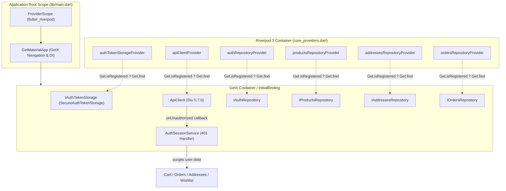

# معمارية موفري النواة الموحدين وجسر التعايش
# Core Provider Architecture & The Single-Instance Bridge

## 1. المقدمة والهدف المعماري

الهدف الأساسي من المرحلة 01 هو بناء **جسر تعايش آمن (Safe Coexistence Bridge)** يتيح تدشين `flutter_riverpod` داخل تطبيق «رونقك» دون إنشاء نسختين متنافستين من الخدمات الحساسة (مثل `ApiClient` أو `IAuthTokenStorage` أو المستودعات).

لو تم تعريف موفري Riverpod بإنشاء كائنات جديدة مستقلة عن GetX، لأدى ذلك إلى:
- تعدد نسخ التوكن في الذاكرة (Token Desynchronization).
- تكرار عملاء Dio وقواعد Interceptors.
- تضارب حالة الكاش بين الشاشات التي ما زالت تعمل على GetX والوحدات المستقبلية التي ستعمل على Riverpod.

لذا اعتمدنا مبدأ **ضمان الهوية الأحادية (Single-Instance Guarantee)**.

---

## 2. جدول الموفرين المعتمدين في النواة (`lib/core/di/core_providers.dart`)

| اسم الموفر (Provider) | النوع المعماري المعكوس | مصدر الكائن في GetX | السلوك البديل (Fallback) |
|---|---|---|---|
| `authTokenStorageProvider` | `Provider<IAuthTokenStorage>` | `Get.find<IAuthTokenStorage>()` | `SecureAuthTokenStorage()` |
| `apiClientProvider` | `Provider<ApiClient>` | `Get.find<ApiClient>()` | ينشئ عميل `ApiClient` جديد بحقن `ref.watch(authTokenStorageProvider)` |
| `authRepositoryProvider` | `Provider<IAuthRepository>` | `Get.find<IAuthRepository>()` | `AuthRepositoryImpl(ref.watch(apiClientProvider), ref.watch(authTokenStorageProvider))` |
| `productsRepositoryProvider` | `Provider<IProductsRepository>` | `Get.find<IProductsRepository>()` | `ProductsRepositoryImpl(ref.watch(apiClientProvider))` |
| `addressesRepositoryProvider` | `Provider<IAddressesRepository>` | `Get.find<IAddressesRepository>()` | `AddressesRepositoryImpl(ref.watch(apiClientProvider))` |
| `ordersRepositoryProvider` | `Provider<IOrdersRepository>` | `Get.find<IOrdersRepository>()` | `OrdersRepositoryImpl(ref.watch(apiClientProvider))` |

---

## 3. آلية عمل جسر الاسترداد الأحادي (Single-Instance Guarantee)

يعتمد كل موفر على التحقق الديناميكي من حقيبة GetX أولاً:

```dart
final apiClientProvider = Provider<ApiClient>((ref) {
  if (Get.isRegistered<ApiClient>()) {
    return Get.find<ApiClient>();
  }
  final tokenStorage = ref.watch(authTokenStorageProvider);
  return ApiClient(tokenStorage: tokenStorage);
});
```

### مزايا هذا النمط:
1. **في بيئة التشغيل الفعلية (Production Runtime):**
   - يقوم `InitialBinding` في GetX بتهيئة `ApiClient` و `IAuthTokenStorage` عند تشغيل التطبيق.
   - عندما تقرأ أي وحدة Riverpod هذه الموفرات، فإنها تسترجع **نفس المرجع الأصلي تماماً في الذاكرة** (`identical(riverpodInstance, getxInstance) == true`).
2. **في بيئة الاختبارات المعزولة (Isolated Unit Tests):**
   - إذا تم تشغيل اختبار Riverpod بدون تفعيل GetX، فإن الموفر ينشئ نسخته النظيفة مع حقن التبعيات تلقائياً عبر `ref.watch`.
   - يمكن استبدال أي موفر بسهولة تامة عبر `ProviderContainer(overrides: [...])` دون التأثير على بيئة GetX العامة.

---

## 4. مخطط تدفق التعايش المعماري (Mermaid Architecture Diagram)



---

## 5. قواعد دورة الحياة والتخلص (Lifecycle & Disposal)

- موفرو النواة معرفون كـ `Provider` ثابتين (Global Singletons per Container) ولا يستخدمون `autoDispose` لأن عميل الشبكة ومستودعات البيانات مصممة للبقاء طوال دورة حياة جلسة التطبيق.
- عند التخلص من بيئة الاختبار، يكفي استدعاء `container.dispose()` لإنهاء أي مراقبين أو موارد مرتبطة بها.

