# قرار معماري: تثبيت وحدة الدعم الفني كنموذج ريادي للمرحلة 02
# Architecture Decision Record (ADR-002) — Preserving Support Module Pilot for Phase 02

> **الحالة:** معتمد رسمياً (Approved)  
> **المرجع:** تعارض التسميات بين `06 — MIGRATION_ROADMAP.md` و `05 — PHASE_01_GATE.md`  
> **التاريخ:** 09 نوفمبر 2026

---

## 1. السياق والمشكلة (Context & Problem Statement)

في وثيقة خارطة الطريق الأصلية لتدقيق المرحلة 00 ([`docs/architecture/phase-00-audit/06 — MIGRATION_ROADMAP.md`](file:///d:/project/laravel/app-rwnaqk/rwnaqk_frontend/docs/architecture/phase-00-audit/06%20%E2%80%94%20MIGRATION_ROADMAP.md))، تم تحديد تسلسل الهجرة المعمارية وفق مبدأ **التدرج التصاعدي في المخاطر (Risk-Ascending Pipeline)**، حيث تم اعتماد:
- **المرحلة 02:** النموذج الريادي منخفض المخاطر: وحدة الدعم الفني والمعلومات (`Support Module Pilot`).
- **المرحلة 03:** النماذج الثانوية: الترحيب وقائمة المفضلة (`Onboarding & Wishlist`).
- **المرحلة 04:** مصادقة العملاء والجلسات المركزية (`Auth & Customer Session Core`).

ولكن في تقرير بوابة المرحلة 01 السابق ([`docs/architecture/phase-01-core/05 — PHASE_01_GATE.md`](file:///d:/project/laravel/app-rwnaqk/rwnaqk_frontend/docs/architecture/phase-01-core/05%20%E2%80%94%20PHASE_01_GATE.md))، تم ذكر عبارة تفيد بأن المرحلة 02 هي: *"Auth & Customer Profile Module Migration"*.

هذا التغيير غير المبرر أحدث تعارضاً صريحاً يفرض القفز مباشرة إلى هجرة وحدة المصادقة المعقدة وعالية المخاطر، قبل اختبار وتثبيت أنماط Riverpod 3 في شاشات المتجر.

---

## 2. القرار المعماري (Architectural Decision)

نقرر بموجب هذا السجل **إلغاء التغيير الطارئ في تقرير بوابة المرحلة 01، والالتزام الصارم بخارطة طريق المرحلة 00 الأصلية**:

> **تثبيت المرحلة 02 رسمياً كـ:**  
> **المرحلة 02: هجرة وحدة الدعم الفني والمعلومات (Phase 02 — Support Module Pilot Migration)**

وتأجيل وحدة المصادقة والجلسة (`Auth Module`) إلى **المرحلة 04** كما كان مخططاً لها هندسياً.

---

## 3. التبريرات الهندسية الصارمة (Technical Rationale)

1. **انعدام التبعيات الخارجية لوحدة الدعم (Zero Outbound Dependencies):**
   - تضم وحدة الدعم (`lib/modules/support/`) 17 ملفاً تتعلق بصفحات ثابتة ومعلوماتية (عن التطبيق، الأسئلة الشائعة، سياسة الخصوصية، التواصل).
   - لا تعتمد هذه الوحدة على أي وحدة تجارية أخرى (لا تعتمد على السلة، ولا الدفع، ولا الكتالوج).
   - في حال حدوث أي خطأ غير متوقع أثناء هجرتها إلى Riverpod 3، فلن تتأثر رحلة الشراء ولا تسجيل الدخول ولا بيانات العملاء.
2. **خطورة هجرة وحدة المصادقة المبكرة (High Risk of Premature Auth Migration):**
   - وحدة المصادقة (`lib/modules/auth/`) تتحكم في حراسة التوجيه في كامل التطبيق (`Route Guards`)، وتخزين التوكن، والتحقق بخطوتين (2FA)، وتأكيد البريد الإلكتروني.
   - البدء بوحدة المصادقة في المرحلة 02 يعني المقامرة باستقرار تسجيل الدخول للمتجر بأكمله قبل أن يثبت فريق العمل كفاءة أنماط ودجات Riverpod 3 والـ ConsumerWidgets في شاشات الإنتاج.
3. **تأسيس النمط الريادي (Validating the Pilot Pattern):**
   - تمثل المرحلة 02 في وحدة الدعم فرصة ذهبية لتأسيس القوالب المرجعية لـ `ConsumerWidget` و `ref.watch` و `AsyncValue`، وتوثيق إرشادات المطورين قبل الدخول في الوحدات الحرجة.

---

## 4. جدول التسلسل الرسمي المعتمد لمراحل الهجرة

```mermaid
flowchart LR
    P0["Phase 00: تدقيق المعمارية (منجز)"] --> P1["Phase 01: تثبيت النواة (منجز)"]
    P1 --> P1_1["Phase 01.1: التحقق المستقل (الحالي)"]
    P1_1 --> P2["Phase 02: ريادة الدعم الفني (Support Pilot)"]
    P2 --> P3["Phase 03: الترحيب والمفضلة (Wishlist)"]
    P3 --> P4["Phase 04: المصادقة والجلسة (Auth Core)"]
    P4 --> P5["Phase 05: العناوين والمواقع (Geo & Addresses)"]
    P5 --> P6["Phase 06: الكتالوج والبحث (Catalog)"]
    P6 --> P7["Phase 07: السلة والتسعير (Cart & Quote)"]
    P7 --> P8["Phase 08: الدفع والطلبات (Checkout & Orders)"]
    P8 --> P9["Phase 09: تنظيف GetX النهائي (Cutover)"]
```

