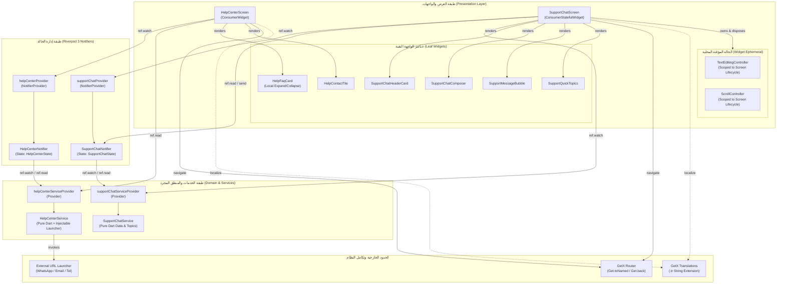

# المعمارية الجديدة لوحدة الدعم الفني
# 02 — SUPPORT ARCHITECTURE: Riverpod 3 Component Design

- **المشروع:** متجر رونقك الإلكتروني (Rawnaquk E-Commerce)
- **المرحلة:** Phase 02 — Support Module Pilot Migration to Riverpod 3
- **الإصدار المعماري:** Riverpod 3.5.0 Explicit Handwritten Providers
- **حالة التوثيق:** معتمد ونهائي

---

## 1. مخطط المعمارية وتدفق البيانات (Architecture Diagram)

---

## 2. تفكيك المسؤوليات البرمجية (Component Responsibilities)

### 2.1 نماذج الحالة المجردة (State Models)
- **`HelpCenterState`:**
  - كائن غير قابل للتعديل (Immutable Object) يتمتع بخاصية `copyWith`.
  - يحمل قائمة الإدخالات، قائمة وسائل التواصل، وقائمة الأسئلة الشائعة.
  - يوفر مشتقات ذكية نقية (`get filteredFaqQuestions` و `get isSearchEmpty`) دون حاجة لحفظ متغيرات وسيطة في الذاكرة.
- **`SupportChatState`:**
  - كائن غير قابل للتعديل يمثل قائمة الرسائل المتبادلة بين العميل ومسؤول الدعم.
  - يحمل عنوان المحادثة `title`، وقائمة الأسئلة السريعة المقترحة `frequentQuestions`.
  - يحمل راية منع الإرسال المتزامن المزدوج `isSubmitting` لمنع النقر المتعدد أو السباقات غير المتزامنة.

### 2.2 المزودات والمتحكمات (Riverpod 3 Notifiers)
- **`helpCenterProvider` / `HelpCenterNotifier`:**
  - يرث من `Notifier<HelpCenterState>`.
  - يشترك تفاعلياً مع `helpCenterServiceProvider` للحصول على الإدخالات الأولية.
  - يدير تحديث عبارة البحث (`setSearchQuery`, `clearSearch`) وتحديد التصنيف (`selectCategory`).
  - يقدم واجهات تفويض صريحة لإجراءات التواصل الخارجي (`contactViaWhatsApp`, `contactViaEmail`, `contactViaPhone`).
- **`supportChatProvider` / `SupportChatNotifier`:**
  - يرث من `Notifier<SupportChatState>`.
  - يبني الحالة الابتدائية استناداً إلى رسائل البداية المعتمدة في `supportChatServiceProvider`.
  - يدير إرسال الرسائل (`sendMessage`) مع التحقق الصارم من النصوص الفارغة ومنع الإرسال المزدوج.
  - يدير تهيئة وسائط الشاشة (`setArgs`) القادمة من المسار أو المنشئ.
  - يتيح تفريغ المحادثة (`clearMessages`) وإعادتها للوضع المبدئي (`resetToSeed`).

### 2.3 طبقة الخدمات (Pure Domain Services)
- **`HelpCenterService`:**
  - كلاس Dart نقي خالٍ تماماً من التبعيات الخارجية باستثناء مشغل الروابط (`url_launcher`).
  - يعتمد مبدأ الانعكاس والتحكم (Inversion of Control) عبر بارامتر اختياري `urlLauncher` لتمكين المحاكاة الكاملة في بيئة الاختبار دون لمس نظام التشغيل.
- **`SupportChatService`:**
  - كلاس نقي يوفر المواضيع السريعة (`quickTopics`)، ورسائل المحاكاة المبدئية (`seedMessages`)، وتنسيق الأختام الزمنية (`timeLabel`).

### 2.4 طبقة الواجهة ودورة الحياة (Presentation & Lifecycle)
- **`HelpCenterScreen`:**
  - ودجت عديم الحالة مستهلك (`ConsumerWidget`).
  - يتلقى `WidgetRef` ويبني الواجهة تفاعلياً بناءً على `ref.watch(helpCenterProvider)`.
  - لا يملك أي كائن مؤقت في الذاكرة.
- **`SupportChatScreen`:**
  - ودجت ذو حالة مستهلك (`ConsumerStatefulWidget`).
  - يمتلك حصرياً `TextEditingController` و `ScrollController`.
  - دورة حياة كاملة: يتم الإنشاء في `initState()` والتهيئة بعد الإطار الأول عبر `addPostFrameCallback`، والتدمير الكامل في `dispose()` مع ضمان عدم ترك أي مراجع ميتة (Zombie References) في الذاكرة.

---

## 3. مطابقة المعايير الصارمة لـ Riverpod 3 (Compliance Checklist)

1. **Explicit Handwritten Providers:** استخدام أسلوب الكتابة اليدوية الصريحة لـ `NotifierProvider` و `Provider` دون الاعتماد على مولدات الأكواد (`build_runner` أو `riverpod_generator`).
2. **Immutable State:** استبدال كائنات `.obs` بمتغيرات وحالات غير قابلة للتعديل تعتمد على `copyWith`.
3. **No Service Locator Inside Models:** منع استخدام `Get.find()` أو سحب الكائنات من خارج نطاق الموفرات.
4. **Lifecycle Safety:** فصل دورة حياة عناصر الواجهة المؤقتة عن دورة حياة الحالة العامة للتطبيق.
5. **RTL & Localization Preservation:** الحفاظ بنسبة 100% على توجيه RTL ودعم الترجمة الكامل عبر `AppLocaleKeys` و `.tr`.

