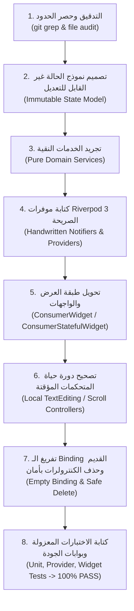

# النمط القياسي المرجعي لهجرة الوحدات
# 05 — REUSABLE MIGRATION PATTERN: Feature Module SOP

- **المشروع:** متجر رونقك الإلكتروني (Rawnaquk E-Commerce)
- **المصدر التأسيسي:** مستخلص من نجاح هجرة وحدة الدعم (Phase 02 Pilot)
- **الهدف:** توحيد وتأمين خطوات هجرة الوحدات القادمة (المرحلة 03: Onboarding & Wishlist، المرحلة 04: Auth، وما بعدها)
- **المستوى المعماري:** Riverpod 3.5.0 Explicit Handwritten Standard

---

## 1. إجراءات التشغيل القياسية خطوة بخطوة (Step-by-Step SOP)



---

## 2. المراحل التفصيلية للتطبيق الموحد

### الخطوة 1: التدقيق وتحديد حدود الوحدة (Module Audit & Isolation)
1. فحص ملفات الوحدة ومجلداتها.
2. استخدام `git grep` للبحث عن كافة المستدعين الخارجيين لكلاسات الكنترولر أو الموديل.
3. التمييز بين:
   - **الحالة العامة المشتركة (Global/Domain State):** بيانات الخادم، سلة التسوق، قائمة الرغبات، نتائج البحث.
   - **الحالة المؤقتة لعناصر الشاشة (Ephemeral UI State):** حقول الإدخال، موضع التمرير، الفلاتر اللحظية.

### الخطوة 2: تصميم نموذج الحالة (Immutable State Model)
- إنشاء مجلد `models/` داخل الوحدة.
- كتابة نموذج حالة غير قابل للتعديل (Immutable Data Class) مع `final fields` و `const constructor`.
- توفير ميثود `copyWith` صريحة وموثوقة.
- تضمين المشتقات المنطقية النقية كـ `getters` بدلاً من تخزين متغيرات وسيطة مكررة.

```dart
// template: module_state.dart
class FeatureState {
  final bool isLoading;
  final String? errorMessage;
  final List<ItemModel> items;

  const FeatureState({
    this.isLoading = false,
    this.errorMessage,
    this.items = const [],
  });

  bool get isEmpty => !isLoading && items.isEmpty;

  FeatureState copyWith({
    bool? isLoading,
    String? errorMessage,
    List<ItemModel>? items,
  }) {
    return FeatureState(
      isLoading: isLoading ?? this.isLoading,
      errorMessage: errorMessage,
      items: items ?? this.items,
    );
  }
}
```

### الخطوة 3: كتابة موفرات Riverpod 3 الصريحة (Explicit Handwritten Providers)
- إنشاء ملف `providers/<feature>_providers.dart`.
- تعريف مزودات الخدمات الأساسية عبر `Provider<T>((ref) => ...)`.
- تعريف متحكم الحالة عبر `NotifierProvider<FeatureNotifier, FeatureState>(FeatureNotifier.new)`.
- عدم استخدام `build_runner` أو التعليمة `@riverpod` لضمان وضوح الشفرة وسرعة البناء واستقرار البيئة.

```dart
// template: feature_providers.dart
final featureServiceProvider = Provider<FeatureService>((ref) {
  return FeatureService();
});

final featureProvider =
    NotifierProvider<FeatureNotifier, FeatureState>(FeatureNotifier.new);

class FeatureNotifier extends Notifier<FeatureState> {
  @override
  FeatureState build() {
    return const FeatureState();
  }

  Future<void> loadData() async {
    state = state.copyWith(isLoading: true);
    try {
      final service = ref.read(featureServiceProvider);
      final items = await service.fetchItems();
      state = state.copyWith(isLoading: false, items: items);
    } catch (e) {
      state = state.copyWith(isLoading: false, errorMessage: e.toString());
    }
  }
}
```

### الخطوة 4: ترحيل الشاشات وعناصر الواجهة (View Migration)
- إذا كانت الشاشة لا تحتاج متحكمات نصوص أو تمرير:
  - تحويلها إلى `ConsumerWidget` مع `Widget build(BuildContext context, WidgetRef ref)`.
  - استبدال `Get.find()` بـ `ref.watch(provider)` لعرض البيانات، أو `ref.read(provider.notifier)` لإطلاق الأحداث.
- إذا كانت الشاشة تحتاج متحكمات نصوص أو تمرير (`TextEditingController`, `ScrollController`):
  - تحويلها إلى `ConsumerStatefulWidget` مع `ConsumerState<Screen>`.
  - إنشاء المتحكمات في `initState()`.
  - التخلص التام منها في `dispose()`.
- استئصال أي وسم `Obx(...)` أو `GetBuilder(...)`.
- الإبقاء على أوامر الملاحة `Get.toNamed(...)` و `Get.back()` واستدعاءات الترجمة `.tr` كما هي لسلامة العقد حتى المرحلة 09.

### الخطوة 5: تفريغ الـ Binding وحذف الكنترولرات بأمان (Safe Deletion)
- فتح ملف `lib/modules/<feature>/bindings/<feature>_binding.dart`.
- مسح كافة استدعاءات `Get.lazyPut(...)` و `Get.put(...)` داخله.
- ترك الكلاس فارغاً كحاوية متوافقة:
  ```dart
  class FeatureBinding extends Bindings {
    @override
    void dependencies() {
      // تم ترحيل إدارة الحالة إلى Riverpod 3.
      // يظل الكلاس للحفاظ على عقد التوجيه في AppPages حتى المرحلة 09.
    }
  }
  ```
- التأكد عبر `git grep "<ControllerName>"` من عدم وجود أي مراجع للملف في أي ملف آخر.
- حذف ملفات الكنترولرات القديمة بأمان.

### الخطوة 6: حزمة الاختبارات المعيارية والتحقق (Standard Test Harness)
- كتابة ملف اختبار جديد تحت المجلد `test/` باسم `phaseX_<feature>_migration_test.dart`.
- تغطية المحاور الأربعة الإلزامية:
  1. اختبارات نماذج الحالة وقيمها الافتراضية و `copyWith`.
  2. اختبارات الخدمات وعزل المنطق.
  3. اختبارات الموفرات والـ Notifiers وعزل الحاويات `ProviderContainer`.
  4. اختبارات الواجهة `testWidgets` عبر لف الشاشة في `ProviderScope` و `GetMaterialApp` لاختبار الرندرة والتفاعل وتفريغ دورة الحياة `dispose`.

---

## 3. قائمة التحقق المعيارية قبل إغلاق أي مرحلة (Feature Migration Gate Checklist)

- [ ] فحص الكود الكلي: `flutter analyze` يعطي **0 issues**.
- [ ] فحص الاختبارات: نجاح كافة اختبارات خط الأساس + اختبارات الوحدة الجديدة بنسبة **100%**.
- [ ] خلو مجلد الوحدة تماماً من `extends GetxController` أو `.obs` أو `Obx(`.
- [ ] سلامة دورة الحياة: التخلص من جميع `TextEditingController` و `ScrollController` محلياً.
- [ ] الحفاظ الكامل على التصاميم وخطوط الألوان وتوجيه RTL ودعم الترجمات.
- [ ] فحص Git: خلو الشجرة من أي تعارضات أو أخطاء تنسيق (`git diff --check`).
- [ ] اعتماد وتوثيق بوابة المرحلة في ملف مستقل تحت `docs/architecture/`.

