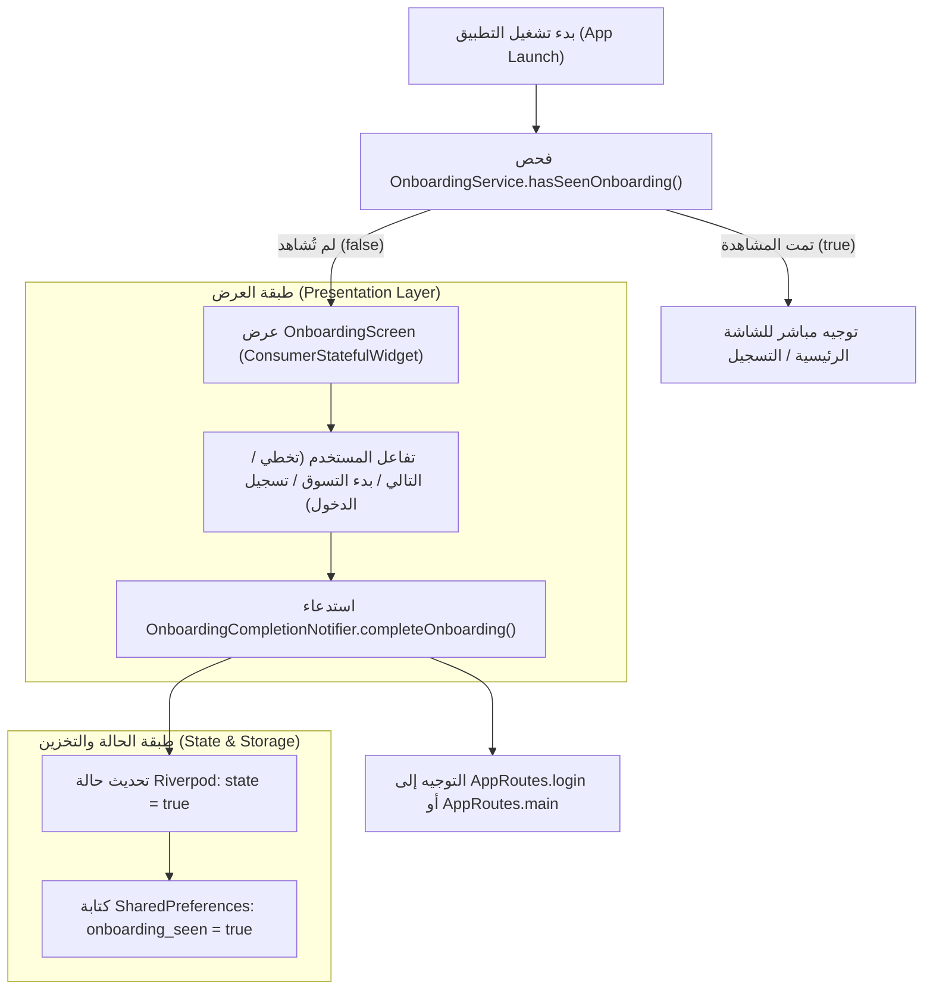

# وثيقة معمارية وحدة التهيئة وشاشات الترحيب
# 02 — ONBOARDING ARCHITECTURE: Persistent Application-Level State Pattern

- **المشروع:** متجر رونقك الإلكتروني (Rawnaquk E-Commerce)
- **المرحلة:** Phase 03 — Onboarding & Wishlist Migration
- **المسار:** `lib/modules/onboarding/`
- **حالة التوثيق:** معتمد ونهائي (APPROVED)

---

## 1. نظرة عامة على وحدة التهيئة (Module Overview)

تعد وحدة التهيئة (`Onboarding Module`) نقطة الاتصال الأولى للمستخدم الجديد مع تطبيق متجر رونقك، وتتولى المهام التالية:
1. استعراض القيم الجوهرية ومزايا المتجر عبر شرائح تقديمية تفاعلية جذابة تدعم اللغة العربية واتجاه اليمين لليسار (RTL).
2. إدارة حالة دائمة على مستوى التطبيق بالكامل (**Persistent Application-Level State**) تسجل ما إذا كان المستخدم قد أنهى أو تخطى شاشات الترحيب، لمنع ظهورها مجدداً في جلسات التشغيل اللاحقة.
3. التوجيه السلس إلى مسارات التطبيق اللاحقة (`/login` أو `/main`).

---

## 2. النمط المعماري لإدارة الحالة الدائمة (Persistent State Pattern)



### 2.1 كبسلة طبقة التخزين النقي (`OnboardingService`)
تم فصل التعامل مع `SharedPreferences` داخل كائن خدمة نقي وقابل للاختبار:
```dart
class OnboardingService {
  Future<bool> hasSeenOnboarding() async {
    final prefs = await SharedPreferences.getInstance();
    return prefs.getBool(LocalStorageKeys.onboardingSeen) ?? false;
  }

  Future<bool> markOnboardingAsSeen() async {
    final prefs = await SharedPreferences.getInstance();
    return prefs.setBool(LocalStorageKeys.onboardingSeen, true);
  }
}
```
- الميزة: سهولة الاستبدال أو المحاكاة (Mocking) في بيئة الاختبارات الآلية (`SharedPreferences.setMockInitialValues`).

### 2.2 موفر إكمال التهيئة (`onboardingCompletionProvider`)
يعتمد على `Notifier<bool>` صريح ومكتوب يدوياً:
```dart
class OnboardingCompletionNotifier extends Notifier<bool> {
  @override
  bool build() => false;

  Future<bool> completeOnboarding() async {
    final service = ref.read(onboardingServiceProvider);
    final saved = await service.markOnboardingAsSeen();
    if (saved) {
      state = true;
    }
    return saved;
  }
}
```

---

## 3. معمارية واجهة المستخدم ودورة الحياة النظيفة (Presentation & Lifecycle)

### 3.1 تصحيح إدارة دورة حياة عناصر الواجهة المؤقتة (Ephemeral UI Controllers)
في GetX القديم، كان يتم إنشاء `OnboardingUiController` للاحتفاظ بـ `pageIndex` و `PageController` في الذاكرة العامة دون تفريغ دوري للموارد.

في المعمارية المحدثة بـ Riverpod 3:
- تحولت الشاشة إلى [`ConsumerStatefulWidget`](file:///d:/project/laravel/app-rwnaqk/rwnaqk_frontend/lib/modules/onboarding/views/onboarding_view.dart).
- أصبحت الشاشة هي المالك الحقيقي لدورة حياة `PageController`:
  ```dart
  class _OnboardingScreenState extends ConsumerState<OnboardingScreen> {
    late final PageController _pageController;
    int _pageIndex = 0;

    @override
    void initState() {
      super.initState();
      _pageController = PageController();
    }

    @override
    void dispose() {
      _pageController.dispose();
      super.dispose();
    }
  }
  ```
- **الفائدة الهندسية:** التخلص التام من أي خطر لتسرب الذاكرة (Memory Leaks) عند مغادرة الشاشة.

### 3.2 دعم تجربة المستخدم (UI/UX Integrity)
- **RTL Arabic:** الحفاظ الكامل على التصميم العربي، والظلال المتقنة (`Neumorphic / Soft Shadow Badges`)، والتبديل بين الوضع الداكن والفاتح (`AppToggles`).
- **تفاعل النقاط (Dots Indicator):** حركة ناعمة وسريعة بانتقال المؤشر بمدة `220ms` ومنحنى `Curves.easeOut`.
- **أزرار الإجراءات:**
  - زر **تخطي (Skip)**: ينتقل فوراً للشريحة الأخيرة.
  - زر **التالي (Next)**: ينتقل للشريحة التالية.
  - زر **ابدأ الآن (Get Started)**: عند الوصول للشريحة الأخيرة، يكمل التهيئة وينتقل لصفحة التسجيل.
  - زر **لدي حساب بالفعل (Already Have Account)**: يكمل التهيئة وينتقل فوراً لصفحة التسجيل.

---

## 4. التحقق والاختبارات الآلية (Automated Verification)

تم فحص وحدة التهيئة وتغطيتها باختبارات آلية دقيقة في [`test/phase3_onboarding_wishlist_test.dart`](file:///d:/project/laravel/app-rwnaqk/rwnaqk_frontend/test/phase3_onboarding_wishlist_test.dart):
1. **اختبار خدمة التهيئة:** التحقق من شرائح العرض وحساب الشريحة الأخيرة.
2. **اختبار استمرارية التخزين:** التحقق من حفظ واسترجاع راية الإكمال في `SharedPreferences`.
3. **اختبار مزود Riverpod:** التحقق من استجابة `OnboardingCompletionNotifier` وتعديل حالته إلى `true`.
4. **اختبار دورة حياة عنصر الواجهة:** التحقق من رندرة الشاشة، التنقل بين الصفحات، الضغط على زر التخطي، والتفريغ النظيف (`dispose()`).
5. **اختبار زر تسجيل الدخول المباشر:** التحقق من تحديث حالة الإكمال والتنقل.

