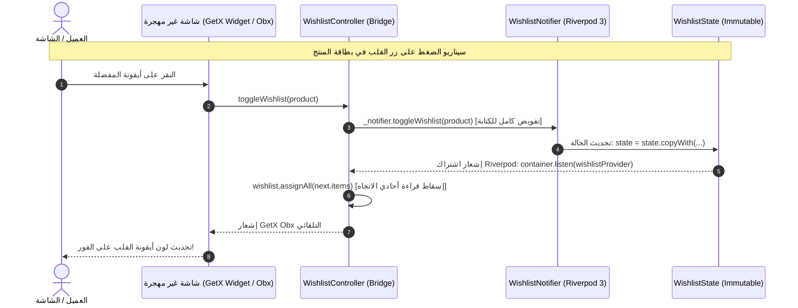

# وثيقة معمارية وحدة المفضلة وإستراتيجية الكاتب الأوحد
# 03 — WISHLIST ARCHITECTURE: Single-Writer Pattern & Cross-Screen State

- **المشروع:** متجر رونقك الإلكتروني (Rawnaquk E-Commerce)
- **المرحلة:** Phase 03 — Onboarding & Wishlist Migration
- **المسار:** `lib/modules/wishlist/`
- **حالة التوثيق:** معتمد ونهائي (APPROVED)

---

## 1. التحدي المعماري وإستراتيجية الحل (Architectural Challenge & Solution)

### 1.1 التحدي في متجر رونقك
تعتبر وحدة المفضلة (`Wishlist Module`) من أكثر وحدات التطبيق تشابكاً واستهلاكاً عبر شاشات المتجر المختلفة:
- تظهر حالة المفضلة داخل بطاقات المنتجات في شاشة الكتالوج (`ProductCardImageSection`).
- تظهر في شاشة تفاصيل المنتج (`ProductDetailsController`).
- تظهر في شاشة الرئيسية (`HomeScreen`).
- تظهر في شاشة المفضلة المخصصة (`WishlistScreen`).
- ترتبط بإجراءات السلة (`CartController.addToCart` و `addAllToCart`).

في مرحلة الهجرة التدريجية، من غير الممكن أو الآمن إعادة كتابة جميع تلك الشاشات دفعة واحدة (مخالفة لقواعد المشروع بعدم إجراء هجرة شاملة متعجلة). إذا تم ترك GetX و Riverpod يكتبان الحالة معاً، سيحدث **Split-Brain / Dual-Source-of-Truth** وسباق بيانات (Race Conditions) وتكرار غير منضبط.

### 1.2 الحل: نمط الكاتب الأوحد الحصري (The Strict Single-Writer Pattern)
تم اعتماد وتطبيق نمط هندسي صارم:
1. **Riverpod 3 هو المالك الأوحد الحصري لكتابة الحالة (Single Authoritative Writer):** كافة عمليات الإضافة والحذف والتفريغ وتغيير التبويبات تتم فقط عبر `WishlistNotifier` في Riverpod.
2. **تحويل كلاس GetX القديم إلى مهايئ توافقي أحادي الاتجاه (One-Way Reactive Projection Adapter):** يقوم `WishlistController` بتفويض كل عمليات الكتابة إلى Riverpod فوراً، بينما يستمع إلى تغيرات Riverpod ليحدّث قوائم `RxList` للقراءة فقط، مما يبقي شاشات GetX القديمة تعمل بتناغم تام دون أن تعلم بحدوث الهجرة خلف الكواليس.

---

## 2. مخطط تدفق البيانات والتفويض (Data Flow Architecture)



---

## 3. النموذج النقي للحالة (`WishlistState`)

يتميز نموذج الحالة [`WishlistState`](file:///d:/project/laravel/app-rwnaqk/rwnaqk_frontend/lib/modules/wishlist/models/wishlist_state.dart) بكونه كائناً نقياً وغير قابل للتعديل (Pure Immutable Value Object):

```dart
@immutable
class WishlistState {
  final List<HomeProductItem> items;
  final List<HomeProductItem> recentlyViewed;
  final int tabIndex;
  final RecentFilter recentFilter;
  final DateTime? selectedDate;
  final String? activeUserId;
  final int sessionGeneration;

  const WishlistState({
    this.items = const [],
    this.recentlyViewed = const [],
    this.tabIndex = 0,
    this.recentFilter = RecentFilter.today,
    this.selectedDate,
    this.activeUserId,
    this.sessionGeneration = 0,
  });

  bool isInWishlist(String id) => items.any((item) => item.id == id);
  int get count => items.length;
  bool get isEmpty => items.isEmpty;
  bool get isNotEmpty => items.isNotEmpty;
}
```

### مزايا هذا النموذج:
- **منع التعديل الجانبي المباشر:** القوائم الداخلية محفوظة عبر `List.unmodifiable` لمنع أي كود خارجي من التعديل على المصفوفة مباشرة.
- **تتبع نطاق الحساب:** الحقلين `activeUserId` و `sessionGeneration` يمنعان أي تسرب لبيانات عميل لعميل آخر.
- **تصفير صريح للحقول القابلة لـ null:** دعم `clearSelectedDate` و `clearActiveUserId` داخل دالة `copyWith` للتحكم الدقيق عند تسجيل الخروج أو مسح التواريخ.

---

## 4. تصميم جسر التوافقية ومهايئ القراءة (`WishlistController`)

تمت إعادة صياغة [`WishlistController`](file:///d:/project/laravel/app-rwnaqk/rwnaqk_frontend/lib/modules/wishlist/controllers/wishlist_controller.dart) ليعمل كـ Single-Writer Adapter:

```dart
class WishlistController extends GetxController {
  WishlistController([WishlistService? service, ProviderContainer? container])
      : _service = service ?? WishlistService(),
        _container = container;

  final ProviderContainer? _container;
  ProviderSubscription<dynamic>? _subscription;

  ProviderContainer get _effectiveContainer =>
      _container ?? globalProviderContainer;

  WishlistNotifier get _notifier =>
      _effectiveContainer.read(wishlistProvider.notifier);

  /// إسقاط قراءة تفاعلي متزامن أحادي الاتجاه من Riverpod
  final RxList<HomeProductItem> wishlist = <HomeProductItem>[].obs;
  final RxList<HomeProductItem> recentlyViewed = <HomeProductItem>[].obs;

  @override
  void onInit() {
    super.onInit();
    _bindToRiverpod();
  }

  void _bindToRiverpod() {
    final container = _effectiveContainer;
    final initial = container.read(wishlistProvider);
    wishlist.assignAll(initial.items);
    recentlyViewed.assignAll(initial.recentlyViewed);

    _subscription = container.listen(
      wishlistProvider,
      (previous, next) {
        wishlist.assignAll(next.items);
        recentlyViewed.assignAll(next.recentlyViewed);
      },
      fireImmediately: false,
    );
  }

  @override
  void onClose() {
    _subscription?.close();
    _subscription = null;
    super.onClose();
  }

  /// يقرأ من الإسقاط التفاعلي لتسجيل مستمعي Obx في GetX
  bool isInWishlist(String id) {
    return wishlist.any((item) => item.id == id);
  }

  /// تفويض كامل للكتابة إلى Riverpod
  void toggleWishlist(HomeProductItem item) => _notifier.toggleWishlist(item);
  void removeFromWishlist(String id) => _notifier.removeFromWishlist(id);
  void clearWishlist() => _notifier.clearWishlist();
  void addAllToCart() => _notifier.addAllToCart();
}
```

### معالجة خطأ GetX الشائع (Improper use of GetX / Obx):
عندما تغلف بطاقة المنتج أيقونة المفضلة داخل ويدجت `Obx()`، يشترط GetX قراءة متغير تفاعلي (`.obs`) واحد على الأقل داخل دالة البناء. لو كانت `isInWishlist(id)` تقرأ مباشرة من حاوية Riverpod لكانت قيمة غير تفاعلية بالنسبة لـ GetX مما يفجر استثناء وقت التشغيل. بقراءة `wishlist.any((item) => item.id == id)`، يسجل `Obx` اشتراكه في قائمة `RxList` المتزامنة تلقائياً من Riverpod.

---

## 5. شاشات وحدة المفضلة المهجرة إلى `ConsumerWidget`

تم تحويل شاشات وقطع وحدة المفضلة بالكامل إلى ويدجتس Riverpod 3 نقية:
1. [`WishlistScreen`](file:///d:/project/laravel/app-rwnaqk/rwnaqk_frontend/lib/modules/wishlist/views/wishlist_view.dart): تقرأ الحالة عبر `ref.watch(wishlistProvider)`، وتعرض الحالة الفارغة أو قوائم المنتجات وسجل المشاهدة بسلاسة.
2. [`WishlistTopBar`](file:///d:/project/laravel/app-rwnaqk/rwnaqk_frontend/lib/modules/wishlist/widgets/wishlist_top_bar.dart): يعرض عدادات المفضلة والتبويبات وينفذ التنقل بين التبويبات عبر `notifier.setTab(index)`.
3. [`RecentFilterRow`](file:///d:/project/laravel/app-rwnaqk/rwnaqk_frontend/lib/modules/wishlist/widgets/recent_filter_row.dart): فلترة المشاهدة الأخيرة حسب اليوم أو الأمس أو تاريخ مخصص.
4. [`WishlistTabAnimatedBody`](file:///d:/project/laravel/app-rwnaqk/rwnaqk_frontend/lib/modules/wishlist/widgets/wishlist_tab_animated_body.dart): التبديل المتحرك بين قائمة الأمنيات وسجل المشاهدة.

---

## 6. استراتيجية الإزالة النهائية لـ GetX مستقبلاً (Phase 09 Readiness)

بفضل هذا النمط:
- عندما يتم ترحيل وحدات الكتالوج (Phase 06) وتفاصيل المنتج والسلة (Phase 07) إلى Riverpod، سيتم استبدال قراءة `WishlistController` في تلك الشاشات بـ `ref.watch(wishlistProvider)`.
- عند الوصول إلى المرحلة النهائية **Phase 09**، سيتم حذف ملف `WishlistController.dart` بحركة واحدة دون أي تعديل على `wishlist_providers.dart` أو شاشة `WishlistScreen`.

