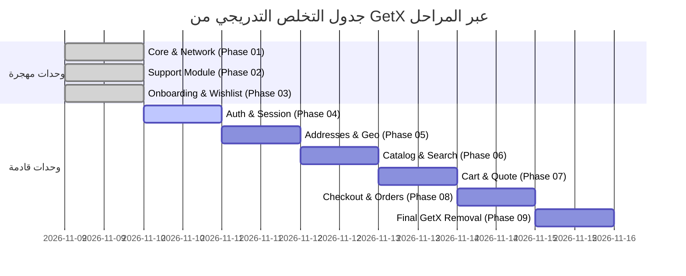

# مصفوفة التخلص من GetX ومتابعة الترحيل
# 04 — GETX REMOVAL MATRIX: Onboarding & Wishlist Modules

- **المشروع:** متجر رونقك الإلكتروني (Rawnaquk E-Commerce)
- **المرحلة:** Phase 03 — Onboarding & Wishlist Migration
- **تاريخ التحديث:** 9 نوفمبر 2026
- **الحالة:** معتمد ومنفذ (EXECUTED)

---

## 1. ملخص حالة التخلص من GetX في المرحلة 03 (Executive Disposition Summary)

شهدت المرحلة 03 تطبيق نهج دقيق للتعامل مع ملفات GetX:
- **الحذف الكامل والفوري للمتحكمات الزائدة:** تم حذف متحكمات التهيئة بالكامل لأنها لم تكن مطلوبة من أي وحدة أخرى.
- **الاحتفاظ بالهياكل الفارغة لسلامة الروابط (Preserved Shells):** تم تفريغ كائن الربط `OnboardingBinding` مع الحفاظ على الكلاس لتجنب كسر `app_pages.dart`.
- **التحويل إلى مهايئ توافقي (Single-Writer Adapter):** تم الإبقاء على `WishlistController` كمهايئ متزامن للقراءة لتغذية شاشات الكتالوج والرئيسية التي لم تهاجر بعد، مع سلب أي صلاحية كتابة منه وإسنادها كلياً إلى Riverpod.
- **الحفاظ على التنقل والترجمة:** الإبقاء على `Get.toNamed` / `Get.offAllNamed` ومفاتيح الترجمة `.tr` وفقاً لقرارات المرحلة 00 وحتى المرحلة 09.

---

## 2. مصفوفة المكونات التفصيلية (Detailed Artifact Disposition Matrix)

| اسم المكون القديم | المسار الأصلي | الحالة في المرحلة 03 | البديل الجديد في Riverpod 3 | ملاحظات وأسباب القرار |
|---|---|---|---|---|
| `OnboardingController` | `lib/modules/onboarding/controllers/onboarding_controller.dart` | **محذوف نهائياً (DELETED)** | `OnboardingCompletionNotifier` في [`onboarding_providers.dart`](file:///d:/project/laravel/app-rwnaqk/rwnaqk_frontend/lib/modules/onboarding/providers/onboarding_providers.dart) | تم حذفه بأمان عبر `git rm` لعدم وجود مستهلكين خارج وحدة التهيئة. |
| `OnboardingUiController` | `lib/modules/onboarding/controllers/onboarding_ui_controller.dart` | **محذوف نهائياً (DELETED)** | دورة حياة محلية `State` داخل [`OnboardingScreen`](file:///d:/project/laravel/app-rwnaqk/rwnaqk_frontend/lib/modules/onboarding/views/onboarding_view.dart) | أصبحت الشاشة تدير `PageController` و `_pageIndex` مباشرة وتفرغهما بـ `dispose()`. |
| `OnboardingBinding` | `lib/modules/onboarding/bindings/onboarding_binding.dart` | **مفرغ (EMPTIED SHELL)** | مزودات Riverpod الصريحة | تم مسح تسجيلات `Get.lazyPut` والإبقاء على الكلاس فارغاً لضمان عمل مسار `AppRoutes.onboarding`. |
| `OnboardingScreen` | `lib/modules/onboarding/views/onboarding_view.dart` | **مهاجر بالكامل (MIGRATED)** | `ConsumerStatefulWidget` | استبدال `GetView<OnboardingController>` بويدجت Riverpod النقي. |
| `WishlistController` | `lib/modules/wishlist/controllers/wishlist_controller.dart` | **محول لمهايئ (ADAPTER)** | [`WishlistNotifier`](file:///d:/project/laravel/app-rwnaqk/rwnaqk_frontend/lib/modules/wishlist/providers/wishlist_providers.dart) ككاتب أوحد، والكنترولر كجسر قراءة | تم تحويله إلى مهايئ تفويض أحادي الاتجاه لإبقاء شاشات الكتالوج والبطاقات متزامنة دون كسرها. |
| `WishlistScreen` | `lib/modules/wishlist/views/wishlist_view.dart` | **مهاجر بالكامل (MIGRATED)** | `ConsumerWidget` مع `ref.watch(wishlistProvider)` | لم تعد تعتمد على GetX إطلاقاً لإدارة حالتها. |
| `WishlistTopBar` | `lib/modules/wishlist/widgets/wishlist_top_bar.dart` | **مهاجر بالكامل (MIGRATED)** | `ConsumerWidget` مع `notifier.setTab()` | يقرأ عداد المفضلة والتبويبات من حالة Riverpod مباشرة. |
| `RecentFilterRow` | `lib/modules/wishlist/widgets/recent_filter_row.dart` | **مهاجر بالكامل (MIGRATED)** | `ConsumerWidget` مع `notifier.setRecentFilter()` | يدير فلاتر الأيام والتواريخ عبر Riverpod. |
| `WishlistTabAnimatedBody` | `lib/modules/wishlist/widgets/wishlist_tab_animated_body.dart` | **مهاجر بالكامل (MIGRATED)** | `ConsumerWidget` مع دعم تمرير الكنترولر اختيارياً | يعرض محتوى التبويبات بحرية تامة دون التبعية الإجبارية لـ GetX. |
| `WishlistUiController` | `lib/modules/wishlist/controllers/wishlist_ui_controller.dart` | **مبقاة مؤقتاً (TEMPORARY BRIDGE)** | حالة `WishlistState` المدمجة | مبقاة فقط لدعم الخصائص التوافقية `controller.ui.tabIndex` لبعض الويدجتس غير المهجرة. |
| `WishlistBinding` | `lib/modules/wishlist/bindings/wishlist_binding.dart` | **مبقى مؤقتاً (TEMPORARY)** | مزودات Riverpod | يسجل `WishlistController` الجسر التوافقي عند دخول المسار. |

---

## 3. مصفوفة الاستخدامات المتبقية لـ GetX وجدول إزالتها

### خطة الإزالة في المراحل اللاحقة:
1. **في Phase 06 (الكتالوج والبحث):**
   - تعديل `ProductCardImageSection` و `ProductDetailsController` لتقرأ مباشرة من `ref.watch(wishlistProvider)` وتستدعي `ref.read(wishlistProvider.notifier).toggleWishlist()`.
2. **في Phase 07 (السلة والطلب):**
   - ربط `WishlistNotifier.addAllToCart()` بمزود السلة المباشر في Riverpod والتخلص من استدعاء `Get.find<CartController>()`.
3. **في Phase 09 (التطهير النهائي):**
   - حذف كلاس `WishlistController` نهائياً.
   - حذف كلاس `WishlistUiController` نهائياً.
   - حذف كلاس `WishlistBinding` و `OnboardingBinding`.
   - استبدال `GetMaterialApp` بـ `MaterialApp` واستبدال نظام الملاحة بـ `GoRouter` أو الملاح الافتراضي، وإزالة حزمة `get` من `pubspec.yaml`.

