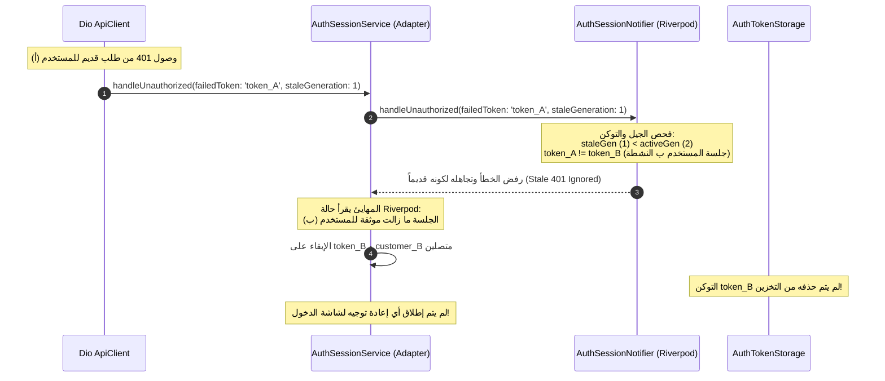

# تصحيحات جسر الجلسات وتفويض الكاتب الأوحد
# 02 — SESSION BRIDGE CORRECTIONS: Single-Writer Enforcement & Pipeline Fixes

- **المشروع:** متجر رونقك الإلكتروني (`Rawnaquk E-Commerce`)
- **المرحلة:** Phase 04.1 — Security Gate & Vulnerability Closure
- **تاريخ التوثيق:** 9 نوفمبر 2026
- **الحالة:** تم التصحيح والتأكيد بنجاح 100% (REMEDIATED & VERIFIED)

---

## 1. مقارنة الشيفرات البرمجية قبل وبعد التصحيح (Code Corrections)

### 1.1 دالة `handleUnauthorized` في [`AuthSessionService`](file:///d:/project/laravel/app-rwnaqk/rwnaqk_frontend/lib/core/services/auth/auth_session_service.dart)

```dart
// قبل التصحيح (معيب وكان يسبب تدمير جلسة المستخدم الجديد):
Future<void> handleUnauthorized({String? failedToken}) async {
  ...
  await _tokenStorage.clearToken();
  token.value = null;
  customer.value = null;
  _onSessionTerminated?.call();
  await _notifier.handleUnauthorized(failedToken: failedToken);
}

// بعد التصحيح المعماري الصارم:
Future<void> handleUnauthorized({
  String? failedToken,
  int? staleGeneration,
}) async {
  if (_isHandlingUnauthorized) {
    return;
  }

  _isHandlingUnauthorized = true;
  try {
    // 1. تفويض المعالجة بالكامل وبشكل صارم إلى نوتيفاير Riverpod (الكاتب الأوحد)
    await _notifier.handleUnauthorized(
      failedToken: failedToken,
      staleGeneration: staleGeneration,
    );

    // 2. مزامنة حالة الإسقاط المحلي حصراً من نوتيفاير Riverpod بعد المعالجة
    final currentRiverpodState =
        _effectiveContainer.read(authSessionProvider);
    token.value = currentRiverpodState.token;
    requiresEmailVerification.value =
        currentRiverpodState.requiresEmailVerification;
    customer.value = currentRiverpodState.customer;
    isGuestMode.value = currentRiverpodState.isGuest;

    // 3. مسح التخزين الممرر للمهايئ فقط إذا كانت الجلسة قد انتهت فعلياً في Riverpod
    if (!currentRiverpodState.isAuthenticated) {
      await _tokenStorage.clearToken();
    }
  } finally {
    _isHandlingUnauthorized = false;
  }
}
```

---

## 2. التقاط رقم الجيل والتوكن لحظة إنشاء الطلب في [`ApiClient`](file:///d:/project/laravel/app-rwnaqk/rwnaqk_frontend/lib/core/network/api_client.dart)

تم تحديث اعتراض الطلبات لتسجيل السياق الزمني للطلب:
```dart
onRequest: (options, handler) async {
  // التقاط رقم جيل الجلسة اللحظي عند الإنشاء
  if (getSessionGeneration != null) {
    options.extra['requestSessionGeneration'] = getSessionGeneration?.call();
  }

  if (!options.headers.containsKey('Authorization')) {
    final token = await _tokenStorage.readToken();
    if (token != null && token.isNotEmpty) {
      options.headers['Authorization'] = 'Bearer $token';
      options.extra['requestToken'] = token;
    }
  } else {
    final authHeader = options.headers['Authorization'] as String?;
    if (authHeader != null && authHeader.startsWith('Bearer ')) {
      options.extra['requestToken'] = authHeader.substring(7).trim();
    }
  }
  return handler.next(options);
}
```

وعند استلام 401:
```dart
case 401:
  final failedToken = ... ?? error.requestOptions.extra['requestToken'];
  final requestGen = error.requestOptions.extra['requestSessionGeneration'];
  onUnauthorizedWithDetails?.call(failedToken, requestGen);
```

---

## 3. مخطط تسلسل معالجة الخطأ القديم بعد الإصلاح (Fixed Sequence Diagram)



