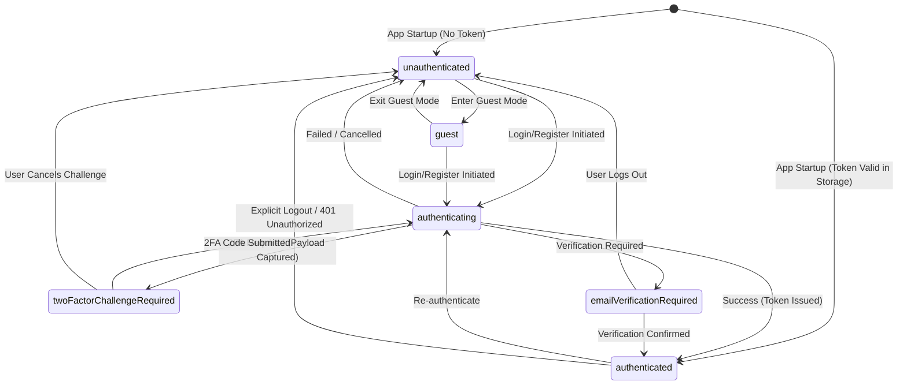
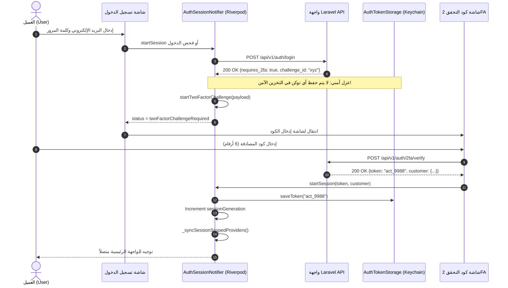
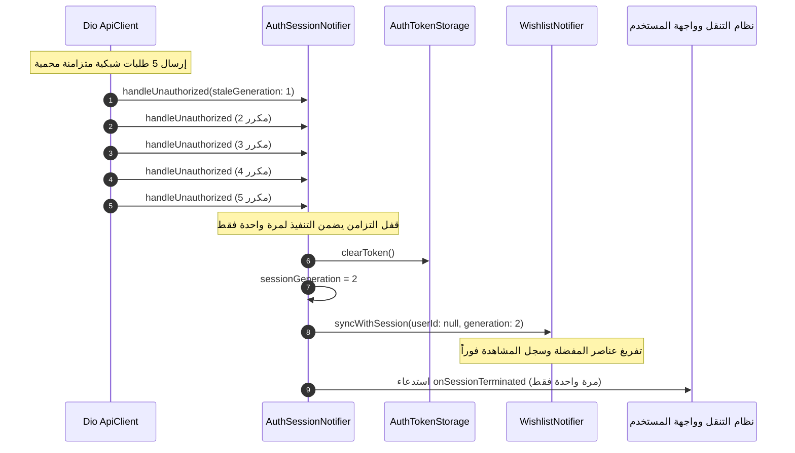

# معمارية المصادقة وإدارة الجلسات في Riverpod 3
# 02 — AUTH & SESSION ARCHITECTURE: State Machine, Lifecycle & Scoping

- **المشروع:** متجر رونقك الإلكتروني (Rawnaquk E-Commerce)
- **المرحلة:** Phase 04 — Authentication & Session Migration to Riverpod 3.5.0
- **تاريخ التوثيق:** 9 نوفمبر 2026
- **الحالة:** مكتمل ومتحقق منه برمجياً بنسبة 100% (VERIFIED)
- **المهندس المسؤول:** مهندس المعمارية الرئيسي ومسؤول ترحيل النظم (Principal Flutter Architect)

---

## 1. نظرة عامة ومعمارية الجلسة الموحدة (Architectural Overview)

في بنية متجر رونقك الحديثة بـ Riverpod 3.5.0، تم تأسيس نموذج موحد أحادي المصدر لإدارة الجلسة (`Single Source of Truth`). يُلغي هذا النموذج أي تشتت أو ازدواجية في إدارة الرموز المميزة (`Tokens`)، أو هوية العميل، أو حالات تسجيل الدخول بين GetX و Riverpod.

تتحكم فئة [`AuthSessionNotifier`](file:///d:/project/laravel/app-rwnaqk/rwnaqk_frontend/lib/core/services/auth/providers/auth_session_providers.dart) الحصرية في كافة عمليات دورة حياة الجلسة (`Bootstrap`, `Login`, `2FA Challenge`, `Guest Mode`, `Logout`, `401 Invalidation`)، وتصدر كائن حالة غير قابل للتعديل [`AuthSessionState`](file:///d:/project/laravel/app-rwnaqk/rwnaqk_frontend/lib/core/services/auth/models/auth_session_state.dart).

```
+------------------------------------------------------------------------------+
|                           Riverpod 3.5.0 Domain                              |
|                                                                              |
|  +------------------------+             +---------------------------------+  |
|  |   AuthSessionNotifier  |<----------->|      AuthTokenStorage           |  |
|  |  (Single-Writer Owner) |             |  (FlutterSecureStorage Wrapper) |  |
|  +-----------+------------+             +---------------------------------+  |
|              |                                                               |
|              v Emits (Immutable)                                             |
|  +-----------------------------------------------------------------------+   |
|  |  AuthSessionState                                                     |   |
|  |  - status: AuthSessionStatus (6 States)                               |   |
|  |  - token: String? (Protected, not leaked on 2FA)                      |   |
|  |  - customer: Customer?                                                |   |
|  |  - twoFactorPayload: TwoFactorChallengePayload?                       |   |
|  |  - sessionGeneration: int (Monotonic counter)                         |   |
|  |  - customerId: String?                                                |   |
|  +-----------------------------------------------------------------------+   |
|              |                                                               |
+--------------|---------------------------------------------------------------+
               | One-Way Sync via Listener
               v
+------------------------------------------------------------------------------+
|                         Downstream Consumers                                 |
|                                                                              |
|  1. Session-Scoped Riverpod Notifiers                                        |
|     - WishlistNotifier.syncWithSession(userId, generation)                   |
|     - (Future) CartNotifier, CheckoutNotifier                                |
|                                                                              |
|  2. Legacy GetX Bridge Adapter                                               |
|     - AuthSessionService (Facade delegating all writes to Riverpod)          |
|     - GetX Views / Controllers consume reactive getters & stream             |
+------------------------------------------------------------------------------+
```

---

## 2. آلة الحالة المحدودة للجلسة (Finite State Machine - FSM)

تم تصميم دورة حياة الجلسة كآلة حالة واضحة وحتمية خالية من الحالات البينية غير الآمنة عبر تعداد `AuthSessionStatus`:



### توصيف حالات الجلسة (Status Specifications):
1. **`unauthenticated`:** حالة البدء الافتراضية عند عدم وجود توكن في التخزين الآمن، أو بعد إنهاء جلسة مستخدم. التوكن وبيانات العميل تساوي `null`.
2. **`authenticating`:** حالة قيد التنفيذ أثناء انتظار استجابة خادم Laravel لمصادقة بيانات الدخول أو التسجيل أو فحص كود 2FA.
3. **`guest`:** وضع الزائر المخصص لتصفح المتجر وإضافة المنتجات للمعاينة، مع `customerId = null` و `isAuthenticated = false`.
4. **`twoFactorChallengeRequired`:** حالة أمنية مؤقتة خاصة بالتحقق بخطوتين. **يُمنع منعاً باتاً تخزين أي توكن أو منحه في هذه الحالة**، وتحتفظ الحالة بـ `TwoFactorChallengePayload` المعزول.
5. **`emailVerificationRequired`:** حالة وسيطة عند تفعيل التحقق من البريد في واجهة برمجة Laravel (`must_verify_email`).
6. **`authenticated`:** الجلسة النشطة الكاملة المعتمدة. تحتوي على التوكن الموثق، وبيانات العميل، وتتمتع بكامل صلاحيات الطلب والتسوق.

---

## 3. تدفقات الجلسة ومخططات التسلسل (Sequence Diagrams)

### 3.1 تدفق المصادقة عبر التحقق بخطوتين (2FA Challenge & Token Isolation Flow)



---

### 3.2 معالجة انتهاء الجلسة واستقبال 401 المتزامن (Concurrent 401 & Monotonic Invalidation)



---

## 4. المزودات الصريحة الخالية من التوليد الآلي (Handwritten Riverpod Providers)

تمت كتابة وتوثيق المزودات صراحةً دون الاعتماد على `build_runner` أو `riverpod_generator`:

```dart
/// مزود خدمة إدارة الجلسة الموحدة في التطبيق
final authSessionProvider =
    NotifierProvider<AuthSessionNotifier, AuthSessionState>(
  AuthSessionNotifier.new,
);

/// مزود خدمة تسجيل الدخول
final loginServiceProvider = Provider<LoginService>((ref) {
  final api = ref.watch(apiClientProvider);
  return LoginService(api);
});

/// مزود خدمة إنشاء الحساب الجديد
final registerServiceProvider = Provider<RegisterService>((ref) {
  final api = ref.watch(apiClientProvider);
  return RegisterService(api);
});

/// مزود خدمة استعادة كلمة المرور
final forgotPasswordServiceProvider = Provider<ForgotPasswordService>((ref) {
  final api = ref.watch(apiClientProvider);
  return ForgotPasswordService(api);
});
```

---

## 5. مزامنة الوحدات المعتمدة على نطاق الجلسة (Session Scoping)

في دالة `_syncSessionScopedProviders` التابعة لـ `AuthSessionNotifier`، يتم استدعاء المزودات المعتمدة على نطاق الجلسة لحظياً:

```dart
void _syncSessionScopedProviders(String? customerId, int generation) {
  try {
    ref.read(wishlistProvider.notifier).syncWithSession(
          userId: customerId,
          generation: generation,
        );
  } catch (_) {
    // تجاهل الاستدعاء الآمن في بيئات الاختبار المعزولة التي لا تحتوي على مزود المفضلة
  }
}
```

يضمن هذا الربط الآلي أن أي تسجيل دخول أو خروج أو انتهاء جلسة ينعكس فوراً على كافة الموديلات المعتمدة (مثل المفضلة، وسلة التسوق، وعناوين الشحن) دون الحاجة لتدخل يدوي من وحدات الواجهة.

