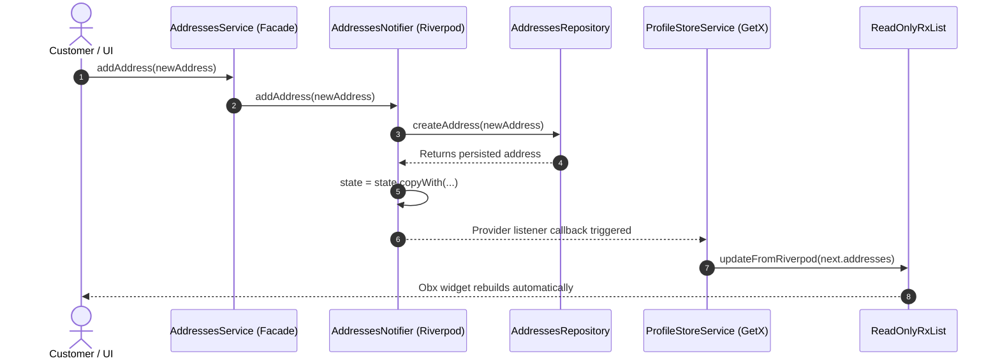

# Address Bridge & Single-Writer Protection

## 1. Context and Problem Statement

In the modular migration from GetX to Riverpod 3.5.0, legacy widgets (e.g., checkout address selection, profile settings) observe customer addresses via `ProfileStoreService.addresses`. 

Prior to Phase 05.1, `ProfileStoreService.addresses` was declared as:
```dart
final addresses = <ShippingAddress>[].obs;
```
Because `RxList<T>` exposes all mutating methods (`add`, `addAll`, `remove`, `removeAt`, `clear`, `assignAll`, `[]=`), any legacy widget or service could inadvertently execute:
```dart
profileStore.addresses.clear();
profileStore.addresses.add(newAddress);
```
Such direct mutations completely bypassed Riverpod's `AddressesNotifier` and its remote repository syncing, producing:
1. Split-brain state between Riverpod and GetX.
2. Silent failure of Laravel API persistence.
3. Loss of synchronization with session lifecycle events.

---

## 2. Solution: `ReadOnlyRxList<E>` Implementation

To reconcile GetX reactive UI compatibility (`Obx`, `ever`) with Riverpod's strict Single-Writer authority, `ReadOnlyRxList<E>` was engineered in `lib/modules/customer/controllers/profile_store_service.dart`:

```dart
class ReadOnlyRxList<E> extends RxList<E> {
  ReadOnlyRxList([List<E>? initial]) : super(initial ?? <E>[]);

  bool _isInternalSync = false;

  void updateFromRiverpod(Iterable<E> newElements) {
    _isInternalSync = true;
    try {
      value = List<E>.from(newElements);
    } finally {
      _isInternalSync = false;
    }
  }

  void _assertWrite(String op) {
    if (!_isInternalSync) {
      throw UnsupportedError(
        'Direct mutation ($op) on ProfileStoreService.addresses is prohibited by the Single-Writer pattern. '
        'Address state must be modified through AddressesNotifier in Riverpod.',
      );
    }
  }

  @override
  void operator []=(int index, E val) {
    _assertWrite('[]=');
    super[index] = val;
  }

  @override
  void add(E element) {
    _assertWrite('add');
    super.add(element);
  }

  @override
  void clear() {
    _assertWrite('clear');
    super.clear();
  }
  // All mutating methods override with _assertWrite ...
}
```

### Key Technical Attributes:
- **Reactive Stream Integrity**: Extends `RxList<E>` directly, ensuring full compatibility with GetX `Obx`, `ever`, and reactive bindings.
- **Atomic Single-Notification Sync**: `updateFromRiverpod` leverages `value = List<E>.from(newElements)`, triggering a single atomic notification instead of sequential `clear()` + `addAll()` emissions.
- **Fail-Fast Defense**: Any unauthorized write from legacy code throws an explicit `UnsupportedError` with explanatory diagnostic text.

---

## 3. Delegation Flow



---

## 4. Automated Test Validation

The single-writer enforcement is validated in `test/phase5_1_hardening_test.dart`:
- Direct `add()`, `clear()`, `assignAll()`, `removeAt()`, and `[]=` throws `UnsupportedError`.
- Authorized mutations via `container.read(addressesProvider.notifier).setAddresses(...)` update the projection smoothly.
- `ever<List<ShippingAddress>>` triggers exactly once per Riverpod state emission.

