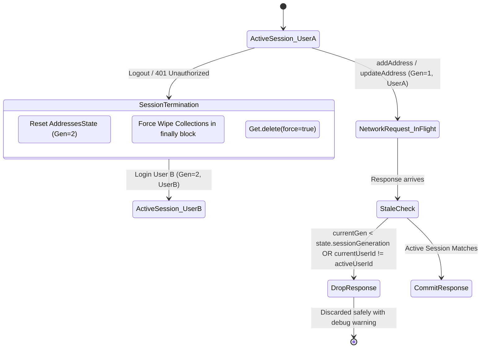

# Session Isolation, Stale Mutation Dropping & Cache Fencing

## 1. Concurrency Risks in Cross-Account Transitions

In mobile e-commerce applications, customer session changes can race against in-flight network requests. If User A initiates an address update over a slow or flaky network, logs out, and User B logs in, the late-arriving HTTP response for User A must never mutate User B's state.

Furthermore, if error handling in legacy GetX controller teardown fails (e.g. throwing an unhandled exception during `clearCart()`), private customer data can linger in memory and be accessed by retained widget references.

---

## 2. Implemented Defense Mechanisms

### A. Generation & Active User Fencing in `AddressesNotifier`
Every mutating method (`addAddress`, `updateAddress`, `deleteAddress`, `setDefaultAddress`) captures:
1. `currentGen`: the generation counter at call initiation.
2. `currentUserId`: the customer ID at call initiation.

Upon awaiting network completion or handling errors in `catch`, the notifier verifies:
```dart
if (currentGen < state.sessionGeneration ||
    (currentUserId != null && currentUserId != state.activeUserId)) {
  debugPrint('[AddressesNotifier] Stale mutation response rejected for old session.');
  return;
}
```
If the generation has incremented or the active user ID has changed, the response is discarded silently without polluting the active session state.

### B. Aggressive Cache Fencing in `_purgeLegacyGetXStores`
In `AuthSessionNotifier._purgeLegacyGetXStores()`, clearing operations for non-migrated controllers (`CartController`, `OrdersController`) are wrapped in `try/finally` blocks:

```dart
if (Get.isRegistered<CartController>()) {
  final cart = Get.find<CartController>();
  try {
    cart.clearCart();
  } finally {
    // Guarantees zero residual data even if clearCart() throws
    cart.cartItems.clear();
    cart.itemQuantities.clear();
    cart.itemVariantTexts.clear();
    cart.itemRatings.clear();
    cart.itemReviewsCounts.clear();
    cart.shippingAddress.value = ShippingAddress.empty();
  }
}
```
If an exception occurs within `clearCart()`, the `finally` block executes unconditionally, purging all collections from memory before triggering a forced eviction (`Get.delete<CartController>(force: true)`).

---

## 3. Session Transition Architecture



---

## 4. Automated Verification Results

In `test/phase5_1_hardening_test.dart`:
- `User A delayed updateAddress is rejected if session switches to User B`: **PASSED**.
- `User A delayed deleteAddress is rejected under User B session`: **PASSED**.
- `Widget retaining controller reference cannot access stale private items even on clearCart failure`: **PASSED**.

