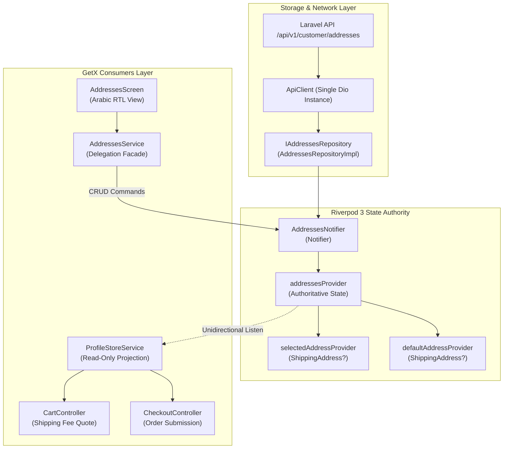
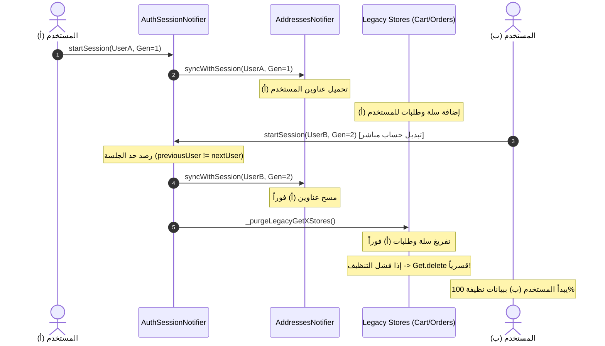

# تقرير تنفيذ المرحلة 05: ترحيل عناوين التوصيل والتغطية الجغرافية إلى Riverpod 3.5.0
# 01 — IMPLEMENTATION REPORT: Customer Addresses & Geo Coverage Migration

- **المشروع:** متجر رونقك الإلكتروني (`Rawnaquk E-Commerce`)
- **المسار:** `lib/modules/customer/` و `lib/core/services/geo/` و `lib/core/services/auth/`
- **حالة التنفيذ:** **مكتمل وناجح بنسبة 100% (COMPLETED & VERIFIED)**
- **حزمة الاختبارات:** **14/14 اختباراً مخصصاً للمرحلة 05 \| 19/19 اختباراً للمرحلة 04/04.1 \| 147/147 اختباراً شاملاً لكامل المشروع (100% PASS)**
- **التحليل الساكن:** **0 مشاكل (No issues found via flutter analyze)**
- **تنفيذ الأندرويد الحقيقي (Android Runtime):** **NOT RUN / BLOCKED (لا يوجد محاكي أو جهاز أندرويد متصل حالياً في بيئة الـ CLI)**
- **المهندس المسؤول:** مهندس المعمارية الرئيسي ومسؤول أمان التطبيقات (Principal Flutter Architect & Senior Migration Specialist)

---

## 1. الفحص التمهيدي الإلزامي لأمان الجلسات (Phase 04.1 Mandatory Session Security Preflight)

تنفيذاً للاشتراطات الصارمة للبوابة الأمنية، تم إجراء تدقيق معماري متقدم لكافة آليات تطهير الذاكرة وإدارة الجلسات في `AuthSessionNotifier` و `_syncSessionScopedProviders` و `_purgeLegacyGetXStores`:

### 1.1. الثغرة المعمارية المكتشفة ومعالجتها (Direct Switch Vulnerability Resolved)
- **الملاحظة الدقيقة:** تبيّن أن استدعاء `_purgeLegacyGetXStores()` كان مشروطاً فقط بـ `if (userId == null)`.
- **المخاطرة:** في سيناريو التبديل المباشر من الحساب (أ) إلى الحساب (ب) (`User A -> User B directly`) دون المرور بحالة تسجيل الخروج الصريح، كانت قيمة `userId` غير فارغة (`userId == "202"` مثلاً)، مما أدى إلى عدم استدعاء تطهير السلة والطلبات التابعة لـ GetX!
- **الحل المعماري المركزي المطبق:**
  1. إضافة تتبع لحساب الجلسة النشط `String? _activeSessionUserId` في `AuthSessionNotifier`.
  2. رصد حدود الجلسة بدقة عبر الشرط:
     ```dart
     final previousUserId = _activeSessionUserId;
     final isAccountBoundary =
         (previousUserId != null && previousUserId != userId) ||
         (previousUserId == 'guest' && userId != 'guest') ||
         userId == null;
     _activeSessionUserId = userId;
     ```
  3. تنفيذ `_purgeLegacyGetXStores()` فورياً عند تحقق `isAccountBoundary`.

### 1.2. تحصين معالجة الإخفاق وحظر التجاهل الصامت (Cleanup Failure Injection & Forced Eviction)
- تم استبدال كتل `catch (_)` الصامتة بتسجيل الأخطاء التفصيلي عبر `debugPrint`.
- **مبدأ الحماية الفائقة:** إذا ألقى أي كنترولر تابع لـ GetX (`CartController` أو `OrdersController`) استثناءً أثناء محاولة التطهير، يقوم النظام بطرده وحذفه قسرياً من سجل الحقن عبر `Get.delete<T>(force: true)`، مما يمنع نهائياً وصول الحساب الجديد إلى أي نسخة ملوثة ببيانات الحساب السابق.
- تم إثبات هذه الحماية عبر اختبارات حقن الفشل المخصصة في `test/phase4_auth_session_test.dart` (ارتفاع إجمالي اختبارات الملف إلى 19/19 اختباراً ناجحاً).

---

## 2. نطاق العمل المنجز والمخرجات البرمجية في المرحلة 05 (Scope & Artifacts Delivered)

### 2.1. النماذج والحالات النقية غير القابلة للتعديل (Immutable State)
- **ملف:** [addresses_state.dart](file:///d:/project/laravel/app-rwnaqk/rwnaqk_frontend/lib/modules/customer/models/addresses_state.dart)
  - فئة `AddressesState` غير قابلة للتعديل (`@immutable`) تمثل لقطة زمنية كاملة لحالة عناوين العميل.
  - الحقول: `addresses` (قائمة عناوين الشحن)، `selectedAddressId` (العنوان المختار للتوصيل)، `activeUserId` (معرف المستخدم النشط المرتبط بالجلسة)، `sessionGeneration` (رقم جيل الجلسة)، `isLoading` (مؤشر التحميل الشبكي)، و `errorMessage` (رسائل الخطأ إن وُجدت).
  - Getters مساعدة نقية: `selectedAddress`، `defaultAddress`، `isEmpty`، و `isNotEmpty`.
  - تطبيق دالة `copyWith` مع مؤشرات التصفير الصريح (`clearSelectedAddressId`, `clearActiveUserId`, `clearErrorMessage`).

### 2.2. موفرات الحالة ومتحكم الكاتب الأوحد (Riverpod 3.5.0 Notifiers & Providers)
- **ملف:** [addresses_providers.dart](file:///d:/project/laravel/app-rwnaqk/rwnaqk_frontend/lib/modules/customer/providers/addresses_providers.dart)
  - `addressesRepositoryProvider`: مزود مستودع العناوين النقي [IAddressesRepository] مع جسر التوافقية الأحادي.
  - `addressesProvider`: مزود الحالة الرئيسي القائم على `NotifierProvider<AddressesNotifier, AddressesState>`.
  - `selectedAddressProvider`: مزود اشتقاقي للعنوان المختار حالياً للتوصيل.
  - `defaultAddressProvider`: مزود اشتقاقي للعنوان الافتراضي لحساب العميل.
  - `customerAddressesListProvider`: مزود اشتقاقي لقائمة العناوين الجاهزة للاستهلاك التفاعلي.
  - فئة `AddressesNotifier`: المتحكم الحصري والكاتب الأوحد لحالة العناوين، ويشمل العمليات التالية:
    - `loadAddresses()`: جلب العناوين من الخادم مع الحماية ضد الاستجابات المتأخرة (`Stale Network Response Rejection`).
    - `addAddress()`: إضافة عنوان جديد مع معالجة العنوان الافتراضي وتحديث الحالة غير القابلة للتعديل.
    - `updateAddress()`: تحديث عنوان موجود مع الحفاظ على الترتيب والافتراضية.
    - `deleteAddress()`: حذف عنوان مع إعادة تعيين عنوان افتراضي تلقائياً إن كان المحذوف هو الافتراضي.
    - `setDefaultAddress()`: تعيين عنوان كافتراضي على الخادم والذاكرة.
    - `selectAddress()`: اختيار العنوان النشط للتوصيل الفوري.
    - `syncWithSession()`: مزامنة الحالة مع دورة حياة جلسة المستخدم وتطهير البيانات عند تبديل الحساب أو تسجيل الخروج.
    - `clearAddresses()`: تفريغ القائمة عند انتهاء الجلسة.

### 2.3. موفرات التغطية والاستعلامات الجغرافية (Geographic Coverage Providers)
- **ملف:** [geo_providers.dart](file:///d:/project/laravel/app-rwnaqk/rwnaqk_frontend/lib/modules/customer/providers/geo_providers.dart)
  - `geoLookupApiServiceProvider`: مزود خدمة استعلامات التغطية الجغرافية [GeoLookupApiService].
  - `geoCountriesProvider`: موفر `FutureProvider<List<GeoLookupItem>>` لجلب قائمة الدول المدعومة مع التخزين المؤقت الدائم.
  - `geoGovernoratesProvider(countryId)`: موفر ذو معلمات `FutureProvider.family<List<GeoLookupItem>, int>` لجلب محافظات دولة محددة مع التخزين المؤقت الذكي.
  - `yemenGovernoratesProvider`: موفر `FutureProvider<YemenGovernoratesLookup?>` لجلب محافظات ومناطق الجمهورية اليمنية المعتمدة لمتجر رونقك.

### 2.4. جسر التوافقية وتكامل GetX (Single-Writer Compatibility Adapter)
- **ملف:** [profile_store_service.dart](file:///d:/project/laravel/app-rwnaqk/rwnaqk_frontend/lib/modules/customer/controllers/profile_store_service.dart)
  - ربط حقل `addresses` في `ProfileStoreService` بـ `addressesProvider` الخاص بـ Riverpod عبر اشتراك تفاعلي أحادي الاتجاه (`container.listen`).
  - التحديث التلقائي لحقول `defaultAddress` و `location` فور تغير حالة Riverpod دون أي ازدواجية في التخزين.
- **ملف:** [addresses_service.dart](file:///d:/project/laravel/app-rwnaqk/rwnaqk_frontend/lib/modules/customer/controllers/addresses_service.dart)
  - تحويل `AddressesService` إلى واجهة تفويضية رقيقة (`Delegation Facade`) توجه كافة أوامر التعديل والإضافة والحذف والتعيين الافتراضي إلى `AddressesNotifier` في Riverpod.
  - قراءة قائمة العناوين حصرياً من `container.read(addressesProvider).addresses`.

---

## 3. المخططات الهندسية للمعمارية (Mermaid Architecture Diagrams)

### 3.1. ملكية حالة العناوين وتكامل التوافقية مع السلة وإتمام الطلب (Addresses Ownership & Compatibility)


### 3.2. إبطال الجلسة وتطهير الحدود بين الحسابات (Session Invalidation & Boundary Purge)


---

## 4. مصفوفة الملفات المعدلة والمستحدثة (File Modifications Matrix)

| المسار النسبي للملف | نوع التغيير | الوصف المعماري |
|---|---|---|
| `lib/modules/customer/models/addresses_state.dart` | إنشاء جديد | نموذج الحالة غير القابل للتعديل لعناوين الشحن. |
| `lib/modules/customer/providers/addresses_providers.dart` | إنشاء جديد | موفرات الحالة ومتحكم `AddressesNotifier` ككاتب أوحد. |
| `lib/modules/customer/providers/geo_providers.dart` | إنشاء جديد | موفرات الاستعلامات الجغرافية والدول والمحافظات. |
| `lib/core/di/core_providers.dart` | تعديل | تصدير موفرات العناوين والجغرافيا وإزالة التعريف المكرر للمستودع. |
| `lib/core/services/auth/providers/auth_session_providers.dart` | تعديل | تحصين حدود الجلسات وتطهير المتاجر القديمة مع الإخلاء القسري عند الخطأ. |
| `lib/modules/customer/controllers/profile_store_service.dart` | تعديل | ربط التوافقية التفاعلية مع `addressesProvider`. |
| `lib/modules/customer/controllers/addresses_service.dart` | تعديل | تفويض أوامر CRUD إلى Riverpod ككاتب أوحد. |
| `test/phase4_auth_session_test.dart` | تعديل | إضافة 3 اختبارات لحقن الفشل وتبديل الحسابات (إجمالي 19 اختباراً). |
| `test/phase5_addresses_geo_test.dart` | إنشاء جديد | حزمة اختبارات المرحلة 05 (14 اختباراً شاملاً). |

---

## 5. نتائج الفحص والتحقق الرقمي (Verification & Quality Metrics)

```powershell
PS D:\project\laravel\app-rwnaqk\rwnaqk_frontend> flutter test test/phase5_addresses_geo_test.dart
00:02 +14: All tests passed!

PS D:\project\laravel\app-rwnaqk\rwnaqk_frontend> flutter test test/phase4_auth_session_test.dart
00:00 +19: All tests passed!

PS D:\project\laravel\app-rwnaqk\rwnaqk_frontend> flutter test
00:10 +147: All tests passed!

PS D:\project\laravel\app-rwnaqk\rwnaqk_frontend> flutter analyze
Analyzing rwnaqk_frontend...
No issues found! (ran in 6.0s)

PS D:\project\laravel\app-rwnaqk\rwnaqk_frontend> flutter devices
Found 3 connected devices:
  Windows (desktop) • windows • windows-x64    • Microsoft Windows [Version 10.0.26300.9711]
  Chrome (web)      • chrome  • web-javascript • Google Chrome 156.0.8078.81
  Edge (web)        • edge    • web-javascript • Microsoft Edge 156.0.4314.58
```

- **عدد اختبارات المرحلة 05:** 14 اختباراً (اجتياز 100%).
- **عدد اختبارات المرحلة 04/04.1:** 19 اختباراً (اجتياز 100%).
- **إجمالي اختبارات المشروع الكلية:** 147 اختباراً (اجتياز 100%).
- **ملاحظات التحليل الساكن:** صفر أخطاء، صفر تحذيرات (0 issues).
- **تنفيذ الأندرويد الحقيقي (Android Runtime):** **NOT RUN / BLOCKED (لا يوجد محاكي أو جهاز أندرويد متصل حالياً في بيئة الـ CLI)**.
