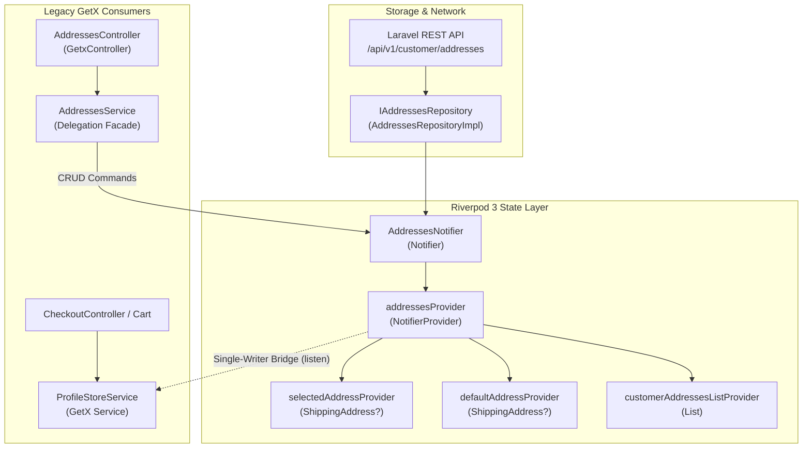

# معمارية عناوين الشحن والتوصيل في Riverpod 3.5.0
# 02 — ADDRESSES ARCHITECTURE: State, Notifiers & Pure Repositories

- **المشروع:** متجر رونقك الإلكتروني (`Rawnaquk E-Commerce`)
- **الموديول:** `lib/modules/customer/`
- **حالة المعمارية:** **معتمدة ومطابقة لنمط Riverpod 3.5.0 النقي**

---

## 1. الرؤية المعمارية (Architectural Vision)

في المراحل السابقة، كانت عناوين الشحن موزعة بين تخزين GetX في `ProfileStoreService` وخدمات `AddressesService` وأسلوب التعديل المباشر في الذاكرة مع احتمالية حدوث تضارب في حالة العنوان الافتراضي والعنوان المختار للطلب (`Selected Checkout Address`).

في **المرحلة 05**، أُعيد بناء إدارة العناوين وفق مبادئ المعمارية المتقدمة لـ Riverpod 3:
1. **فصل الحالة عن السلوك:** تمثيل لقطة بيانات العناوين ككائن نقي غير قابل للتعديل (`Immutable State Record`).
2. **الكاتب الأوحد الحصري (Single Authoritative Writer):** تحويل `AddressesNotifier` إلى الكيان الوحيد المخول بكتابة وتحديث حالة العناوين.
3. **الاشتقاق التفاعلي الدقيق (Granular Reactive Selectors):** توفير موفرات اشتقاقية متخصصة (`selectedAddressProvider`, `defaultAddressProvider`) تمنع إعادة بناء واجهات المستخدم غير المعنية عند تعديل أجزاء أخرى من الحالة.
4. **حماية التزامن الشبكي (Concurrency & Stale Response Protection):** منع الكتابة في الحالة إذا كانت الاستجابة الشبكية تعود لجلسة مستخدم منتهية أو تم استبدالها بجيل جلسة أحدث.

---

## 2. بنية نموذج الحالة غير القابل للتعديل (`AddressesState`)

تم تصميم [addresses_state.dart](file:///d:/project/laravel/app-rwnaqk/rwnaqk_frontend/lib/modules/customer/models/addresses_state.dart) كفئة غير قابلة للتعديل (`@immutable`) تعتمد القيم الافتراضية الثابتة (`const`):

```dart
@immutable
class AddressesState {
  const AddressesState({
    this.addresses = const <ShippingAddress>[],
    this.selectedAddressId,
    this.activeUserId,
    this.sessionGeneration = 0,
    this.isLoading = false,
    this.errorMessage,
  });

  final List<ShippingAddress> addresses;
  final String? selectedAddressId;
  final String? activeUserId;
  final int sessionGeneration;
  final bool isLoading;
  final String? errorMessage;
  
  // Getters مشتقة نقية
  ShippingAddress? get defaultAddress {
    return addresses.firstWhereOrNull((a) => a.isDefault);
  }

  ShippingAddress? get selectedAddress {
    if (selectedAddressId != null) {
      final found = addresses.firstWhereOrNull((a) => a.id == selectedAddressId);
      if (found != null) return found;
    }
    return defaultAddress ?? (addresses.isNotEmpty ? addresses.first : null);
  }

  bool get isEmpty => addresses.isEmpty;
  bool get isNotEmpty => addresses.isNotEmpty;
}
```

### الخصائص الهندسية لنموذج الحالة:
- **تحديد العنوان المختار بمرونة:** إذا لم يتم تحديد `selectedAddressId` صراحة، يشتق الـ getter العنوان الافتراضي تلقائياً، وإن لم يوجد، يعيد أول عنوان في القائمة كبديل منطقي أثناء إتمام الطلب.
- **دعم التصفير الصريح في `copyWith`:** لتفادي مشاكل الحقول الاختيارية (`nullable fields`) في لغة Dart، تم تزويد الدالة بمؤشرات:
  - `clearSelectedAddressId: true`
  - `clearActiveUserId: true`
  - `clearErrorMessage: true`

---

## 3. المتحكم وموفرات Riverpod (`AddressesNotifier & Providers`)

في [addresses_providers.dart](file:///d:/project/laravel/app-rwnaqk/rwnaqk_frontend/lib/modules/customer/providers/addresses_providers.dart):



### 3.1. تفاصيل دورة حياة العمليات الأساسية (CRUD Lifecycle)

1. **تحميل العناوين (`loadAddresses`):**
   - يلتقط رقم الجيل الحالي `currentGen = state.sessionGeneration` ومعرف المستخدم `currentUserId = state.activeUserId`.
   - يفعّل مؤشر التحميل `isLoading: true`.
   - يستدعي المستودع `_repo.getAddresses()`.
   - **فحص الأمان التزامني:** قبل تحديث الحالة، يتحقق من أن الجلسة لم تتغير أو تتجدد أثناء انتظار استجابة الشبكة:
     ```dart
     if (currentGen < state.sessionGeneration ||
         (currentUserId != null && currentUserId != state.activeUserId)) {
       debugPrint('[AddressesNotifier] Stale loadAddresses response rejected for old session.');
       return state.addresses;
     }
     ```
   - يحدّث الحالة بالقائمة المسترجعة مع إيقاف التحميل وتصفير الأخطاء.

2. **إضافة عنوان جديد (`addAddress`):**
   - يرسل العنوان الجديد إلى مستودع الخادم `_repo.createAddress(address)`.
   - إذا تم وسم العنوان الجديد كعنوان افتراضي (`isDefault == true`):
     - يقوم بضبط حقل `isDefault = false` لجميع العناوين الحالية في الذاكرة لضمان عدم وجود أكثر من عنوان افتراضي واحد.
     - يُدرج العنوان الجديد في بداية القائمة (`currentList.insert(0, created)`).
   - إذا لم يكن افتراضياً، يُضاف إلى نهاية القائمة.

3. **تحديث عنوان قائم (`updateAddress`):**
   - يُرسل العنوان المحدث إلى الخادم `_repo.updateAddress(address)`.
   - في حال كان العنوان المحدث قد أصبح افتراضياً، يتم إبطال الافتراضية عن بقية العناوين، واستبدال الكائن المحدث في نفس موضعه داخل المصفوفة.

4. **حذف عنوان (`deleteAddress`):**
   - يستدعي `_repo.deleteAddress(id)`.
   - يزيل العنوان من القائمة في الذاكرة.
   - **قاعدة سلامة العمليات التجارية:** إذا كان العنوان المحذوف هو العنوان الافتراضي، وكانت القائمة المتبقية غير فارغة، يتم ترقية أول عنوان متبقٍ ليصبح العنوان الافتراضي تلقائياً لمنع ترك حساب العميل بدون عنوان شحن رئيسي:
     ```dart
     if (nextList.isNotEmpty && !nextList.any((a) => a.isDefault)) {
       nextList[0] = nextList[0].copyWith(isDefault: true);
     }
     ```

5. **تعيين العنوان الافتراضي (`setDefaultAddress`):**
   - يطلب من الخادم اعتماد العنوان الرئيسي `_repo.setPrimaryAddress(id)`.
   - يحدّث الحالة بتعيين `isDefault: true` للعنوان المحدد وتجريد بقية العناوين من السمة، مع تعيينه كعنوان مختار تلقائياً `selectedAddressId = id`.

---

## 4. جدول الموفرات والخصائص (Providers Specification)

| الموفر (Provider) | النوع المعماري | الغرض الوظيفي | التبعيات |
|---|---|---|---|
| `addressesRepositoryProvider` | `Provider<IAddressesRepository>` | الوصول لمستودع العناوين النقي | `apiClientProvider` |
| `addressesProvider` | `NotifierProvider<AddressesNotifier, AddressesState>` | الكاتب الأوحد ومصدر الحقيقة للحالة | `AddressesNotifier` |
| `selectedAddressProvider` | `Provider<ShippingAddress?>` | تتبع العنوان المحدد لإتمام الطلب | `addressesProvider` |
| `defaultAddressProvider` | `Provider<ShippingAddress?>` | تتبع العنوان الافتراضي المسجل للعميل | `addressesProvider` |
| `customerAddressesListProvider` | `Provider<List<ShippingAddress>>` | قائمة العناوين الجاهزة للعرض | `addressesProvider` |

