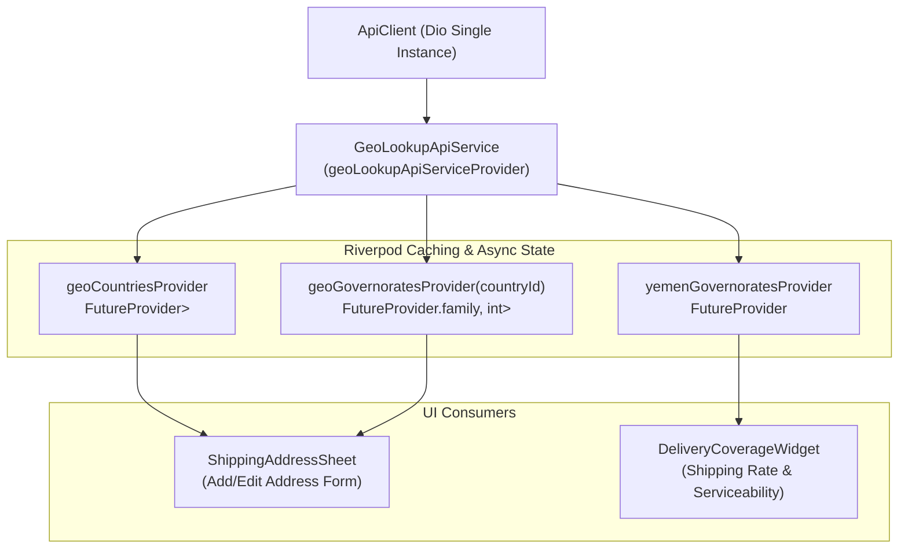

# معمارية الاستعلامات والتغطية الجغرافية في Riverpod 3.5.0
# 03 — GEO COVERAGE ARCHITECTURE: Geographic Lookups, Caching & Serviceability

- **المشروع:** متجر رونقك الإلكتروني (`Rawnaquk E-Commerce`)
- **الموديول:** `lib/core/services/geo/` و `lib/modules/customer/providers/geo_providers.dart`
- **حالة المعمارية:** **معتمدة ومطابقة لنمط Riverpod 3.5.0 النقي**

---

## 1. الرؤية الهندسية ونطاق التغطية (Engineering Vision & Coverage Scope)

تعتمد تجربة التسوق في متجر رونقك على دقة التوصيل داخل الجمهورية اليمنية وتوسع الشحن الإقليمي (المملكة العربية السعودية ودول الخليج). يتطلب ذلك معمارية استعلامات جغرافية خفيفة، سريعة الاستجابة، وتعتمد على التخزين المؤقت الذكي في الذاكرة لمنع تكرار طلبات HTTP للبيانات الجغرافية شبه الثابتة (الدول والمحافظات والمديريات).

في **المرحلة 05**، تم عزل وتأسيس موفرات التغطية الجغرافية باستخدام `FutureProvider` و `FutureProvider.family` في Riverpod 3.5.0، مع الحفاظ على التوافق التام مع واجهات واختيارات المستخدم في النماذج السفلية (`ShippingAddressSheet`).

---

## 2. النماذج الجغرافية (Geographic Data Models)

تعتمد المنظومة على النماذج المعرفة في `lib/modules/customer/data/models/geo_lookup_item.dart`:

```dart
@immutable
class GeoLookupItem {
  const GeoLookupItem({
    required this.id,
    required this.name,
    this.countryId,
    this.code,
  });

  final int id;
  final String name;
  final int? countryId;
  final String? code;
}

@immutable
class YemenGovernoratesLookup {
  const YemenGovernoratesLookup({
    required this.countryId,
    required this.countryName,
    required this.governorates,
  });

  final int countryId;
  final String countryName;
  final List<GeoLookupItem> governorates;
}
```

---

## 3. موفرات الاستعلامات الجغرافية (Geo Providers Specification)

تم تنظيم الموفرات في [geo_providers.dart](file:///d:/project/laravel/app-rwnaqk/rwnaqk_frontend/lib/modules/customer/providers/geo_providers.dart):



### 3.1. تفاصيل الموفرات:

1. **`geoLookupApiServiceProvider`:**
   - يوفر كائن `GeoLookupApiService` النقي المرتبط بـ `apiClientProvider`.
   - قابل للاستبدال الكامل في الاختبارات (`overrideWithValue`) لاختبار مختلف سيناريوهات التغطية أو انقطاع الشبكة.

2. **`geoCountriesProvider`:**
   - نوع الموفر: `FutureProvider<List<GeoLookupItem>>`.
   - الغرض: جلب قائمة الدول النشطة من نقطة النهاية `/api/v1/geo/countries`.
   - سلوك التخزين المؤقت: يخزن النتيجة تلقائياً في الذاكرة طوال دورة حياة التطبيق، مما يلغي أي طلبات شبكية متكررة عند فتح نموذج إضافة العنوان أكثر من مرة.

3. **`geoGovernoratesProvider(int countryId)`:**
   - نوع الموفر: `FutureProvider.family<List<GeoLookupItem>, int>`.
   - الغرض: جلب المحافظات التابعة لدولة محددة عبر `/api/v1/geo/governorates?country_id={countryId}`.
   - ميزة `family`: إنشاء مساحة تخزين مؤقت مستقلة لكل `countryId`، بحيث إذا اختار العميل "اليمن" ثم "السعودية" ثم عاد إلى "اليمن"، تُسترجع قائمة محافظات اليمن فوراً من الذاكرة دون طلب شبكي إضافي.

4. **`yemenGovernoratesProvider`:**
   - نوع الموفر: `FutureProvider<YemenGovernoratesLookup?>`.
   - الغرض: استعلام مخصص وسريع للتغطية الجغرافية داخل اليمن عبر `/api/v1/geo/yemen-governorates` يشمل معلومات التوصيل المتاحة.

---

## 4. استراتيجية الصمود ومعالجة الأخطاء (Resilience & Error Fallbacks)

- **انقطاع الشبكة (Network Exceptions):** عند تعذر الاتصال بالخادم، تُصدر الموفرات كائن `AsyncError` يحمل رسالة الخطأ المعربة، مع إمكانية استخدام خيار `ref.refresh()` لإعادة المحاولة بسلاسة من واجهة المستخدم.
- **وضع البيانات التجريبية (Mock Data Fallback):** في بيئة التطوير والاختبار، إذا تم تفعيل وضع Mock Data، تعود الخدمة تلقائياً إلى البيانات المحلية الافتراضية للمحافظات اليمنية الرئيسية (صنعاء، عدن، تعز، حضرموت، الحديدة، إب).

