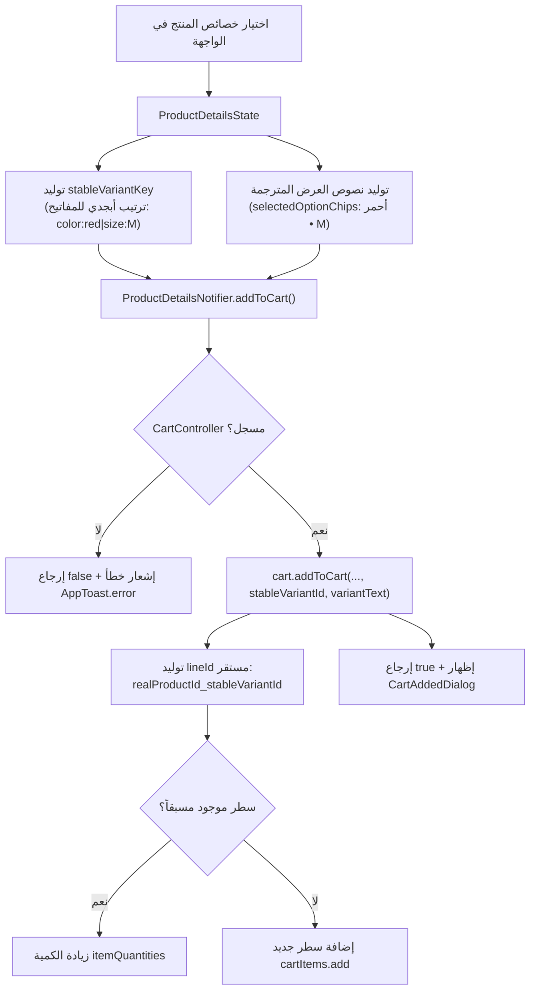

# معمارية إرسال السلة وهوية المتغيرات المستقرة
# Cart Dispatch & Stable Variant Identity Architecture

**المرحلة:** Phase 06.1 Quality Closure  
**المكونات:** `ProductDetailsNotifier`, `ProductDetailsController`, `CartController`, `ProductDetailsState`

---

## 1. تحليل المشكلة المعمارية السابقة

### أ. ردود الفعل المضللة (False Add-to-Cart)
سابقاً، كانت دالة `addToCart([BuildContext? context])` تفحص `Get.isRegistered<CartController>()` وتقوم باستدعاء السلة، ولكن سطر استدعاء الحوار:
```dart
if (context != null) {
  CartAddedDialog.show(context);
}
```
كان يقع خارج كتلة التحقق في نهاية الدالة، مما يتسبب في ظهور حوار النجاح حتى لو:
1. كان `current == null` (المنتج غير محمل).
2. كان `CartController` غير مسجل في الذاكرة (مما يوحي للمستخدم بإضافة وهمية).
3. حدث استثناء غير متوقع أثناء معالجة السلة.

### ب. اصطدام وتكرار أسطر السلة بناءً على اللغة (Variant Identity Fragility)
كان إنشاء معرف السطر في `CartController.addToCart` يعتمد على النص المترجم المعروض للمستخدم:
```dart
final lineId = v.isNotEmpty ? '${realProductId}_$v' : realProductId;
```
حيث `v` كانت قيمة مثل `'أحمر - S'` في الجلسة العربية، وقيمة `'Red - S'` في الجلسة الإنجليزية.
نتج عن ذلك:
- عند تبديل اللغة أو إضافة المنتج بلغة مختلفة، يُنشأ سطر جديد ومكرر لنفس السلعة والمقاس في السلة.
- اختلاف ترتيب الخصائص (مثلاً المقاس قبل اللون) يغير معرف السطر.

---

## 2. التصميم المعماري الجديد والحل الهندسي



### أ. توليد المعرف المستقر `stableVariantKey`
أضيفت خاصية غير قابلة للتغيير ومستقلة تماماً عن اللغة وترتيب الاختيارات في `ProductDetailsState` و `ProductDetailsController`:
```dart
String get stableVariantKey {
  if (selectedAttributes.isNotEmpty) {
    final sortedKeys = selectedAttributes.keys.toList()..sort();
    final parts = <String>[];
    for (final key in sortedKeys) {
      final val = selectedAttributes[key];
      if (val != null && val.trim().isNotEmpty) {
        parts.add('$key:${val.trim()}');
      }
    }
    if (parts.isNotEmpty) return parts.join('|');
  }

  final parts = <String>[];
  if (selectedColorId.trim().isNotEmpty) {
    parts.add('color:${selectedColorId.trim()}');
  }
  if (selectedSize.trim().isNotEmpty) {
    parts.add('size:${selectedSize.trim()}');
  }
  return parts.join('|');
}
```

### ب. ترقية `CartController.addToCart`
دعم المعامل الاختياري `stableVariantId`:
- إذا وُجد `stableVariantId`، يُعتمد حصراً في بناء `lineId`.
- يُستخدم `variantText` كعنوان توضيحي فقط في الواجهة.
- دمج آمن وموحد للكميات عند تكرار إضافة نفس المتغير عبر لغات مختلفة.

### ج. إغلاق ثغرة التأكيد الوهمي
أصبحت دالة `addToCart` تُرجع `bool` صريحاً، ولا يُستدعى `CartAddedDialog.show(context)` إلا بعد نجاح الإضافة الفعلي وإرجاع `true`.

