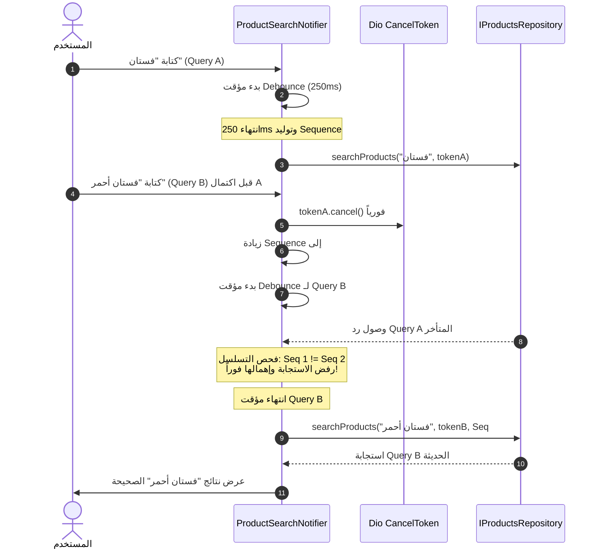

# توثيق اختبارات سباق البحث وترقيم صفحات الكتالوج
# Search Debounce Race & Catalog Pagination Verification

**المرحلة:** Phase 06.1 Quality Closure  
**المكونات:** `ProductSearchNotifier`, `ProductsListingNotifier`, `IProductsRepository`

---

## 1. سباق البحث الزمني وحماية الاستجابات المتأخرة

### طبيعة التهديد (Race Condition Vulnerability)
عندما يقوم المستخدم بكتابة استعلام بحث (Query A) ثم يتبعه سريعاً باستعلام آخر (Query B) أثناء تشغيل مؤقت التهدئة (Debounce 250ms):
- إذا كان استعلام (Query A) قد بدأ طلبه الشبكي بالفعل، فإن تأجيل إلغاء الطلب أو تأجيل زيادة رقم التسلسل إلى ما بعد انتهاء الـ 250ms يسمح لرد (Query A) بالوصول وتحديث نتائج الواجهة بالخطأ قبل أن يبدأ طلب (Query B).

### الحل المعماري
في دالة `ProductSearchNotifier.onQueryChanged(String text)`:
1. **الإلغاء الفوري:** استدعاء `_cancelToken?.cancel('Superseded by user typing')` فورياً بمجرد استلام الحرف الجديد.
2. **الترقية الفورية للتسلسل:** زيادة `++_searchSequence` وتحديث الحالة `searchSequence: nextSeq` فوراً، مما يجعل أي رد وارد من طلبات سابقة غير متطابق ومهمل تماماً (`currentSequence != _searchSequence`).

---

## 2. تكامل الترتيب مع ترقيم الصفحات الخادمي (Catalog Sorting & Server Pagination)

### التحدي
في الواجهات المتصلة بـ Laravel API، إذا كان الكتالوج ديناميكياً ويعتمد على التصفح عبر الصفحات (`page 1`, `page 2`...)، فإن تغيير الترتيب محلياً لعناصر الصفحة الحالية فقط (In-Memory Sort) يضلل العميل، لأن المنتجات الأكثر ملاءمة للترتيب الجديد قد تكون موجودة في الصفحات اللاحقة بالخادم.

### الإجراء المعتمد في `ProductsListingNotifier`
- **القوائم الثابتة (`initialItems.isNotEmpty`):** يتم تطبيق الترتيب والفلاتر محلياً وبشكل فوري.
- **القوائم الديناميكية الخادمية (`initialItems.isEmpty`):**
  1. تطبيق الترتيب محلياً فوراً على العناصر الحالية لضمان استجابة بصرية لحظية للواجهة.
  2. إطلاق استدعاء `refreshList()` خادمي لإعادة جلب الصفحة الأولى من خادم Laravel مع تمرير معامل `sort` المحدث.

