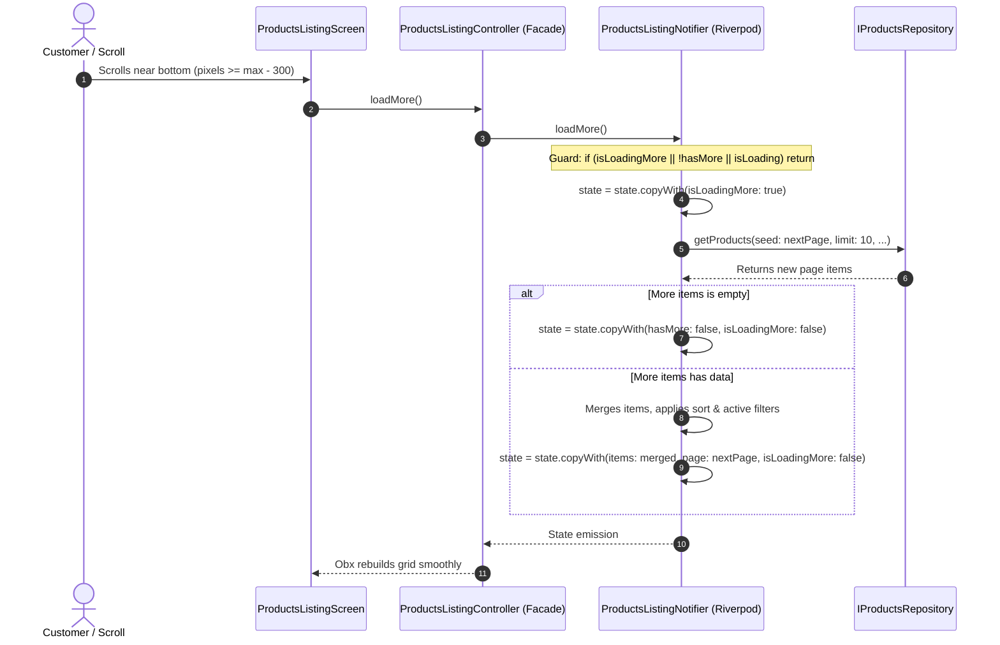

# Catalog State Architecture & Pagination Pipeline

## 1. Domain Modeling: `ProductsListingState`

The catalog listing model is encapsulated in `lib/modules/catalog/models/products_listing_state.dart`. It represents an immutable snapshot of the products listing grid:

```dart
@immutable
class ProductsListingState {
  final List<HomeProductItem> items;
  final List<HomeProductItem> initialItems;
  final bool isLoading;
  final bool isLoadingMore;
  final bool hasMore;
  final int page;
  final String title;
  final String source;
  final String? errorMessage;
  final ListingSort sort;
  final AppFilterResult? filterResult;
  final int activeFilterCount;
}
```

### Key Properties:
- `initialItems`: Retains the complete, unfiltered base dataset returned by the repository to avoid destructive filtering where successive filter changes progressively empty the list.
- `items`: The active, displayable projection after `applySort` and `applyFilters`.
- `page`: Integer tracker for cursor/page boundaries.
- `hasMore`: Boolean flag detecting end-of-catalog or empty remote responses.

---

## 2. Pagination & Sorting Flow



---

## 3. Filter and Sort Invariants

1. **Deterministic Sorting**: Supported via enum `ListingSort` (`newest`, `priceLow`, `priceHigh`, `discountHigh`). Changing sort triggers in-memory re-ordering without full network re-fetches when data is already cached.
2. **Multi-Factor Filters**: `AppFilterResult` captures price ranges (`RangeValues`), category IDs, and product types. Filters are applied immediately via `ProductsListingService.applyFilters`.
3. **Double-Fetch Protection**: `loadMore()` is guarded by `isLoadingMore || !hasMore || isLoading`. Concurrent scroll events cannot spawn duplicate requests or corrupt page offsets.

