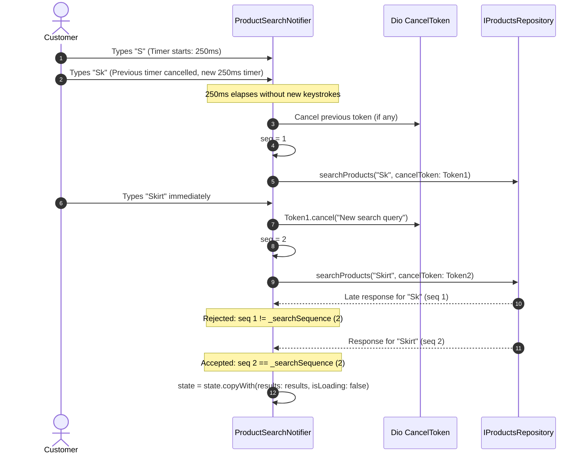

# Storefront Search Debounce, Cancellation & Stale Rejection

## 1. Challenge & Problem Statement

Mobile storefront search is highly susceptible to race conditions:
1. **Network Saturation**: Users typing "Skirt" trigger 5 rapid keystrokes (`S`, `Sk`, `Ski`, `Skir`, `Skirt`). Without debouncing and request cancellation, 5 concurrent HTTP requests hit the backend.
2. **Out-of-Order Execution (Async Race Condition)**: The request for `Sk` might take 400ms due to heavy server load, while `Skirt` completes in 80ms. If the late response for `Sk` resolves last, it overwrites the correct results for `Skirt`.
3. **Ghost Loading Indicators**: Abandoned requests keep loading states active indefinitely.

---

## 2. Multi-Layered Defense in `ProductSearchNotifier`

In `lib/modules/search/providers/search_providers.dart`, search robustness is guaranteed through three coordinated defenses:

### A. 250ms Keystroke Debounce
```dart
void onQueryChanged(String text) {
  state = state.copyWith(query: text);
  _debounce?.cancel();
  
  if (text.trim().isEmpty) {
    clearQuery();
    return;
  }
  
  _debounce = Timer(const Duration(milliseconds: 250), () {
    _executeSearch(text.trim());
  });
}
```

### B. Dio `CancelToken` In-Flight Cancellation
Before firing any new request, active network tokens are immediately aborted:
```dart
_cancelToken?.cancel('New search query triggered: $query');
_cancelToken = CancelToken();
```
If Dio raises a cancellation exception (`CancelToken.isCancel(e)`), it is caught and silently dropped because it was deliberately superseded by user input.

### C. Search Sequence Token (Stale Response Rejection)
Every search request increments an atomic monotonic sequence number:
```dart
final currentSequence = ++_searchSequence;
// ... await repo.searchProducts(...) ...
if (currentSequence != _searchSequence) {
  // Discard late-arriving results from superseded query
  return;
}
```

---

## 3. Search Lifecycle Architecture



---

## 4. Test Verification Evidence

Validated in `test/phase6_catalog_search_test.dart`:
- `onQueryChanged debounces search and onSubmitted executes immediately`: **PASSED**.
- `Stale delayed response is rejected when a newer query completes`: **PASSED**.
- `Empty query clears results immediately and cancels active tokens`: **PASSED**.

