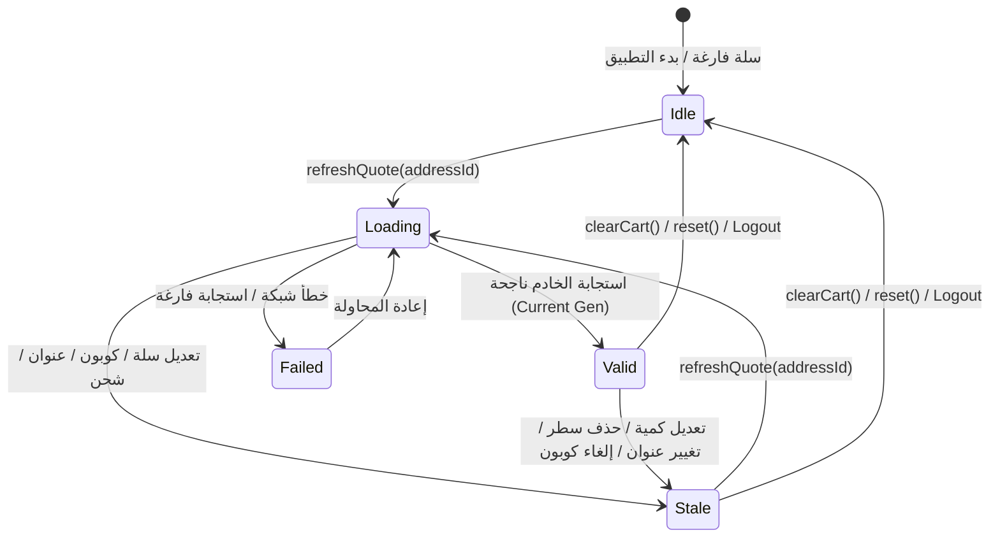

# إبطال عروض الأسعار وحماية السباق الزمني في السلة
# Cart Quote Invalidation & Race Condition Protection

## 1. التوصيف التقني للمشكلة

في تطبيقات التجارة الإلكترونية ذات التسعير الخادمي الموثق (Server-Side Pricing Quote)، يمثل التزامن بين إدخالات المستخدم واستجابات الشبكة غير المتزامنة (Asynchronous Network Calls) تحدياً مالياً حرجاً.

إذا كان المستخدم يتصفح السلة، وقام بتطبيق كود خصم، ثم قام بتغيير عنوان الشحن أو كمية المنتجات، تنطلق عدة طلبات HTTP أو تلغى أخرى. أي خلل في التحقق من صحة التسلسل الزمني قد يؤدي إلى:
1. تطبيق كود خصم على سلة غير مؤهلة.
2. احتساب رسوم شحن لمنطقة جغرافية أُلغيت.
3. اعتماد إجمالي سعر لكمية 1 بينما السلة تحوي 3 قطع (Financial Loss).

---

## 2. آلة الحالة الخماسية لعرض السعر (CartQuoteStatus State Machine)



---

## 3. آلية الحماية المزدوجة (Dual-Token & Generation Barrier)

تم تعزيز `CartQuoteNotifier` بآلية مناعة مزدوجة:

### 1. إبطال وإلغاء فوري عبر Dio `CancelToken`:
```dart
_cancelToken?.cancel('Cart or pricing inputs mutated');
_cancelToken = null;
```

### 2. حاجز الأجيال التصاعدية (Monotonic Generation Counter):
```dart
void invalidateQuote() {
  _cancelToken?.cancel('Cart or pricing inputs mutated');
  _cancelToken = null;
  _generation++;

  if (state.status != CartQuoteStatus.stale) {
    state = state.copyWith(
      status: CartQuoteStatus.stale,
      generation: _generation,
    );
  }
}
```

### 3. بوابة القبول الثلاثية (Triple-Guard Acceptance Gate):
عند عودة الاستجابة من السيرفر، يتم فحص ثلاثة شروط إلزامية قبل اعتماد النتيجة:
```dart
if (token.isCancelled ||
    currentGen != _generation ||
    state.status != CartQuoteStatus.loading) {
  return false; // رفض قاطع لأي استجابة متأخرة
}
```

---

## 4. إثبات الصمود بالاختبارات المؤتمتة

تم اختبار الآلية بنجاح في `test/phase7_1_financial_integrity_test.dart`:
- **الاختبار الأول:** محاكاة استجابة شبكية متأخرة استغرقت وقتاً طويلاً بينما قام المستخدم بتعديل الكمية في المنتصف. النتيجة: رُفضت الاستجابة فوراً، ولم يتم اعتماد السعر القديم، وبقيت حالة السعر `stale`.
- **الاختبار الثاني:** تغيير العنوان أبطل صلاحية عرض السعر القائم فوراً.
- **الاختبار الثالث:** تغيير خيار الشحن أبطل صلاحية العرض القائم.
- **الاختبار الرابع:** تطبيق أو إزالة الكوبون أعاد ضبط العرض وفق مدخلات السيرفر المعتمدة.

