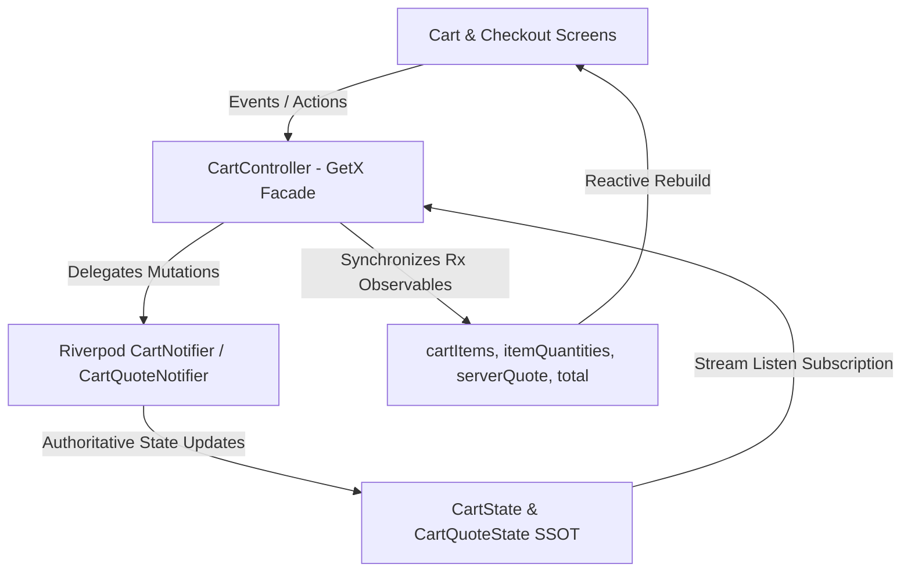

# سلامة جسر التوافق مع GetX CartController
# Cart Bridge & Single-Writer Delegation Integrity

## 1. نموذج الكاتب المنفرد (Single-Writer Delegation Facade)

لضمان سلامة العمليات وعدم كسر أي واجهة مستخدم تعتمد على GetX قبل المرحلة 09، يعمل `CartController` كواجهة تفويض أحادية الاتجاه:

---

## 2. قواعد الحصانة ضد تصنيع الأسعار محلياً (Zero-Price-Manufacture Rules)

1. **لا أسعار معتمدة بدون السيرفر:**
   خاصية `total` في `CartController` تقرأ أولاً وبشكل ملزم من `serverQuote.value?.grandTotal`. إذا كان عرض السعر غير متوفر أو غير صالح، يتم استخدام الحساب التقديري المحلي فقط لأغراض العرض التوضيحي مع تعطيل الدفع النهائي حتى استلام عرض السعر المعتمد.
2. **منع التعديل المباشر للمصفوفات:**
   جميع دوال `addToCart` و `removeFromCart` و `incrementQuantity` و `decrementQuantity` و `clearCart` تفوض فوراً إلى `_cartNotifier`، ولا يتم تعديل المجموعات المحلية إلا استجابة لتغير حالة Riverpod عبر `_syncCartFromRiverpod`.
3. **تطهير شامل عند تسجيل الخروج:**
   في `AuthSessionNotifier._purgeLegacyGetXStores()`:
   يتم استدعاء `cartProvider.notifier.clearCart()` و `cartQuoteProvider.notifier.reset()` بالإضافة لتفريغ صريح لمجموعات `CartController.cartItems.clear()` لضمان عدم تسريب أي بيانات بين الحسابات.

