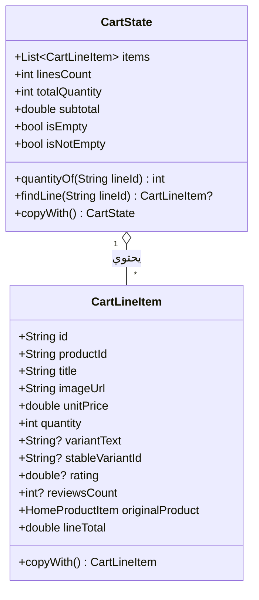

# معمارية حالة السلة وعمليات التعديل غير القابلة للتغيير
# Cart State & Immutable Mutations Architecture

**المرحلة:** Phase 07 Cart Migration  
**المكونات:** `CartLineItem`, `CartState`, `CartNotifier`, `cartProvider`

---

## 1. نموذج بيانات السلة غير القابل للتعديل المباشر

تم تصميم كائنات السلة لتكون نقية وغير قابلة للتعديل (`@immutable`)، حيث يتم تمثيل كل بند في السلة ككائن `CartLineItem` مستقل يحتوي على:
- `id`: المعرف الفريد للسطر (`realProductId_stableVariantId` أو `realProductId`).
- `productId`: معرف المنتج الأصلي للربط مع الكتالوج والمخزون.
- `title` & `imageUrl`: بيانات العرض السريعة.
- `unitPrice`: سعر الوحدة الصافي بعد خصم المنتج المباشر.
- `quantity`: الكمية المطلوبة (موجبة دائماً).
- `stableVariantId`: المفتاح التقني غير المترجم للمتغيرات (مثل: `color:black|size:54`).
- `variantText`: النص التوضيحي المترجم للواجهة.
- `originalProduct`: كائن `HomeProductItem` الأصلي لضمان توافقية الشاشات القديمة.

---

## 2. دورة حياة التعديل في `CartNotifier`

يتحكم `CartNotifier` في جميع العمليات على السلة وفق القواعد الصارمة التالية:
1. **الإضافة (`addToCart`):**
   - استخراج المفتاح المستقر `stableVariantId`.
   - فحص السطر: إذا كان موجوداً، تزداد الكمية بمقدار `qty`. وإن لم يكن، يُضاف سطر جديد.
   - إبطال عرض السعر الخادمي فورياً (`ref.read(cartQuoteProvider.notifier).invalidateQuote()`).
2. **الحذف (`removeFromCart`):**
   - استبعاد السطر المحدد وإصدار حالة جديدة خالية منه.
   - إبطال عرض السعر.
3. **تعديل الكمية (`updateQuantity`):**
   - إذا كانت الكمية الجديدة `<= 0`، يتم تحويل العملية إلى حذف.
   - إذا كانت موجبة، يتم تحديث كمية السطر المحدد مع الاحتفاظ بباقي الأسطر.
   - إبطال عرض السعر.
4. **التفريغ (`clearCart`):**
   - إعادة تعيين الحالة إلى `const CartState()`.
   - تصفير كائن عرض السعر وجيل الطلب في `CartQuoteNotifier`.

