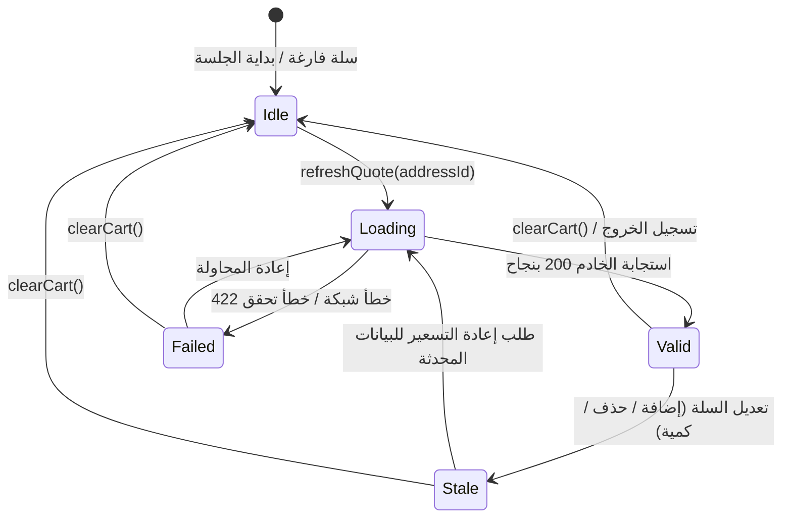

# آلة حالة عرض السعر الخادمي والتسعير المعتمد
# Server-Side Pricing Quote State Machine

**المرحلة:** Phase 07 Cart Migration  
**المكونات:** `CartQuoteStatus`, `CartQuoteState`, `CartQuoteNotifier`, `cartQuoteProvider`

---

## 1. سلطة التسعير الحصرية لخادم Laravel

في التجارة الإلكترونية الآمنة، يُعتبر تطبيق العميل (Flutter Storefront) **غير موثوق به مالياً**. لا يجوز للتطبيق احتساب القيمة الإجمالية للدفع محلياً، بل يجب أن يكون خادم Laravel هو المصدر المعتمد والوحيد (Authoritative Source of Truth) لاحتساب:
- الإجمالي الفرعي الصافي بعد خصومات المتغيرات.
- رسوم الشحن الجغرافي بناءً على `address_id` المحفوظ في الخادم.
- خصم الكوبونات الترويجية بعد التحقق من شروط الحد الأدنى وتاريخ الصلاحية.
- الإجمالي النهائي للدفع (`grandTotal`).

---

## 2. آلة حالة عرض السعر (Quote State Machine)

تتحكم آلة الحالة في الانتقالات التشغيلية لعرض السعر عبر الحالات الخمس التالية:

### توصيف الحالات
1. **`Idle`:** السلة فارغة أو لم يدخل المستخدم في مرحلة الدفع بعد.
2. **`Loading`:** جاري الاتصال بالخادم لجلب عرض السعر مع رمز الإلغاء `CancelToken` ورقم الجيل `generation`.
3. **`Valid`:** تم توثيق عرض السعر بنجاح، وجميع المبالغ المالية معتمدة ومطابقة لمحتوى السلة الحالي.
4. **`Stale`:** حدث أي تعديل في بنود السلة أو الكميات، مما يجعل عرض السعر القديم باطلاً مالياً ويمنع المتابعة للدفع حتى تجديده.
5. **`Failed`:** تعذر جلب عرض السعر لخطأ في الشبكة، أو عدم تغطية العنوان جغرافياً.

