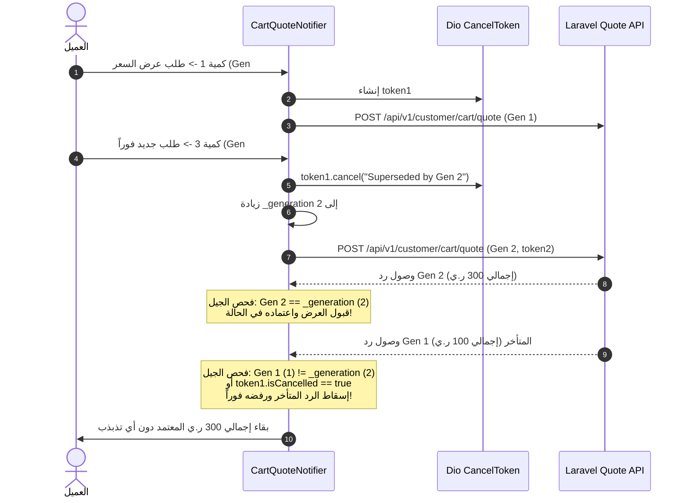

# حماية السباق الزمني وإسقاط عروض الأسعار المتأخرة
# Race Conditions & Stale Quote Rejection Architecture

**المرحلة:** Phase 07 Cart Migration  
**المكونات:** `CartQuoteNotifier`, `CancelToken`, `requestFingerprint`, `_generation`

---

## 1. سيناريو الخطر المالي (The Financial Race Condition Hazard)

في شبكات الهاتف المحمول غير المستقرة، قد يطلب المستخدم تعديل السلة مرتين متتاليتين:
1. **الطلب الأول (Gen #1):** كمية المنتج 1 (إجمالي 100 ر.ي). يتأخر الطلب في الشبكة لمدة ثانية ونصف.
2. **الطلب الثاني (Gen #2):** يرفع المستخدم الكمية إلى 3 (إجمالي 300 ر.ي) بعد نصف ثانية.
3. يستجيب الخادم للطلب الثاني سريعاً ويُحدث الواجهة بـ 300 ر.ي.
4. **الخطر:** يصل رد الطلب الأول المتأخر (100 ر.ي). إذا قَبِل التطبيق هذا الرد القديم، سيُعرض على المستخدم إجمالي 100 ر.ي لـ 3 قطع، مما يتسبب في فشل التحقق عند الدفع أو خسارة مالية!

---

## 2. دروع الحماية المطبقة في `CartQuoteNotifier`

تم دمج طبقتين دفاعيتين صارمتين:

### أ. بصمة الطلب الفريدة (`requestFingerprint`)
تتضمن البصمة كافة العوامل المؤثرة في التسعير:
`addr:$addressId|items:$itemsFingerprint|c:$couponCode|s:$shippingOptionId|g:$generation`
أي اختلاف في البنود أو الكميات يغير البصمة مباشرة.

### ب. عداد الأجيال المتصاعد (`_generation`)
كل استدعاء لـ `refreshQuote` يزيد العداد الذري الداخلي `++_generation`. لا يُقبل أي رد شبكي إلا إذا كان رقم جيله مطابقاً تماماً لقيمة `_generation` الحالية وكان التوكن سارياً ولم يُلغَ.

