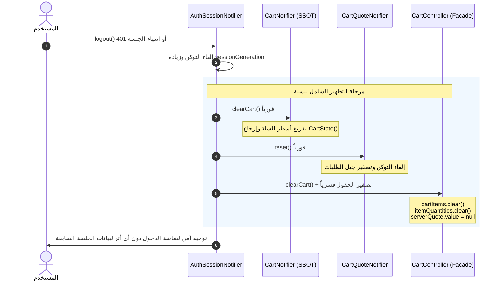

# عزل جلسات السلة وحماية البيانات بين الحسابات
# Session Isolation & Guest Cart Security Architecture

**المرحلة:** Phase 07 Cart Migration  
**المكونات:** `AuthSessionNotifier`, `CartNotifier`, `CartQuoteNotifier`, `CartController`

---

## 1. خطر تسريب بيانات السلة عبر حدود الحسابات (Cross-Account Leakage)

في تطبيقات التجارة الإلكترونية، إذا قام المستخدم (أ) بوضع سلع خاصة في السلة أو تطبيق كوبون ثم سجل خروجه، وقام المستخدم (ب) بتسجيل دخوله على نفس الهاتف، فإن بقاء عناصر السلة القديمة في الذاكرة:
1. يكشف خصوصية مشتريات واهتمامات المستخدم السابق.
2. يتسبب في محاولة تنفيذ طلبات بأسعار أو عناوين تنتمي لحساب آخر.

---

## 2. استراتيجية التطهير المزدوج (Dual-Layer Purge)

تم تطبيق استراتيجية صارمة لتطهير السلة عند أي تغيير في حالة المصادقة (تسجيل خروج، طرد أمني عبر 401، أو تبديل الحساب):

### ضمانات العزل المحققة:
- سلة الضيف (Guest Cart) تُدار محلياً ولا يتم ربطها بحساب العميل إلا بعد مصادقة صريحة من الخادم.
- عند تسجيل الخروج، يتم مسح السلة المعتمدة في Riverpod، بالإضافة للمجموعات التوافقية في GetX، مع إلغاء أي طلبات عروض أسعار معلقة في الشبكة لمنع عودتها بعد الخروج.

