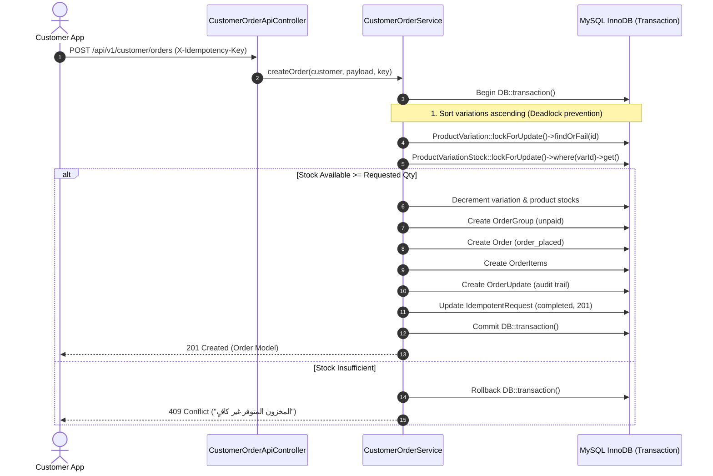

# Phase 08.1 — Architectural Document 03: Database Transactions & Inventory Integrity

## 1. Concurrency Model & Locking Strategy

To prevent race conditions, double spending, and inventory overselling during flash sales or simultaneous checkouts, `CustomerOrderService` enforces database-level transactions with pessimistic row locking (`lockForUpdate`).



---

## 2. Deadlock Prevention Strategy

When multiple customers order multiple items concurrently in different order (e.g., User A orders Item 1 then Item 2; User B orders Item 2 then Item 1), simultaneous locks can trigger a MySQL Deadlock (`Deadlock found when trying to get lock`).

### Mitigation in `CustomerOrderService.php`:
All item variations are sorted strictly in ascending order by their primary key before acquisition of locks:
```php
// ترتيب المتغيرات بترتيب تصاعدي ثابت لمنع حدوث Deadlocks
usort($items, fn ($a, $b) => ((int) $a['product_variation_id']) <=> ((int) $b['product_variation_id']));
```
This guarantees an identical locking order across all concurrent transactions, mathematically preventing cyclic wait deadlocks.

---

## 3. Atomic Cancellation & Re-stocking

When an order is cancelled by the customer via `POST /api/v1/customer/orders/{id}/cancel`:
1. **Status Preflight**: Cancellation is allowed only for `order_placed` and `confirmed` statuses. Already shipped or cancelled orders are rejected immediately with HTTP 409 Conflict.
2. **Double Cancellation Guard**: Calling cancellation twice produces HTTP 409 Conflict: `تم إلغاء هذا الطلب مسبقاً`.
3. **Atomic Stock Restoration**: Inside a single database transaction, stock is incremented back on `ProductVariationStock` and `Product` models:
   ```php
   ProductVariationStock::where('product_variation_id', $item->product_variation_id)
       ->where('location_id', $item->location_id)
       ->increment('stock_qty', (int) $item->qty);

   Product::where('id', $item->productVariation->product_id)
       ->increment('stock_qty', (int) $item->qty);
   ```
4. **Audit Trail**: An `OrderUpdate` record documents the exact timestamp, actor ID, and stock return reason.

