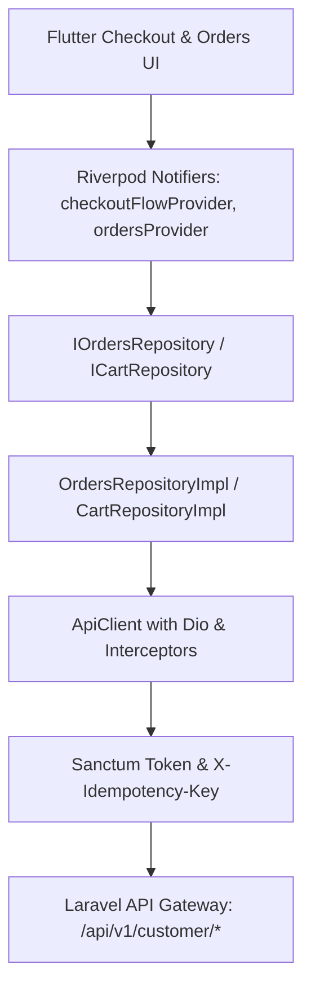

# Phase 08.1 — Architectural Document 06: Flutter & Laravel Integration Architecture

## 1. Client Repository Architecture

In Flutter, communication with the Laravel backend flows through clean, dependency-injected repository implementations:
- `CartRepositoryImpl` (`lib/modules/cart/data/repositories/cart_repository.dart`)
- `OrdersRepositoryImpl` (`lib/modules/orders/data/repositories/orders_repository_impl.dart`)

---

## 2. DTO Alignment & Data Integrity

The Flutter data transfer objects (DTOs) were matched to the Laravel Eloquent and Resource schemas:

| Flutter DTO Property | Laravel Resource Property | Type | Verification Status |
|---|---|---|---|
| `CartQuoteModel.grandTotal` | `grand_total` | `double` | Verified via `test_staging_e2e_real_http.php` |
| `CartQuoteModel.shippingFee` | `shipping_fee` | `double` | Verified across zone delivery tiers |
| `CartQuoteModel.couponDiscountTotal` | `coupon_discount_total` | `double` | Verified with cap & percentage rules |
| `CartQuoteModel.isServiceable` | `is_serviceable` | `bool` | Verified against unserviceable addresses |
| `OrderModel.id` | `order_code` / `id` | `String` | Formatted order code (e.g. "100015") |
| `OrderModel.total` | `total` / `grand_total_amount` | `double` | Authoritative server price |
| `OrderModel.status` | `delivery_status` | `String` | Lifecycle: `order_placed` -> `cancelled` |
| `OrderModel.addressLine` | `address_line` | `String` | Fully resolved hierarchy (Gov + Dist + Desc) |

---

## 3. Production Environment & Mock Elimination

In `AppEnv`:
- `ENABLE_MOCK_DATA` is explicitly decoupled from release builds.
- When `ENABLE_MOCK_DATA=false`, all operations dispatch real HTTP network requests with authentic JSON payload parsing and strict error handling (`ValidationException`, `UnauthorizedException`, `ApiException`).
- If an unauthenticated request occurs, `TokenInterceptor` automatically invokes `onSessionTerminated` to trigger a clean session teardown in Riverpod.

