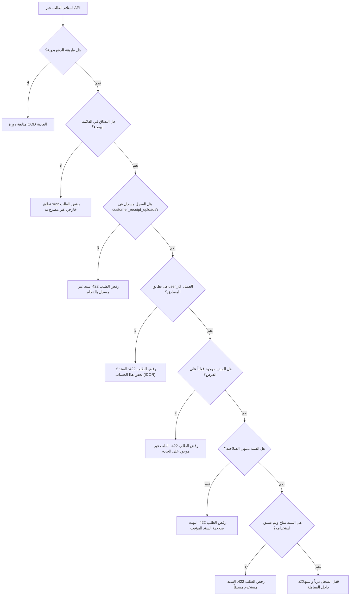

# التحقق الصارم من ملكية السند وأمن الرفع المؤقت — Phase 08.2
## Receipt Ownership and Upload Trust Boundary Security

**المسار:** `docs/architecture/phase-08-2-security-hardening/02_RECEIPT_OWNERSHIP_AND_UPLOAD_SECURITY.md`  
**الحالة:** معتمد ومنفذ  
**المكونات:** `Modules/Shop/app/Models/CustomerReceiptUpload.php`, `Modules/Shop/app/Services/CustomerOrderService.php`, `app/Http/Controllers/Api/TemporaryImageController.php`

---

## 1. التهديد الأمني الأصلي (Original Security Threat)

في الفحص الأمني بعد Phase 08.1، تبين وجود ثغرة خطيرة في حدود الثقة (Trust Boundary Vulnerability):
1. **حقن الروابط الخارجية (External URL Injection):** كان الفحص السابق يكتفي بالتأكد من أن الرابط يحتوي على المسار `temporary/images/`. كان بإمكان المهاجم إرسال:
   ```json
   {
       "payment_method": "wallet",
       "receipt_image_url": "https://attacker-malicious-site.com/temporary/images/fake.jpg"
   }
   ```
   فيمر الطلب كطلب تحويل بنكي بدون أي سند حقيقي في خوادمنا.
2. **انتحال ملكية السندات (IDOR):** في حال قام العميل (أ) برفع سند حقيقي، كان يمكن للعميل (ب) نسخ رابط السند واستخدامه في حسابه لإتمام طلب دون دفع.
3. **تجاوز بيئة الاختبار (`testing` environment bypass):** كان الكود يحتوي على شرط `if (! app()->environment('testing'))` مما يعني أن جميع الفحوصات الأمنية كانت تتوقف عند تشغيل الاختبارات الآلية.

---

## 2. البنية المعتمدة لسجلات الرفع المعتمدة (`CustomerReceiptUpload`)

تم إنشاء جدول مخصص `customer_receipt_uploads` لتوثيق كل عملية رفع من التطبيق وربطها بالمستخدم:

```sql
CREATE TABLE `customer_receipt_uploads` (
    `id` bigint unsigned NOT NULL AUTO_INCREMENT PRIMARY KEY,
    `ulid` char(26) NOT NULL UNIQUE,
    `user_id` bigint unsigned NOT NULL,
    `disk` varchar(50) NOT NULL DEFAULT 'public',
    `file_path` varchar(255) NOT NULL,
    `url` varchar(500) NOT NULL,
    `mime_type` varchar(100) NOT NULL,
    `file_size_bytes` bigint unsigned NOT NULL,
    `file_hash` varchar(64) NOT NULL,
    `status` enum('available', 'consumed', 'expired', 'revoked') NOT NULL DEFAULT 'available',
    `order_group_id` bigint unsigned NULL,
    `consumed_at` timestamp NULL,
    `expires_at` timestamp NULL,
    `created_at` timestamp NULL,
    `updated_at` timestamp NULL,
    INDEX `idx_user_status` (`user_id`, `status`),
    INDEX `idx_file_hash` (`file_hash`),
    FOREIGN KEY (`user_id`) REFERENCES `users` (`id`) ON DELETE CASCADE
) ENGINE=InnoDB DEFAULT CHARSET=utf8mb4 COLLATE=utf8mb4_unicode_ci;
```

---

## 3. سلسلة الفحوصات الأمنية عند إنشاء الطلب

عند استلام طلب دفع يدوي (محفظة/كريمي/جوالي/حوالة بنكية)، ينفذ `CustomerOrderService` سلسلة الفحوصات الصارمة التالية:



---

## 4. إثبات التحقق بالاختبارات الآلية

تم إثبات هذه الحصانة في `tests/Feature/Shop/ReceiptSecurityAndUploadHardeningTest.php`:
1. `it rejects external arbitrary domain in receipt_image_url with 422`: نجح.
2. `it rejects receipt_image_url when no CustomerReceiptUpload record exists in database with 422`: نجح.
3. `it rejects receipt_image_url belonging to another customer with 422 (IDOR protection)`: نجح.
4. `it rejects receipt_image_url when file does not exist on physical storage disk with 422`: نجح.
5. `it rejects expired temporary receipt upload with 422`: نجح.
6. `it rejects already consumed receipt upload with 422`: نجح.

