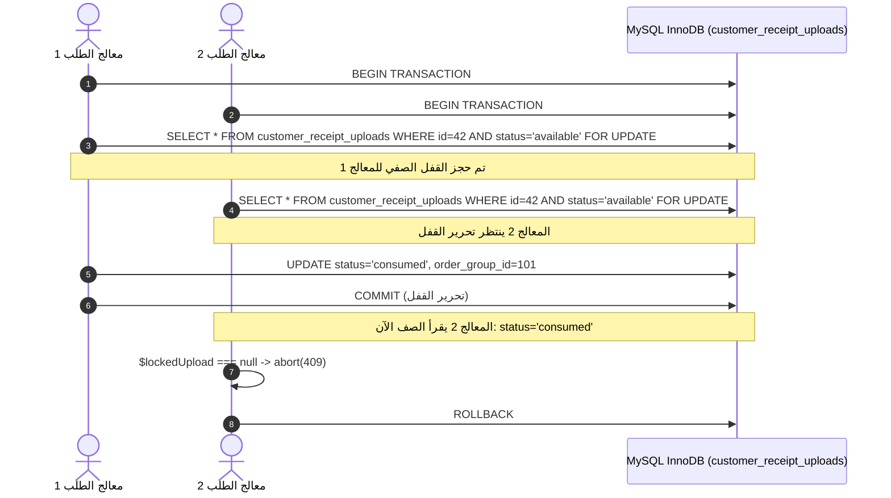

# التزامن الحرج وفرادة سندات التحويل — Phase 08.2
## Receipt Concurrency, Row Locking & State Transitions

**المسار:** `docs/architecture/phase-08-2-security-hardening/03_RECEIPT_CONCURRENCY_AND_UNIQUENESS.md`  
**الحالة:** معتمد ومنفذ  
**المكونات:** `Modules/Shop/app/Services/CustomerOrderService.php`, `Modules/Shop/app/Models/CustomerReceiptUpload.php`

---

## 1. تحليل سباق التزامن (Race Condition & TOCTOU Analysis)

قبل التحديث الأمني، كان فحص استخدام السند يعتمد على استعلام بحث عادي:
```php
OrderGroup::where('manual_payment_details->receipt_image_url', $receiptImageUrl)->exists();
```
هذا النمط يعاني من ثغرة **Time-of-Check to Time-of-Use (TOCTOU)**:
- إذا أرسل العميل طلبين متزامنين في نفس الميلي ثانية (بواسطة سكريبت أو نقر مزدوج)، فسيقوم الطلبان بقراءة عدم وجود السند في جدول الطلبات قبل أن يُكتب أي منهما.
- كلاهما سيمر بنجاح، مما يؤدي إلى إنشاء طلبي شراء لنفس السند البنكي لخصم منتجين بسند دفع واحد.

---

## 2. آلية القفل الصفي والانتقال الذري للحالة (`lockForUpdate`)

تم حل هذه المعضلة باستخدام قفل الصفوف الحصري في محرك **MySQL InnoDB**:

```php
// داخل DB::transaction
if ($isManualPayment && $uploadRecord) {
    /** @var CustomerReceiptUpload|null $lockedUpload */
    $lockedUpload = CustomerReceiptUpload::query()
        ->where('id', $uploadRecord->id)
        ->where('user_id', $customer->id)
        ->where('status', 'available')
        ->lockForUpdate()
        ->first();

    if (! $lockedUpload) {
        abort(409, 'سند التحويل قيد الاستخدام في طلب متزامن آخر أو تم استهلاكه.');
    }
}
```

### انتقال الحالة بعد نجاح إنشاء الطلب:
```php
if ($lockedUpload) {
    $lockedUpload->update([
        'status' => 'consumed',
        'order_group_id' => $orderGroup->id,
        'consumed_at' => now(),
    ]);
}
```



---

## 3. دورة استعادة السند عند الإلغاء (Order Cancellation Rollback)

إذا قام العميل بإلغاء طلبه قبل مراجعته واعتماده من قبل الإدارة، فإن النظام يسترجع السند تلقائياً إلى حالة `available`:

```php
if ($orderGroup->is_manual_payment) {
    CustomerReceiptUpload::query()
        ->where('order_group_id', $orderGroup->id)
        ->where('user_id', $customer->id)
        ->update([
            'status' => 'available',
            'order_group_id' => null,
            'consumed_at' => null,
        ]);
}
```

---

## 4. إثبات التحقق بالاختبارات الآلية

- اختبار `locks receipt row and atomically transitions status to consumed upon successful order creation` نجح بنجاح.
- اختبار `restores receipt upload status to available when order is cancelled` نجح بنجاح.
- اختبار `rejects wallet order when receipt image was reused in another order` أكد رفض الاستخدام المكرر بـ 422/409.

