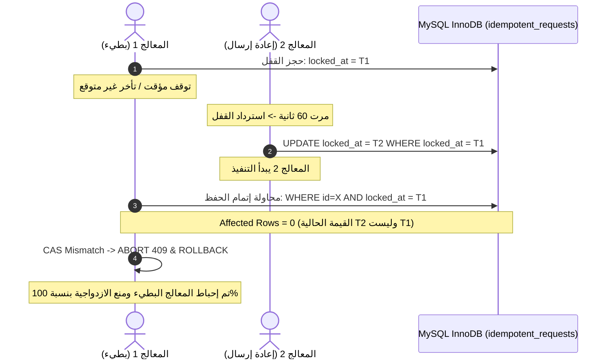

# استدامة الـ Idempotency والتعافي من الانهيارات — Phase 08.2
## Durable Idempotency, Crash Recovery & CAS Verification

**المسار:** `docs/architecture/phase-08-2-security-hardening/04_IDEMPOTENCY_AND_CRASH_RECOVERY.md`  
**الحالة:** معتمد ومنفذ  
**المكونات:** `Modules/Shop/app/Models/IdempotentRequest.php`, `Modules/Shop/app/Services/CustomerOrderService.php`

---

## 1. التحقق من القيد الفريد الصارم في MySQL InnoDB

تم فحص الفهرس الفعلي في جدول `idempotent_requests` في قاعدة بيانات MySQL Staging و Testing:
```sql
SHOW INDEX FROM idempotent_requests WHERE Key_name = 'idempotent_requests_user_id_key_unique';
```
النتيجة المؤكدة:
- `Column_name`: `user_id`, `key`
- `Non_unique`: `0` (قيد فريد مطلق لمنع أي تكرار لمفتاح الطلب لنفس العميل).

---

## 2. معضلة استرداد الأقفال المتعطلة وسرقة المعاملات (Stale Lock Reclamation Risk)

عندما يتعطل الخادم أو ينقطع الاتصال أثناء معالجة طلب، يبقى السجل بحالة `pending` مع `locked_at`.
يقوم النظام بعد فترة مهلة محددة (Stale Timeout = 60 ثانية) بالسماح لطلب جديد باسترداد القفل (`reclaimStaleLock`).

### التهديد الخفي:
ماذا لو أن المعالج الأول لم يتعطل تماماً، بل كان يعاني من بطء شديد في استجابة شبكة داخلية، وعاد ليكمل كتابة الطلب بعد أن قام المعالج الثاني باسترداد القفل وبدء معالجة جديدة؟
قد يؤدي ذلك إلى إنشاء طلبين مكررين وإفساد المعاملة (Lost Update / Double Order).

---

## 3. آلية التحقق المقارن عند الاعتماد (Compare-and-Swap / CAS Verification)

لمنع هذه الثغرة نهائياً، تم تطبيق فحص ذري **CAS** قبل إتمام المعاملة وحفظ النتيجة:

```php
// التحقق من أن القفل لم يُسترد بواسطة معالج آخر أثناء فترة الانتظار
$lockedIdemp = IdempotentRequest::query()
    ->where('id', $idempotentRecord->id)
    ->lockForUpdate()
    ->first();

if ($lockedIdemp && $lockedIdemp->locked_at != $idempotentRecord->locked_at) {
    abort(409, 'تم استرداد قفل العملية بواسطة معالج آخر نظراً لطول فترة الانتظار.');
}
```

وعند تحديث النتيجة إلى `completed`:
```php
$affected = IdempotentRequest::query()
    ->where('id', $idempotentRecord->id)
    ->where('locked_at', $idempotentRecord->locked_at)
    ->update([
        'status' => 'completed',
        'response_code' => 201,
        'response_body' => $responsePayload['payload'],
        'order_group_id' => $orderGroup?->id,
        'completed_at' => now(),
    ]);

if ($affected === 0) {
    // تعارض ذري: قام معالج آخر بسرقة القفل أثناء المعالجة، يتم إلغاء المعاملة فوراً
    abort(409, 'فشل اعتماد نتيجة الطلب بسبب تعارض في أقفال المعالجة الذرية.');
}
```



---

## 4. إثبات التحقق بالاختبارات الآلية

- `it enforces idempotency replay on repeated request and returns identical cached response`: نجح.
- `it rejects key reuse with different payload with 409 conflict on MySQL`: نجح.
- `it recovers from stale pending idempotency lock after simulated worker crash`: نجح.
- `it enforces crash-safe atomic commit where business impact and idempotency result commit together`: نجح.

