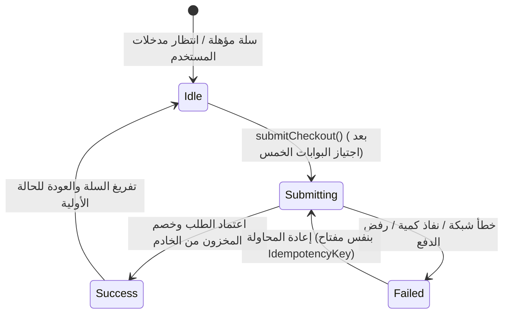

# معمارية تدفق إتمام الشراء والدفع في Riverpod 3
# Checkout Flow Architecture & Validation Gates

## 1. تصميم آلة حالة تدفق الشراء (Checkout State Machine)

تم تصميم حالة الشراء في `CheckoutState` ككائن غير قابل للتعديل المباشر (Immutable State) محصن بآلة حالات رباعية:



---

## 2. بوابات التحقق المسبق الإلزامية (Pre-Submission Validation Gates)

قبل الشروع في أي طلب شبكي أو احتساب مالي، يتحقق `CheckoutFlowNotifier.submitCheckout` من خمس بوابات صارمة:

1. **بوابة فراغ السلة (Cart Emptiness Gate):**
   ```dart
   if (cart.isEmpty) {
     // رفض فوري مع رسالة: السلة فارغة
     return null;
   }
   ```
2. **بوابة التغطية الجغرافية والعنوان (Geographical Serviceability Gate):**
   ```dart
   if (address.isEmpty || !address.isServiceable) {
     // رفض فوري: العنوان خارج نطاق التغطية
     return null;
   }
   ```
3. **بوابة بيانات التواصل (Contact Completeness Gate):**
   ```dart
   if (contact.isEmpty) {
     // رفض فوري: رقم هاتف المندوب غير مكتمل
     return null;
   }
   ```
4. **بوابة صلاحية عرض السعر الخادمي (Authoritative Server Quote Gate):**
   ```dart
   if (!quote.isValid) {
     // رفض فوري: عرض السعر stale أو loading أو غير معتمد
     return null;
   }
   ```
5. **بوابة سند التحويل للمحافظ (Wallet Receipt Mandatory Gate):**
   ```dart
   if (state.isWalletPayment && !state.hasReceipt) {
     // رفض فوري: سند التحويل البنكي إلزامي لطريقة الدفع بالمحفظة
     return null;
   }
   ```

---

## 3. تكامل التسعير المعتمد مع المستودع (Authoritative Amount Dispatch)

عند إرسال الطلب، لا يقوم العميل بتمرير أي مبالغ محسوبة محلياً كقيم نهائية ملزمة، بل يرسل:
- `expectedGrandTotal: quote.grandTotal`
- `items`: البنود مع معرّفاتها الرقمية `product_variation_id` و `product_id`.
- `shippingOptionId`: خيار الشحن المعتمد في عرض السعر.
- `couponCode`: كود الخصم المعتمد في عرض السعر.

ويقوم خادم Laravel بإعادة احتساب العملية ومطابقتها قبل إنشاء سجل الطلب الرسمي وخصم الكميات من المخزون.

