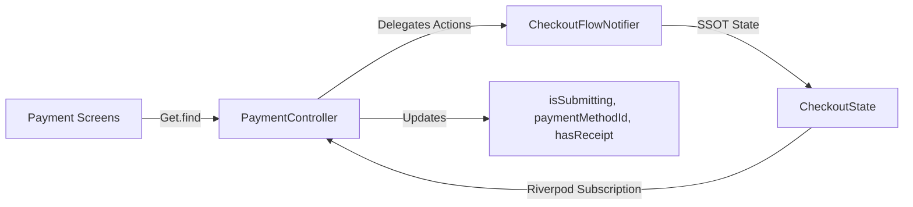

# جسر التوافق مع كنترولرات GetX القديمة
# GetX Compatibility Bridge & Facade Architecture

## 1. أهداف جسر التوافق (Bridge Objectives)

وفقاً لقواعد المشروع غير القابلة للتفاوض (`00-store-project-guardrails.md` و `10-getx-and-portability.md`):
- يحظر إجراء أي هجرة كاملة أو إعادة كتابة شاملة للواجهات أو موجه الصفحات (Router) قبل المرحلة 09.
- تظل جميع شاشات الدفع (`PaymentView`, `OrderConfirmationScreen`, `OrderSuccessScreen`, `OrdersView`, `OrderTrackingView`) تستخدم استدعاءات GetX الحالية كما هي دون تعديل.
- يتم تفريغ المنطق المالي والشبكي من الكنترولرات القديمة وتحويلها إلى واجهات تفويض أحادية الكاتب (Single-Writer Delegation Facades).

---

## 2. تفويض `PaymentController` إلى Riverpod



### آليات التفويض المنفذة:
1. `setPaymentMethodId(id)` يفوض إلى `_checkoutNotifier.setPaymentMethod(id)`.
2. `setSelectedWalletAccountIndex(i)` يفوض إلى `_checkoutNotifier.selectWalletAccount(i)`.
3. `pickReceiptImage()` يفوض إلى `_checkoutNotifier.setReceiptImage(...)`.
4. `removeReceiptImage()` يفوض إلى `_checkoutNotifier.clearReceipt()`.
5. `confirmAndSubmitOrder()` يعتمد على حارس النقر المزدوج ويستدعي `cart.payNow` / `submitCheckout`.

---

## 3. تفويض `OrdersController` إلى Riverpod

### آليات التفويض المنفذة:
1. `loadOrders({refresh})` يفوض إلى `_ordersNotifier.loadOrders(refresh: refresh)`.
2. `setFilter(filter)` يفوض إلى `_ordersNotifier.setFilter(filter)`.
3. `addOrder(order)` يفوض إلى `_ordersNotifier.addOrder(order)`.
4. `cancelOrder(orderId)` يفوض إلى `_ordersNotifier.cancelOrder(orderId)`.
5. `clearOrders()` يفوض إلى `_ordersNotifier.clear()` ويطهر الكاش المحلي لـ `_repository`.
6. اشتراك Riverpod المباشر (`_ordersSub`):
   ```dart
   _ordersSub = _effectiveContainer.listen<OrdersState>(
     ordersProvider,
     (previous, next) {
       orders.assignAll(next.orders);
       isLoading.value = next.isLoading;
     },
     fireImmediately: false,
   );
   ```
   هذا الربط يضمن أن أي تحديث يطرأ في Riverpod ينعكس فوراً في الـ `RxList<OrderModel>` المعروض في واجهات GetX.

