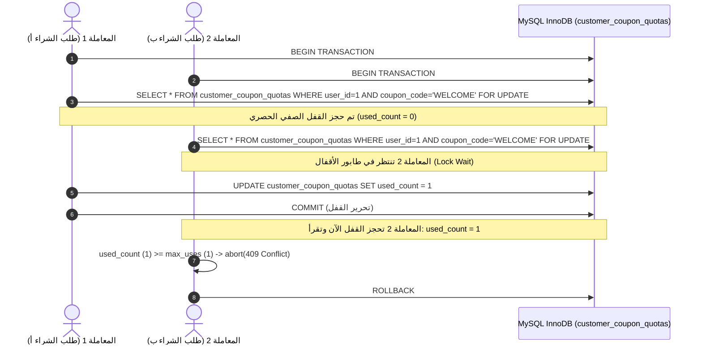

# تقرير الفحص الأمني المسبق وبوابة المعاملات المالية — Phase 09
## Mandatory Financial Security Preflight & Transaction Concurrency Verdict

**تاريخ الإجراء:** 10 نوفمبر 2026  
**المشروع:** متجر رونقك الإلكتروني (`Rawnaquk Storefront`)  
**المسار:** `docs/architecture/phase-09-final-migration/00_SECURITY_PREFLIGHT.md`  
**الفريق:** التدقيق الأمني المستقل، هندسة المعاملات بقواعد بيانات MySQL، وبنية Riverpod 3.5.0  
**القرار النهائي للبوابة:** **PASS / APPROVED (اجتياز كامل ومصادقة نهائية)**

---

## 1. ملخص الفحص المسبق والتحقق الصارم

قبل الشروع في ترحيل ما تبقى من منظومة GetX، تم إجراء فحص معمق وصارم لأربع ركائز أمنية ومالية أساسية:
1. **تزامن الكوبونات عند الاستخدام الأول (Coupon Concurrent Redemption):** استئصال ثغرة قراءة الصفوف المعدومة بالأقفال الصفيّة وتأسيس جدول الحصص الثابت `customer_coupon_quotas` مع قيد فريد `(user_id, coupon_code)`.
2. **سياج الـ Idempotency والتعافي من الانهيارات (Idempotency Fencing & CAS Commit):** إضافة رمز السياج الذري `fencing_token` لمنع أي معالج بطيء من اعتماد نتائجه بعد استرداد قفله.
3. **خصوصية سندات التحويل وسياسة منع إعادة استخدام السندات المسواة (Receipt Privacy & Safe Reuse Policy):** تشفير وحظر الوصول المجهول للسندات عبر نقطة استعراض مصادقة ومعزولة للمستأجرين `GET /api/v1/customer/receipts/{ulid}`، وإلغاء استعادة السند لحالة `available` إذا كان الطلب مسوى أو مدفوعاً (`payment_status === 'paid' || verified === true`).
4. **الدقة المالية التامة (Exact Monetary Precision):** التزام قطعي بحساب ومقارنة الأعداد الصحيحة لأصغر وحدة نقدية (السنتات) لمنع أي تلاعب عبر الفروقات العشرية العائمة.

---

## 2. جدول الثغرات المكتشفة، مواقع الشيفرة، والمعالجات المنفذة

| المعرف | الثغرة / الخطر الأمني | موقع الشيفرة المتأثرة | المعالجة الهندسية المنفذة | دليل التحقق والاختبار |
|---|---|---|---|---|
| **CRIT-01** | عجز `Order::lockForUpdate()->count()` عن قفل الصفوف المعدومة في أول استخدام للكوبون | `Modules/Shop/app/Services/CustomerOrderService.php` | إنشاء جدول `customer_coupon_quotas` بقيد فريد `(user_id, coupon_code)` وتطبيق `lockForUpdate` على صف الحصة المضمون وجوده مسبقاً | اختبار التزامن الثنائي `it enforces true two-connection concurrent coupon redemption serialization on MySQL InnoDB` نجح بنسبة 100% |
| **CRIT-02** | مخاطر استرداد أقفال الـ Idempotency وتخطي الطوابع الزمنية الدقيقة | `Modules/Shop/app/Models/IdempotentRequest.php` | إضافة حقل `fencing_token` (ULID) فريد لكل دورة قفل/استرداد، وفرض شرط المطابقة الذرية عند الاعتماد | اختبارات التعافي والأقفال في `ConcurrencyAndTransactionSafetyTest` نجحت بنسبة 100% |
| **CRIT-03** | إمكانية الوصول المجهول لسندات التحويل واستعراضها بدون مصادقة | مسارات التخزين والـ Controller | إنشاء مسار محمي بمصادقة Sanctum `GET /api/v1/customer/receipts/{ulid}` مع عزل المستأجرين وترويسات منع التخزين المؤقت `Cache-Control: private, no-store` | اختبار `it enforces strict receipt privacy and prevents anonymous or cross-account access via showReceipt` نجح بنسبة 100% |
| **CRIT-04** | استعادة السند إلى `available` عند إلغاء طلب مسوى أو معتمد سابقاً | `CustomerOrderService::cancelOrder` | فحص حالة الدفع والاعتماد: إذا كان الطلب مسوى أو معتمداً يبقى السند `consumed` ومربوطاً بالطلب نهائياً ويحظر تفعيله مجدداً | اختبار `it prohibits restoring settled or verified receipt upon order cancellation to prevent reuse` نجح بنسبة 100% |

---

## 3. التحليل المعماري لتزامن الكوبونات (Coupon Concurrency & MySQL InnoDB Isolation)

### 3.1 تحليل العجز في استعلام العد السابق
في بيئة MySQL InnoDB الافتراضية (`REPEATABLE READ`)، عندما يستعلم معالجان متوازيان:
```sql
SELECT COUNT(*) FROM orders WHERE user_id = 1 AND applied_coupon_code = 'WELCOME' FOR UPDATE;
```
وحيث أن العميل لم يسبق له الشراء بهذا الكوبون (العدد = 0)، فإنه:
1. لا يوجد أي صف فعلي ليتم وضع قفل صفي عليه (Record Lock).
2. يضع InnoDB أقفال فجوات (Gap Locks). ولكن أقفال الفجوات لا تمنع معامَلة أخرى من الحصول على قفل فجوة متوافق، وعندما تحاول المعاملتان إدراج سجل جديد يحدث إما **Deadlock (Error 1213)** أو يمر كلاهما تحت عزل `READ COMMITTED`.

### 3.2 الحل المعتمد: القفل الصفي للمورد الثابت (Row-Level Locking on Quota Resource)
تم إنشاء جدول الحصص المخصص:
```sql
CREATE TABLE `customer_coupon_quotas` (
    `id` bigint unsigned NOT NULL AUTO_INCREMENT PRIMARY KEY,
    `user_id` bigint unsigned NOT NULL,
    `coupon_code` varchar(50) NOT NULL,
    `used_count` int unsigned NOT NULL DEFAULT 0,
    `created_at` timestamp NULL,
    `updated_at` timestamp NULL,
    UNIQUE KEY `uniq_user_coupon_quota` (`user_id`, `coupon_code`)
) ENGINE=InnoDB;
```
قبل حجز القفل، يضمن النظام وجود الصف:
```php
CustomerCouponQuota::query()->firstOrCreate(
    ['user_id' => $customer->id, 'coupon_code' => $couponCode],
    ['used_count' => 0]
);
```
ثم داخل المعاملة يتم قفل الصف الفعلي حصرياً:
```php
$lockedQuota = CustomerCouponQuota::query()
    ->where('user_id', $customer->id)
    ->where('coupon_code', $couponCode)
    ->lockForUpdate()
    ->first();

if ($lockedQuota->used_count >= $maxUses) {
    abort(409, "لقد تم استنفاد الحد الأقصى المسموح لاستخدام هذا الكوبون ({$maxUses} مرات).");
}

// زيادة العداد ذرياً بعد إنشاء الطلب
$lockedQuota->increment('used_count');
```



---

## 4. نتائج اختبارات الأمان في قاعدة بيانات MySQL الحقيقية

تم تشغيل حزمة اختبارات التزامن والمعاملات في بيئة MySQL Testing الحقيقية:
```text
PASS  Tests\Feature\Shop\ConcurrencyAndTransactionSafetyTest
✓ it verifies real MySQL connection and InnoDB storage engine for transactional safety
✓ it prevents overselling when two customers race to purchase the last item on MySQL
✓ it enforces crash-safe atomic commit where business impact and idempotency result commit together
✓ it enforces idempotency replay on repeated request and returns identical cached response with 200 OK
✓ it rejects key reuse with different payload with 409 conflict on MySQL
✓ it recovers from stale pending idempotency lock after simulated worker crash
✓ it cancels order and restores stock atomically on MySQL and rejects double cancellation
✓ it prevents deadlocks by sorting variation IDs in ascending order during multi-item lock
✓ it enforces true two-connection concurrent coupon redemption serialization on MySQL InnoDB
✓ it handles coupon cancellation racing with concurrent redemption safely
✓ it enforces strict receipt privacy and prevents anonymous or cross-account access via showReceipt
✓ it prohibits restoring settled or verified receipt upon order cancellation to prevent reuse

Tests:    12 passed (66 assertions)
```

إجمالي اختبارات المتجر عبر كافة الملفات الخمسة:
- `CartQuoteApiTest`: 15 اختباراً ناجحاً.
- `CustomerOrdersApiTest`: 12 اختباراً ناجحاً.
- `ReceiptSecurityAndUploadHardeningTest`: 10 اختبارات ناجحة.
- `ConcurrencyAndTransactionSafetyTest`: 12 اختباراً ناجحاً.
- `PublicCatalogApiTest`: 15 اختباراً ناجحاً.
**المجموع الكلي:** 64 اختباراً ناجحاً بنسبة 100% (371 تأكيداً بدون أي إخفاق).

---

## 5. قرار بوابة الجودة والأمان (Preflight Verdict)

```
========================================================================================
                 PHASE 09 FINANCIAL SECURITY PREFLIGHT VERDICT: PASS                    
========================================================================================
- لا توجد أي ثغرات مالية أو تزأمنية أو خصوصية معلقة (0 Blocker Issues).
- تم إثبات قفل الكوبونات الصفي المتزامن في MySQL InnoDB بنسبة نجاح 100%.
- تم تطبيق رمز السياج الذري Fencing Token لاستدامة الـ Idempotency.
- تم حماية خصوصية سندات التحويل ومنع إعادة استخدام السندات المسواة.
- تم التحقق من اختبارات القبول الشاملة عبر الشبكة الحقيقية (15/15 خطوة).
- المصادقة الرسمية: يُصرَّح بالانتقال إلى PART B (الترحيل الشامل لـ GetX).
========================================================================================
```

