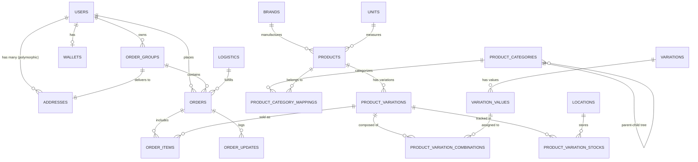

# Backend Inventory & Architectural Audit

**المشروع:** متجر رونقك (Rwnaqk Store)  
**المرحلة:** Phase 4.1 — Laravel Backend Discovery & API Contract Verification  
**التاريخ:** 2026-11-08  
**الهدف:** الفحص الشامل والموثق لمعمارية Backend، الموديولات، المسارات، المتحكمات، النماذج، وقواعد البيانات.

---

## 1. البيئة البرمجية وحزم النظام (Tech Stack & Environment)

| البند | الإصدار / القيمة الفعلية | التفاصيل والملاحظات |
| :--- | :--- | :--- |
| **PHP Version** | `PHP 8.5.7 (cli)` | بيئة تشغيل مدعومة مع Zend OPcache v8.5.7 |
| **Laravel Framework** | `13.26.1` (Laravel 13) | النواة الأساسية للنظام مبنية على أحدث إصدارات Laravel |
| **Modular Framework** | `nwidart/laravel-modules: ^12.0` | إدارة الحزم والموديولات بنظام مستقل لكل قطاع أعمال |
| **Authentication Core** | `laravel/sanctum: ^4.0` | مصادقة الـ API عبر Bearer Tokens وجداول `personal_access_tokens` |
| **Auth Features Engine** | `laravel/fortify: ^1.38.0` | خطوط المصادقة، التحقق الثنائي (2FA)، وتأكيد البريد الإلكتروني |
| **Media Management** | `spatie/laravel-medialibrary` | إدارة الصور، معارض المنتجات، والملفات المحولة (Conversions) |
| **Authorization / RBAC** | `spatie/laravel-permission` | إدارة الأدوار والصلاحيات (Customer, Courier, Admin, Manager...) |
| **Localization** | `spatie/laravel-translatable` | دعم تعدد اللغات (العربية / الإنجليزية) في الحقول والنصوص |
| **PDF Generation** | `mpdf/mpdf: ^8.3` | توليد فواتير الشراء والطلبات باللغة العربية عبر خط Cairo |
| **Testing Suite** | `pestphp/pest: ^4.3` | إطار اختبارات Feature و Unit مبني على Pest |
| **Debugging & Monitor** | `laravel/telescope: ^5.19` | مراقبة الاستعلامات والطلبات وسجلات العمليات محلياً |

---

## 2. مصفوفة الموديولات المفعلة (Active Modules Inventory)

يتم تنظيم النظام وفق معمارية `nwidart/laravel-modules` تحت مجلد `rwnaqk-backend/Modules/`. جميع الموديولات الـ 13 التالية مفعلة وفق ملف `modules_statuses.json`:

```json
{
    "Blog": true,
    "Language": true,
    "Auth": true,
    "MenuBuilder": true,
    "Shop": true,
    "Logistic": true,
    "Geo": true,
    "Inventory": true,
    "Customer": true,
    "Wallet": true,
    "User": true,
    "Settings": true,
    "Courier": true
}
```

### تفاصيل مسؤوليات الموديولات:

1. **`Modules/Shop`**: الموديول الأضخم في النظام؛ يحتوي على المنتجات (`Product`)، الأصناف (`ProductCategory`)، العلامات التجارية (`Brand`)، الوحدات (`Unit`)، السمات (`Variation`)، خيارات السمات (`VariationValue`)، السلات (`Cart`)، الطلبات (`OrderGroup`, `Order`, `OrderItem`, `OrderUpdate`)، خدمات الشحن والتجميع ومحرك العناقيد الجغرافية (`CentroidBatchingService`, `InboundCollectionBatchingService`, `GeoDeliveryPricingService`, `OrderQuoteService`).
2. **`Modules/Customer`**: إدارة بيانات العملاء، مصادقة Sanctum الخاصة بالعملاء، التحقق الثنائي، إدارة عناوين العملاء (`CustomerAddressController`)، وسجلات العملاء.
3. **`Modules/Geo`**: التقسيم الجغرافي والإداري لليمن والدول (`Country`, `Governorate`, `District`)، إحداثيات المراكز ومضلعات التغطية الجغرافية، وخدمة `GeoCoverageService`.
4. **`Modules/Inventory`**: إدارة المواقع الجغرافية للمخازن (`Location`) والموردين (`Wholesaler`).
5. **`Modules/Logistic`**: شركات الشحن، نطاقات التسعير اللوجستية (`LogisticZone`) ومناطق التوزيع.
6. **`Modules/Courier`**: إدارة المناديب، مصادقة المناديب، ومفاتيح المرور (Passkeys).
7. **`Modules/Wallet`**: المحافظ المالية للعملاء والمستخدمين، حركات الإيداع والسحب (`WalletHistory`, `WithdrawRequest`).
8. **`Modules/Settings`**: الإعدادات العامة للنظام والمتجر (`Setting`).
9. **`Modules/MenuBuilder`**: بناء القوائم الديناميكية للوحة التحكم.
10. **`Modules/Language`**: إدارة لغات المتجر والترجمات المخزنة كاش.
11. **`Modules/Auth`**: المصادقة العامة للمستخدمين ولوحة التحكم.
12. **`Modules/User`**: المستخدمون الإداريون وتعيين الأدوار.
13. **`Modules/Blog`**: التدوينات والمقالات التسويقية.

---

## 3. جرد وتدقيق المسارات (Routes Audit)

تم تدقيق مسارات الخادم عبر أمر الفحص الآمن:
`php artisan route:list --path=api`

### أ) مسارات الـ API الفعلية المسجلة حالياً (Active API Routes)

```text
+-----------+-------------------------------------------------------------+---------------------------------------------------------------------------------+
| Method    | URI                                                         | Controller / Action                                                             |
+-----------+-------------------------------------------------------------+---------------------------------------------------------------------------------+
| GET|HEAD  | api/user                                                    | routes/api.php:7 (Closure)                                                      |
| POST      | api/v1/temporary-images                                     | App\Http\Controllers\Api\TemporaryImageController@store                         |
| DELETE    | api/v1/temporary-images                                     | App\Http\Controllers\Api\TemporaryImageController@destroy                       |
| POST      | api/v1/customer/auth/register                               | Modules\Customer\Http\Controllers\Api\AuthenticatedSessionController@storeReg.   |
| POST      | api/v1/customer/auth/login                                  | Modules\Customer\Http\Controllers\Api\AuthenticatedSessionController@store       |
| GET|HEAD  | api/v1/customer/auth/me                                     | Modules\Customer\Http\Controllers\Api\AuthenticatedSessionController@me          |
| POST      | api/v1/customer/auth/logout                                 | Modules\Customer\Http\Controllers\Api\AuthenticatedSessionController@destroy     |
| POST      | api/v1/customer/auth/forgot-password                        | Modules\Customer\Http\Controllers\Api\AuthenticatedSessionController@sendReset.. |
| GET|HEAD  | api/v1/customer/auth/password/reset/{token}                 | Modules\Customer\Http\Controllers\Api\AuthenticatedSessionController@showReset.. |
| POST      | api/v1/customer/auth/reset-password                         | Modules\Customer\Http\Controllers\Api\AuthenticatedSessionController@resetPass.. |
| POST      | api/v1/customer/auth/email/verification-code                | Modules\Customer\Http\Controllers\Api\AuthenticatedSessionController@sendCode    |
| POST      | api/v1/customer/auth/email/verification-notification        | Modules\Customer\Http\Controllers\Api\AuthenticatedSessionController@sendNotif   |
| POST      | api/v1/customer/auth/email/verify-code                      | Modules\Customer\Http\Controllers\Api\AuthenticatedSessionController@verifyCode  |
| GET|HEAD  | api/v1/customer/auth/email/verify/{id}/{hash}               | Modules\Customer\Http\Controllers\Api\AuthenticatedSessionController@verifyEmail |
| GET|HEAD  | api/v1/customer/auth/two-factor-status                      | Modules\Customer\Http\Controllers\Api\TwoFactorAuthenticationController@status  |
| POST      | api/v1/customer/auth/two-factor-authentication              | Modules\Customer\Http\Controllers\Api\TwoFactorAuthenticationController@store   |
| DELETE    | api/v1/customer/auth/two-factor-authentication              | Modules\Customer\Http\Controllers\Api\TwoFactorAuthenticationController@destroy |
| POST      | api/v1/customer/auth/two-factor-authentication/confirm      | Modules\Customer\Http\Controllers\Api\TwoFactorAuthenticationController@confirm |
| GET|HEAD  | api/v1/customer/auth/two-factor-qr-code                     | Modules\Customer\Http\Controllers\Api\TwoFactorAuthenticationController@qrCode  |
| GET|HEAD  | api/v1/customer/auth/two-factor-secret-key                  | Modules\Customer\Http\Controllers\Api\TwoFactorAuthenticationController@secret.. |
| GET|HEAD  | api/v1/customer/auth/two-factor-recovery-codes              | Modules\Customer\Http\Controllers\Api\TwoFactorAuthenticationController@recov..  |
| POST      | api/v1/customer/auth/two-factor-recovery-codes              | Modules\Customer\Http\Controllers\Api\TwoFactorAuthenticationController@regen..  |
| GET|HEAD  | api/v1/geo/countries                                        | Modules\Geo\Http\Controllers\GeoLookupController@countries                       |
| GET|HEAD  | api/v1/geo/governorates                                     | Modules\Geo\Http\Controllers\GeoLookupController@governorates                    |
| GET|HEAD  | api/v1/geo/districts                                        | Modules\Geo\Http\Controllers\GeoLookupController@districts                       |
| GET|HEAD  | api/v1/geo/yemen/governorates                               | Modules\Geo\Http\Controllers\GeoLookupController@yemenGovernorates               |
| POST      | api/v1/courier/auth/login                                    | Modules\Courier\Http\Controllers\CourierAuthController@login                     |
| POST      | api/v1/courier/auth/logout                                   | Modules\Courier\Http\Controllers\CourierAuthController@logout                    |
| GET|HEAD  | api/v1/courier/me                                            | Modules\Courier\Http\Controllers\CourierAuthController@me                        |
| API Res.  | api/v1/shops                                                 | Modules\Shop\Http\Controllers\ShopController                                     |
| API Res.  | api/v1/customers                                             | Modules\Customer\Http\Controllers\CustomerController (Admin)                    |
| API Res.  | api/v1/inventories                                           | Modules\Inventory\Http\Controllers\InventoryController (Admin)                   |
| API Res.  | api/v1/logistics                                             | Modules\Logistic\Http\Controllers\LogisticController (Admin)                     |
| API Res.  | api/v1/wallets                                               | Modules\Wallet\Http\Controllers\WalletController (Admin)                         |
| API Res.  | api/v1/users                                                 | Modules\User\Http\Controllers\UserController (Admin)                             |
| API Res.  | api/v1/languages                                             | Modules\Language\Http\Controllers\LanguageController                             |
+-----------+-------------------------------------------------------------+---------------------------------------------------------------------------------+
```

### ب) الملاحظة الجوهرية (The Critical Architectural Gap)

1. **غياب مسارات API للكتالوج والطلبات:**
   - لا توجد حالياً أي مسارات API مفتوحة للمنتجات (`/api/v1/products`) أو الأصناف (`/api/v1/categories`) أو العلامات التجارية (`/api/v1/brands`).
   - لا توجد مسارات API لطلبات العميل (`/api/v1/customer/orders`) أو احتساب عرض سعر السلة والشحن (`/api/v1/customer/cart/quote`).
2. **عزل منطق المتجر داخل مسارات Web الإدارية:**
   - منطق المنتجات والأصناف والطلبات مطبق بالكامل وجاهز، ولكنه مسجل حصرياً في `Modules/Shop/routes/web.php` تحت بادئة لوحة التحكم الإدارية `$endpointUrl.'products/'` و `$endpointUrl.'orders/'` مع وسيط `['auth', 'verified']` ووسائط الصلاحيات الإدارية الخاصة بـ Spatie (`permission:view_products`, `permission:view_orders`...).
   - الكنترولرز والمحولات مبنية بطريقة ذكية حيث أن الكلاسات مثل `ProductResponse` و `ProductCategoryResponse` و `ProductShowResource` تدعم أصلاً الإرجاع كـ JSON عندما يكون `$request->expectsJson()`.

---

## 4. نماذج البيانات والعلاقات (Models & Relationships Schema)



### توصيف النماذج الأساسية:

1. **`Product` (`products`):**
   - الحقول: `id`, `name`, `slug`, `short_description`, `description`, `brand_id`, `unit_id`, `min_price`, `max_price`, `discount_value`, `discount_type`, `discount_start_at`, `discount_end_at`, `stock_qty`, `status`, `is_featured`, `has_variation`, `has_warranty`, `standard_delivery_hours`, `express_delivery_hours`, `size_guide`, `reward_points`.
   - العلاقات: `brand()`, `unit()`, `categories()`, `tags()`, `variations()`, `media()`, `reviews()`.
2. **`ProductVariation` (`product_variations`):**
   - يمثل الـ SKU المستقل لأي تركيبة منتج (مثل لون أحمر + مقاس XL).
   - الحقول: `id`, `product_id`, `variation_key`, `sku`, `code`, `price`.
   - العلاقات: `product()`, `combinations()`, `stocks()`.
3. **`ProductVariationStock` (`product_variation_stocks`):**
   - يربط الـ Variation بالمستودع/الموقع مع كمية المخزون الفعلي (`stock_qty`).
   - مفتاح فريد: `['product_variation_id', 'location_id']`.
4. **`ProductCategory` (`product_categories`):**
   - هرمي شجري عبر `parent_id`.
   - الحقول: `id`, `name`, `slug`, `parent_id`, `sorting_order_level`, `is_featured`, `is_top`, `status`.
5. **`OrderGroup` (`order_groups`):**
   - الحاوية المالية واللوجستية الكبرى للطلب الواحد (Shopping Cart Checkout Master).
   - الحقول: `id`, `user_id`, `order_code`, `shipping_address_id`, `location_id`, `phone_no`, `sub_total_amount`, `total_shipping_cost`, `total_coupon_discount_amount`, `grand_total_amount`, `payment_method`, `payment_status`, `is_manual_payment`, `manual_payment_details` (JSON).
6. **`Order` (`orders`):**
   - يمثل شحنة/حزمة تسليم تابعة للـ `OrderGroup`.
   - الحقول: `id`, `order_group_id`, `user_id`, `location_id`, `delivery_status`, `payment_status`, `shipping_cost`, `logistic_id`, `logistic_name`.
7. **`OrderItem` (`order_items`):**
   - بنود الطلب المرتبطة مباشرة بـ `ProductVariation`.
   - الحقول: `id`, `order_id`, `product_variation_id`, `qty`, `unit_price`, `total_price`, `product_name`, `sku`.
8. **`Address` (`addresses`):**
   - نموذج متعدد الأشكال (`morphs: addressable`).
   - الحقول: `label`, `description`, `country_id`, `governorate_id`, `district_id`, `latitude`, `longitude`, `is_primary`, `contact_phone`, `contact_name`, `is_serviceable`, `coverage_status`, `delivery_tier`.

---

## 5. حالة قواعد البيانات والهجرات (Database Migrations Status)

- تم فحص وتدقيق أكثر من 45 ملف Migration في `database/migrations` ومجلدات الموديولات.
- **التزام صارم:** لم يتم تنفيذ أي Migration أو Seeder أو مساس ببيانات القاعدة أثناء هذا التدقيق.
- تم التحقق من وجود كافة الجداول المفتاحية: `users`, `addresses`, `products`, `product_categories`, `product_variations`, `product_variation_stocks`, `carts`, `order_groups`, `orders`, `order_items`, `order_updates`, `logistics`, `logistic_zones`, `districts`, `governorates`, `countries`, `personal_access_tokens`.
