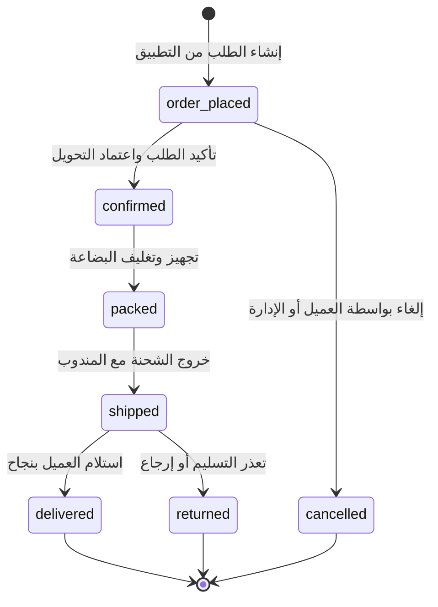

# Commerce Domain Analysis & Business Rules

**المشروع:** متجر رونقك (Rwnaqk Store)  
**المرحلة:** Phase 4.1 — تحليل منطق التجارة الإلكترونية وقواعد العمل  
**الهدف:** تحديد القواعد الحاكمة للمتجر، معمارية البيانات، الأصول القابلة لإعادة الاستخدام، وما يجب بناؤه دون تكرار منطق قائم.

---

## 1. هوية المنتج والسمة (Product & Variant Identity)

### قواعد العمل في Laravel:
- كل منتج يمثله سجل في جدول `products`.
- يحدد الحقل `has_variation` طبيعة المنتج:
  - **إذا كان `has_variation = false` (منتج بسيط):** يُنشئ النظام تلقائياً سجلاً واحداً في `product_variations` مرتبطاً بالمنتج بدون خيارات، وتكون كمية المخزون وسعر البيع مرتبطين به.
  - **إذا كان `has_variation = true` (منتج متعدد السمات):** يمتلك المنتج عدة سجلات في `product_variations`، كل سجل يحمل `sku` فريد، و `variation_key` يمثل تركيبة المعرفات (مثل `1|4` للون أحمر ومقاس XL)، ويرتبط بجدول `product_variation_combinations` الذي يربط السمة بقيمتها (`VariationValue`).
- في جدول عناصر الطلب `order_items`: يتم الربط دائماً مع `product_variation_id` (وليس مع `product_id` مباشرة)، مع أخذ لقطة نصية لحظية لاسم المنتج (`product_name`) والـ SKU (`sku`) وسعر الوحدة وقت الشراء لضمان سلامة السجلات المحاسبية حتى لو تغيرت بيانات المنتج لاحقاً.

### التوافق في Flutter:
- يتعامل `HomeProductItem` مع هوية المنتج عبر حقلين:
  - `id`: المعرف المعروض (وقد يمثل معرف الـ variant أو خط السلة الفريد `lineId`).
  - `originalProductId`: معرف المنتج الأصلي في الكتالوج لمنع فقدان هوية المنتج عند الإضافة للسلة.
- **التوصية:** عند جلب تفاصيل المنتج من `GET /api/v1/products/{id}`، يُعاد كائن `variations` بكامل تفاصيله وتركيباته، ليتمكن المستخدم من اختيار (اللون / المقاس) وتمرير `product_variation_id` الفعلي عند إضافة العنصر للسلة أو إنشاء الطلب.

---

## 2. المخزون المتاح والمحجوز (Available vs Reserved Inventory)

### الوضع الحالي في Backend:
- جدول `product_variation_stocks` يخزن المخزون لكل سمة منتج في كل موقع جغرافي/مستودع:
  `['product_variation_id', 'location_id', 'stock_qty']`.
- في إنشاء الطلبات الإدارية (`OrdersAction@store`): لا يوجد حالياً فحص إلزامي للمخزون أو حجز فوري لحظة الطلب، بل يتم تسجيل بنود الطلب مباشرة.
- لا يوجد حقل منفصل للمخزون المحجوز (`reserved_qty`).

### قاعدة العمل الإلزامية لـ API تطبيق العملاء:
1. **التحقق من توفر المخزون قبل إنشاء الطلب (Pre-order Validation):**
   - لكل بند في الطلب، يجب التحقق من أن:
     $$\sum(\text{stock\_qty}) \ge \text{requested\_qty}$$
   - في حال عدم التوفر، يتم إرجاع خطأ `422 Unprocessable Content` مع رسالة واضحة: `الكمية المطلوبة من المنتج غير متوفرة حالياً في المخزون`.
2. **خصم المخزون (Stock Deduction):**
   - عند تأكيد إنشاء الطلب بنجاح داخل الـ DB Transaction، يتم إنقاص `stock_qty` للسمة المطلوبة في الموقع المحدد أو الرئيسي.
   - في حال إلغاء الطلب وهو في حالة `order_placed`، يتم إعادة الكميات إلى `stock_qty` تلقائياً عبر Action إلغاء الطلب.

---

## 3. الأسعار والخصومات (Pricing & Discounts)

### طبقات التسعير والخصم:
1. **سعر المنتج الأساسي:**
   - السعر الأساسي لكل سمة مسجل في `product_variations.price`.
   - المنتجات البسيطة تُسجل `min_price` و `max_price` في `products`.
2. **خصومات المنتجات (Product Level Discounts):**
   - حقول جدول `products`: `discount_value` و `discount_type` (`percent` أو `fixed`) مع نطاق تاريخي `discount_start_at` و `discount_end_at`.
   - قاعدة الاحتساب:
     - إذا كان الخصم نسبة مئوية (`percent`):
       $$\text{Sale Price} = \text{Price} \times \left(1 - \frac{\text{discount\_value}}{100}\right)$$
     - إذا كان الخصم مبلغاً ثابتاً (`fixed`):
       $$\text{Sale Price} = \max(0, \text{Price} - \text{discount\_value})$$
     - لا يتم تطبيق الخصم إذا كان التاريخ الحالي خارج النطاق المحدد.
3. **خصومات الكوبونات (Order Level Coupon Discounts):**
   - تطبق على إجمالي السلة (`sub_total_amount`).
   - تسجل في `order_groups.total_coupon_discount_amount` و `orders.coupon_discount_amount`.
4. **المجموع الكلي النهائي للطلب:**
   $$\text{Grand Total} = \max(0, \text{Subtotal} - \text{Discounts} + \text{Shipping Cost} + \text{Tips})$$

---

## 4. احتساب الشحن والتغطية الجغرافية (Shipping & Geo Calculation)

يمتلك Backend متجر رونقك محركاً جغرافياً متطوراً جاهزاً بالكامل للاستخدام:

1. **`GeoDeliveryPricingService` (`Modules/Shop/Services/GeoDeliveryPricingService.php`):**
   - يحسب المسافة بين إحداثيات عنوان العميل (`latitude`, `longitude`) وأقرب مركز توزيع أو مستودع في المحافظة/المديرية.
   - يعتمد على خوارزمية Haversine لحساب المسافة بالأمتار والكيلومترات.
   - يفحص هل العنوان يقع ضمن نطاق التغطية المخدوم (`is_serviceable`).
   - يحدد شريحة التسعير (`delivery_tier`) ورسوم التوصيل الأساسية.
2. **`OrderQuoteService` (`Modules/Shop/Services/OrderQuoteService.php`):**
   - يربط العنوان بمناطق الشحن المسجلة في جدول `logistic_zones`.
   - يرجع قائمة الشركات اللوجستية المؤهلة لتوصيل الطلب (`eligible_logistics`) وتكلفة كل منها.
   - يدعم التخزين المؤقت الذكي بالكاش (`Cache::remember`) لمنع تكرار العمليات الحسابية الجغرافية لنفس العنوان.
3. **نظام العناقيد ومسارات التجميع (`CentroidBatchingService`):**
   - عند إنشاء أي طلب، يلحق النظام الطلب تلقائياً بأقرب دورة توزيع وعنقود مكاني (`assignOrderToCycle`) لجدولة المناديب وتوليد مسارات استلام البضائع من المتاجر.

---

## 5. دورة حياة الطلبات وحالاتها (Order Lifecycle & Statuses)

يستخدم النظام بنية من طبقتين:
- **`OrderGroup` (الحاوية المالية الرئيسية):** تمثل عملية الدفع الواحدة.
- **`Order` (شحنة التسليم):** تمثل الشحنة التنفيذية.

### حالات الدفع (`payment_status`):
- `unpaid`: افتراضية لطلبات الدفع عند الاستلام أو بانتظار مراجعة سند التحويل.
- `paid`: عند تأكيد الدفع أو التحقق من صحة السند.
- `failed`: في حال فشل المعاملة.
- `refunded`: في حال استرداد المبلغ إلى المحفظة.

### مطابقة حالات التتبع مع Flutter:
- في `OrderModel` و `OrderStatusStep`:
  - `pending` $\rightarrow$ يقابل `order_placed`
  - `confirmed` $\rightarrow$ يقابل `confirmed`
  - `shipped` $\rightarrow$ يقابل `shipped`
  - `delivered` $\rightarrow$ يقابل `delivered`
  - `canceled` $\rightarrow$ يقابل `cancelled`

---

## 6. وسائل الدفع وسندات التحويل (Payment Methods & Proofs)

يدعم تطبيق Flutter حالياً خيارين رئيسيين للدفع:

1. **الدفع عند الاستلام (`cash_on_delivery` - COD):**
   - يتم تعيين `payment_method = 'cash_on_delivery'`.
   - تكون حالة الدفع المبدئية `payment_status = 'unpaid'`.
   - لا يتطلب أي مرفقات.
2. **التحويل عبر المحافظ الإلكترونية (`wallet`):**
   - يدعم التحويل لحسابات معتمدة (مثل: ون كاش، جيب، الكريمي...).
   - **قاعدة إلزامية:** لا يمكن إتمام الطلب إلا بعد إرفاق صورة إشعار أو سند التحويل المالي.
   - **آلية العمل التقنية:**
     1. يرفع التطبيق صورة السند إلى مسار الـ API القائم:
        `POST /api/v1/temporary-images`
     2. يستلم التطبيق رابط الصورة المؤقتة: `{"url": "https://.../temporary-images/xxx.jpg"}`.
     3. عند إرسال طلب الشراء إلى `POST /api/v1/customer/orders`، يرسل التطبيق:
        - `payment_method`: `'wallet'`
        - `wallet_account_id`: معرف المحفظة المحول إليها
        - `payment_receipt_url`: رابط الصورة المستلمة
     4. يقوم الخادم بتخزين التفاصيل في حقل `manual_payment_details` (JSON) وتعيين `is_manual_payment = true` وربط الصورة بالطلب عبر Spatie MediaLibrary تحت مجموعة `payment_proof`.

---

## 7. صلاحيات الوصول والأمان (Security & Permissions)

- **عزل بيانات العملاء (Data Isolation):**
  - يجب ألا يتمكن أي عميل من الوصول إلى طلبات عميل آخر، أو تعديل عنوان لا يملكه.
  - جميع استعلامات طلبات العملاء وعناوينهم في الـ API تعتمد حصرياً على العميل المصادق:
    `$request->user()->orders()`
    `$request->user()->addresses()`
- **إلغاء الطلبات:**
  - يحق للعميل إلغاء طلبه فقط إذا كانت حالته `order_placed` (أو `pending`).
  - بمجرد انتقال الطلب إلى `confirmed` أو ما بعدها، يُمنع العميل من الإلغاء المباشر ويُطلب منه التواصل مع خدمة العملاء.

---

## 8. منع تكرار الطلبات (Idempotency Key Protection)

- يرسل تطبيق Flutter هيدر `X-Idempotency-Key` (UUID v4) مع كل استدعاء لـ `OrdersRepositoryImpl.createOrder`.
- **آلية العمل في Laravel:**
  - يتم اعتراض الهيدر عبر `IdempotencyMiddleware`.
  - إذا تم استلام نفس المفتاح لنفس المستخدم خلال 24 ساعة، يعيد الخادم الاستجابة المخزنة مسبقاً (مع كود الحالة نفسه) دون إعادة تنفيذ حركة الخصم أو إنشاء طلب مكرر.
  - المفتاح في الكاش: `idempotency:order:{user_id}:{idempotency_key}`.

---

## 9. مصفوفة الأصول: القابل لإعادة الاستخدام مقابل المطلوب بناؤه

| المكون / الوظيفة | الوضع الحالي | القرار المعماري |
| :--- | :--- | :--- |
| **محرك احتساب أسعار التوصيل** | موجود بالكامل في `GeoDeliveryPricingService` | **إعادة استخدام فورية** دون كتابة سطر رياضي إضافي |
| **محرك عروض أسعار السلة** | موجود في `OrderQuoteService` | **إعادة استخدام فورية** |
| **رفع سندات التحويل المؤقتة** | موجود ومفعل في `TemporaryImageController` | **إعادة استخدام فورية** |
| **محولات استعراض المنتجات** | `ProductShowResource` و `ProductResource` | **إعادة استخدام فورية** |
| **محولات الأصناف والماركات** | `CategoryResource` و `BrandResource` | **إعادة استخدام فورية** |
| **منطق إدارة العناوين والتغطية** | موجود في `CustomerAddressController` و `GeoCoverageService` | **إعادة استخدام المنطق** داخل Controller مخصص للـ API |
| **مسارات API الكتالوج للعملاء** | غير معرّفة كمسارات API عامة | **مطلوب بناء Routes + Controller خفيف للعملاء** |
| **مسارات API طلبات العميل** | غير معرّفة للعملاء (موجودة فقط للأدمن) | **مطلوب بناء Routes + CustomerOrderAction** |
| **وسيط منع التكرار (Idempotency)** | غير موجود في Backend | **مطلوب بناء Middleware خفيف وفعال** |
