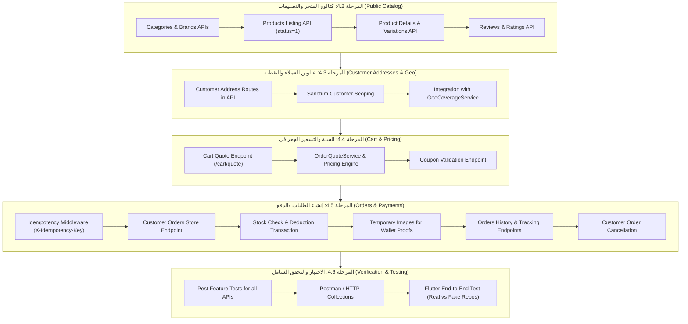

# Phase 4 Implementation Plan — Laravel & Flutter Integration

**المشروع:** متجر رونقك (Rwnaqk Store)  
**المرحلة:** Phase 4 — خطة التنفيذ والربط التدريجي المنظم  
**المنهجية:** البدء بالكتالوج العام (Read-Only) لضمان استقرار التصفح، ثم العناوين والتسعير الجغرافي، وصولاً إلى إتمام الطلبات والدفع مع الحماية من التكرار.

---

## 1. القواعد الصارمة للتنفيذ (Strict Rules & Guardrails)

1. **معمارية GetX في Flutter:** ثابتة ومستقرة تماماً ولا يتم تعديل أي Binding أو Controller أو Reactive Type.
2. **المستودعات التجريبية (Fake Repositories):** تبقى كما هي بنسبة 100% كخط دفاع وتراجع آمن (Fallback) للاختبار وعزل التطوير.
3. **المستودعات الحقيقية (Remote Repositories):** تم تفعيلها وجاهزيتها، وتكتفي باستقبال العقود المطابقة من Laravel دون إعادة كتابة.
4. **قواعد البيانات في Laravel:** لا يتم تعديل أي جداول أو إضافة migrations جديدة في هذه المرحلة؛ الجداول القائمة تغطي كافة متطلبات التجارة الإلكترونية.
5. **معمارية Backend:** اتباع مبادئ `backend-architecture.md` بوضع الأكواد في طبقاتها الصحيحة (`Controllers`, `FormRequests`, `Actions`, `Resources`, `Middleware`).
6. **فصل الصلاحيات:** عزل مسارات لوحة التحكم الإدارية (`web`) عن مسارات الـ API العامة ومسارات العملاء (`auth:sanctum`).

---

## 2. خريطة مراحل التنفيذ والتبعيات (Implementation Roadmap)



---

## 3. تفاصيل المراحل التنفيذية والملفات المستهدفة

---

### المرحلة 4.2: كتالوج المتجر والتصنيفات (Public Catalog APIs)

**الأهداف:** تزويد تطبيق Flutter ببيانات حقيقية للأقسام والماركات والمنتجات والسمات.

**الملفات المستهدفة في Laravel:**
1. إنشاء متحكم الكتالوج العام للعملاء:
   `rwnaqk-backend/Modules/Shop/app/Http/Controllers/Api/ProductApiController.php`
2. إنشاء متحكم الأصناف العام:
   `rwnaqk-backend/Modules/Shop/app/Http/Controllers/Api/CategoryApiController.php`
3. إنشاء متحكم العلامات التجارية:
   `rwnaqk-backend/Modules/Shop/app/Http/Controllers/Api/BrandApiController.php`
4. تسجيل المسارات العامة في:
   `rwnaqk-backend/Modules/Shop/routes/api.php`
   ```php
   Route::prefix('v1')->group(function () {
       Route::get('categories', [CategoryApiController::class, 'index']);
       Route::get('brands', [BrandApiController::class, 'index']);
       Route::get('products', [ProductApiController::class, 'index']);
       Route::get('products/{id}', [ProductApiController::class, 'show']);
       Route::get('products/{id}/reviews', [ProductApiController::class, 'reviews']);
   });
   ```
5. **اختبارات الجودة (Pest Tests):**
   - `Modules/Shop/tests/Feature/Api/ProductCatalogApiTest.php`
   - التحقق من تصفح المنتجات والترقيم والفرز والمنتجات المفعلة فقط.

---

### المرحلة 4.3: عناوين العملاء والتغطية الجغرافية (Customer Addresses API)

**الأهداف:** تمكين العميل في Flutter من حفظ واختيار عناوين التوصيل المرتبطة بمحافظات ومديريات اليمن.

**الملفات المستهدفة في Laravel:**
1. إنشاء متحكم عناوين العميل المصادق:
   `rwnaqk-backend/Modules/Customer/app/Http/Controllers/Api/CustomerAddressApiController.php`
2. تسجيل المسارات تحت حماية Sanctum في `Modules/Customer/routes/api.php`:
   ```php
   Route::middleware(['auth:sanctum'])->prefix('v1/customer')->group(function () {
       Route::apiResource('addresses', CustomerAddressApiController::class);
       Route::patch('addresses/{address}/primary', [CustomerAddressApiController::class, 'setPrimary']);
   });
   ```
3. استخدام `StoreCustomerAddressRequest` وربط العنوان تلقائياً بـ `GeoCoverageService`.
4. **اختبارات الجودة:**
   - `Modules/Customer/tests/Feature/Api/CustomerAddressApiTest.php`

---

### المرحلة 4.4: السلة والتسعير الجغرافي والكوبونات (Cart Quote & Coupons)

**الأهداف:** حساب رسوم التوصيل الدقيقة بناءً على إحداثيات العنوان وسلة الشراء.

**الملفات المستهدفة في Laravel:**
1. إنشاء متحكم الشراء والدفع الأولي:
   `rwnaqk-backend/Modules/Shop/app/Http/Controllers/Api/CheckoutApiController.php`
2. تسجيل مسارات عرض السعر والكوبونات:
   ```php
   Route::middleware(['auth:sanctum'])->prefix('v1/customer/cart')->group(function () {
       Route::post('quote', [CheckoutApiController::class, 'quote']);
       Route::post('validate-coupon', [CheckoutApiController::class, 'validateCoupon']);
   });
   ```
3. إعادة استخدام `OrderQuoteService` و `GeoDeliveryPricingService`.
4. **اختبارات الجودة:**
   - `Modules/Shop/tests/Feature/Api/CartQuoteApiTest.php`

---

### المرحلة 4.5: إنشاء الطلبات وحماية التكرار والدفع (Customer Orders & Idempotency)

**الأهداف:** إتمام عمليات الشراء والدفع عند الاستلام أو التحويل الإلكتروني مع رفع السندات، وتتبع الطلبات.

**الملفات المستهدفة في Laravel:**
1. إنشاء وسيط الحماية من التكرار:
   `rwnaqk-backend/app/Http/Middleware/IdempotencyMiddleware.php`
   - يفحص هيدر `X-Idempotency-Key`.
   - يخزن الاستجابة في الكاش لمدة 24 ساعة.
2. إنشاء متحكم طلبات العملاء:
   `rwnaqk-backend/Modules/Shop/app/Http/Controllers/Api/CustomerOrderApiController.php`
3. إنشاء Action مخصص لطلبات العملاء مع خصم المخزون والعمليات المترابطة:
   `rwnaqk-backend/Modules/Shop/app/Action/Customer/StoreCustomerOrderAction.php`
4. تسجيل المسارات في `Modules/Shop/routes/api.php`:
   ```php
   Route::middleware(['auth:sanctum'])->prefix('v1/customer')->group(function () {
       Route::post('orders', [CustomerOrderApiController::class, 'store'])->middleware('idempotent');
       Route::get('orders', [CustomerOrderApiController::class, 'index']);
       Route::get('orders/{order}', [CustomerOrderApiController::class, 'show']);
       Route::post('orders/{order}/cancel', [CustomerOrderApiController::class, 'cancel']);
   });
   ```
5. **اختبارات الجودة:**
   - `Modules/Shop/tests/Feature/Api/CustomerOrderCreationTest.php`
   - اختبار منع التكرار مع `X-Idempotency-Key`.
   - اختبار عدم إنشاء الطلب في حال نفاذ المخزون.
   - اختبار حفظ صورة سند التحويل عبر `manual_payment_details`.

---

### المرحلة 4.6: التحقق والربط النهائي مع تطبيق Flutter

**الأهداف:** تشغيل التطبيق على بيئة Backend الحقيقية دون أي أخطاء وظيفية.

**الخطوات:**
1. ضبط المتغير `AppEnv.enableMockData = false` في بيئة التطوير.
2. اختبار تسجيل الدخول واستلام التوكن وحفظه في `SecureAuthTokenStorage`.
3. اختبار استعراض الكتالوج والتصنيفات والمنتجات من قاعدة البيانات الفعلية.
4. اختبار اختيار سمة المنتج والكمية وإضافتها للسلة.
5. اختبار إضافة عنوان حقيقي واحتساب تكلفة الشحن بناءً على المسافة الجغرافية.
6. اختبار إتمام طلب دفع عند الاستلام والتأكد من ظهوره في لوحة التحكم الإدارية ونظام العناقيد `CentroidBatchingService`.
7. اختبار إتمام طلب عبر المحفظة ورفع صورة السند والتأكد من إرفاقها بشكل صحيح.
8. التأكد من بقاء `FakeProductsRepository` و `FakeOrdersRepository` جاهزة كـ fallback آمن عند انقطاع الخادم.

---

## 4. خطة الحماية وإدارة المخاطر (Risk Management & Safety Plan)

| الخطر المحتمل | الإجراء الوقائي المعتمد |
| :--- | :--- |
| **تضارب مسارات الـ Web الإدارية مع الـ API** | عزل كامل للمسارات تحت بادئة `/api/v1/...` مع وسائط مصادقة مستقلة (`auth:sanctum` للعميل و `auth` للجلسات الإدارية). |
| **تكرار منطق التسعير أو الشحن** | استخدام نفس الخدمات المركزية (`GeoDeliveryPricingService` و `OrderQuoteService`) دون إعادة كتابة أي معادلة. |
| **فقدان المخزون أو البيع السالب** | استخدام `DB::transaction` مع قفل السجلات `lockForUpdate` أثناء خصم كميات `product_variation_stocks`. |
| **تكرار الطلب عند بطء الشبكة** | اعتماد `X-Idempotency-Key` عبر `IdempotencyMiddleware`. |
| **تأثر استقرار واجهات Flutter** | بقاء معمارية GetX نقية ومجمدة؛ التغيير محصور بالكامل في تغذية الـ Repositories من الـ API الفعلي. |
